# 实验二 UML 设计说明

本文件合并组件图、类图、用例图、活动图、时序图、状态图的说明，供实验报告第 3 章直接引用。所有图片与 `.puml` 源文件在同一目录，原分图说明已归档到 `../杂物/旧说明/UML/`。

---

## 1. 组件图

本目录有两张组件图，说明统一写在本文件中：

| 文件 | 回答的问题 |
|---|---|
| `UML组件图.puml` / `.png` | 总体架构：角色入口、共享能力、业务约束、技术支撑如何分层？ |
| `UML组件图_领域依赖.puml` / `.png` | 共享领域模块 D1～D6 与 Q1 之间的依赖关系 |

总体图讲“角色入口如何受约束、共享能力如何封装”；领域依赖图讲“共享能力内部谁依赖谁、如何保证不超发和状态一致”。两张图层次不同，但说明合并在本文件中。

---

### 一、总体组件图

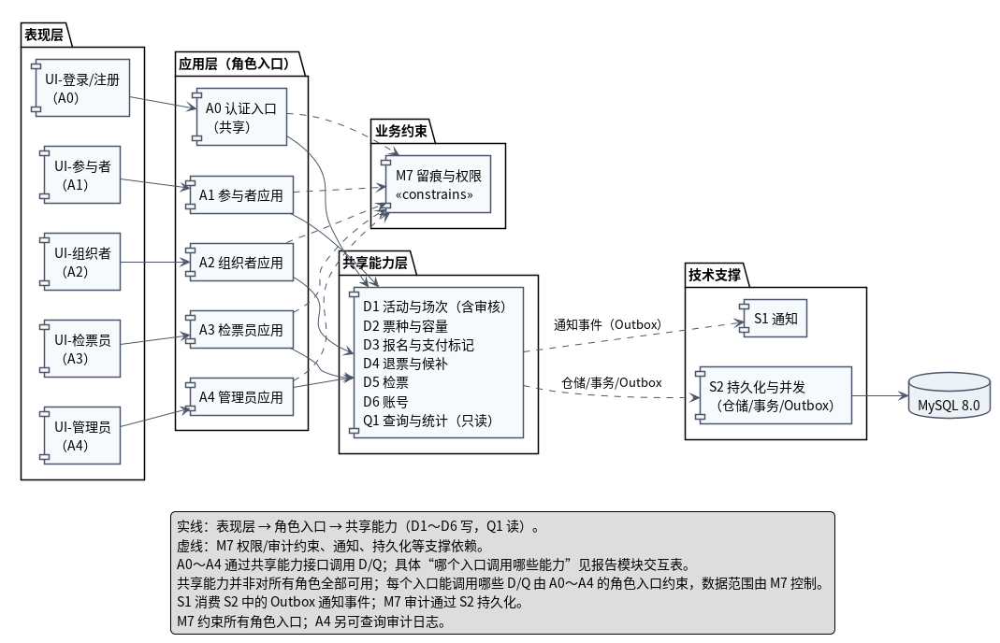

#### 1.1 分层

| 层 | 组件 | 职责 |
|---|---|---|
| 表现层 | UI-登录/注册、UI-参与者、UI-组织者、UI-检票员、UI-管理员 | 按角色显示页面；只调用应用层入口 |
| 应用层（角色入口） | A0 认证入口（共享）、A1 参与者应用、A2 组织者应用、A3 检票员应用、A4 管理员应用 | 用例编排、权限入口、事务边界；不承载核心业务规则 |
| 共享能力层 | D1～D6（写）、Q1（只读） | 拥有数据与不变量；提供共享命令/查询 |
| 业务约束 | M7 留痕与权限 | 约束 A0～A4 的每个用例：权限校验、数据范围、审计留痕 |
| 技术支撑 | S1 通知、S2 持久化与并发、MySQL 8.0 | S1 消费 Outbox 通知事件并投递站内消息；S2 提供仓储/事务/Outbox；MySQL 存储 |

> **入口接入点**：总体图中的“入口接入点（连线汇聚，不是模块）”只是把 A0～A4 的连线汇聚到一个点，再从该点画一条实线到共享能力、一条虚线到 M7；它**不是新增业务模块**，也不改变 1.3 表中“每个入口能调用哪些 D/Q”的限制。

#### 1.2 图例

| 符号 | 含义 |
|---|---|
| 实线箭头 | 表现层 → 角色入口 → 共享能力；写能力之间的同步调用 |
| 虚线箭头 | 只读查询、M7 权限/审计约束、共享能力到 S1/S2 的通知/持久化依赖 |
| `A0`～`A4` | 应用层入口；A0 是共享认证入口，其余按角色 |
| `D1`～`D6` | 共享领域模块，拥有数据与业务不变量 |
| `Q1` | 查询与统计，只读，跨角色共享 |
| `M7` | 业务约束，不是技术支撑 |
| `S1`、`S2` | 技术支撑 |
| `入口接入点` | 视觉汇聚点，不是模块；具体入口—能力对应见 1.3 表 |

#### 1.3 角色入口与共享能力的对应

| 入口 | 可调用的共享能力 | 说明 |
|---|---|---|
| A0 认证入口 | D6 | 注册（仅参与者/组织者）、登录、退出 |
| A1 参与者应用 | D3、D4、D5、Q1 | 报名、退票、候补、发起检票、浏览/我的票 |
| A2 组织者应用 | D1、D2、Q1 | 活动/场次/审核、票种/容量、名单/统计 |
| A3 检票员应用 | D5、Q1 | 负责的活动、处理检票请求 |
| A4 管理员应用 | D1、D4、D6、Q1、M7 | 审核、强制退票、封禁/创建检票账号、分配检票活动、全平台数据、审计查询 |

> 这张表就是“共用但有入口控制”的落地：同一个 D/Q 能力可以被多个入口使用，但每个入口能调用的范围、前置条件和数据范围由 M7 + 入口本身限制。
>
> **共享能力不是对所有角色全部可用**：A0～A4 是入口约束，同一个 D/Q 能力在不同入口下的权限、前置条件和数据范围不同；共享能力本身不假设所有角色都能调用。入口接入点只是连线汇聚，不改变本表的限制。

#### 1.4 为什么 M7 单独作为“业务约束”

M7 不是“和业务无关的技术支撑”，而是约束所有业务操作：

- 每个用例执行前，A0～A4 调用 `IPermissionService` 校验角色和数据范围；
- 关键操作调用 `IAuditService` 写留痕；
- A4 还可以通过 M7 查询审计日志；
- M7 不反向依赖任何业务模块，因此不会形成循环依赖。

S1 通知、S2 持久化/并发才是技术支撑，放在单独的“技术支撑”区。S1 消费共享能力写入 S2 的 Outbox 通知事件，不直接依赖角色入口；M7 的审计数据也通过 S2 持久化。

---

### 二、领域依赖组件图

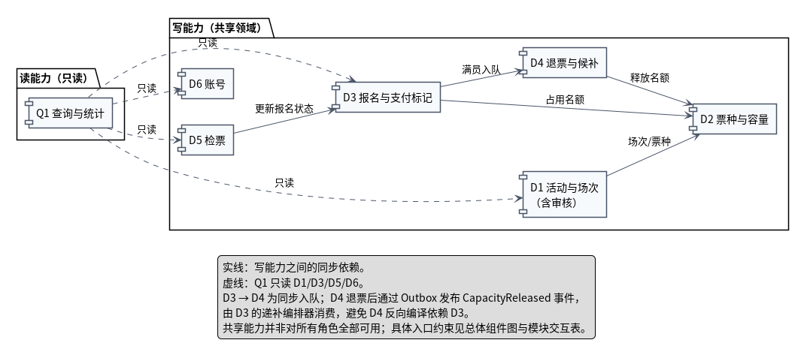

对应源文件：`UML组件图_领域依赖.puml`；导出图：`UML组件图_领域依赖.png`。

这张图只画 D1～D6 与 Q1，回答“共享领域模块之间谁依赖谁”。它是总体组件图的补充：总体图看角色入口和能力封装，这张图看共享能力内部关系。

#### 2.1 依赖与理由

| 依赖 | 类型 | 理由 |
|---|---|---|
| D1 → D2 | 同步 | 活动创建时需要场次/票种；票种容量的写入归 D2 |
| D3 → D2 | 同步 | 报名前必须原子占用名额，避免超发 |
| D3 → D4 | 同步 | 名额已满时，报名流程需要把用户加入候补队列 |
| D4 → D2 | 同步 | 退票/候补取消释放名额 |
| D5 → D3 | 同步 | 检票通过后需要把报名记录改为“已检票” |
| Q1 ⇢ D1/D3/D5/D6 | 只读 | 查询统计读取活动、报名、检票、账号数据，不修改业务表 |

#### 2.2 D3 与 D4 的循环依赖怎么避免

- D3 → D4：报名满员时同步调用 `enqueue()` 入队；
- D4 退票释放名额后，只发布 `CapacityReleased` 事件（写入 Outbox），**不直接调用 D3**；
- D3 的递补编排器消费事件，调用 D4 的 `promoteNext()` 取得队首，再创建报名记录、占用名额、更新候补状态；
- 所以编译期依赖只有 D3 → D4，D4 不反向依赖 D3。

#### 2.3 Q1 为什么单独存在

- 查询需要跨 D1/D3/D5/D6 组合数据，放在某个领域模块里会让该模块膨胀；
- Q1 只读，不产生业务副作用；
- 统计口径在 Q1 内统一实现，避免参与者/组织者/管理员各算一套；
- 数据范围和字段脱敏由 M7 策略 + Q1 查询条件共同保证。

---

### 三、和实验一 8 个模块的对应

| 实验一模块 | 图中落点 |
|---|---|
| 活动与场次 | D1 |
| 票种与容量 | D2 |
| 报名与支付标记 | D3 |
| 退票与候补 | D4 |
| 检票 | D5 |
| 查询与统计 | Q1 |
| 留痕与权限 | M7 |
| 账号与管理员处置 | D6 账号 + A4 管理员应用（注册登录由 A0 + D6 承担） |

---

### 四、读图时重点看

1. 表现层是否只调用角色入口，没有直接连数据库；
2. A0～A4 是否各自独立，不再有一个 M8 汇聚所有角色；
3. 共享能力是否分成“写 D1～D6”和“读 Q1”；
4. M7 是否作为业务约束，而不是技术支撑；
5. D3/D4 是否有循环依赖，事件解耦是否清楚；
6. Q1 是否只读，是否按角色数据范围过滤。

---

## 2. 类图

本目录有两张类图，共同构成实验二的类模型：

| 文件 | 内容 |
|---|---|
| `UML类图.puml` / `.png` | 核心业务类图：账号、活动、场次、票种、报名、候补、检票、审核 |
| `UML类图_治理.puml` / `.png` | 治理类图：举报、通知、审计留痕 |

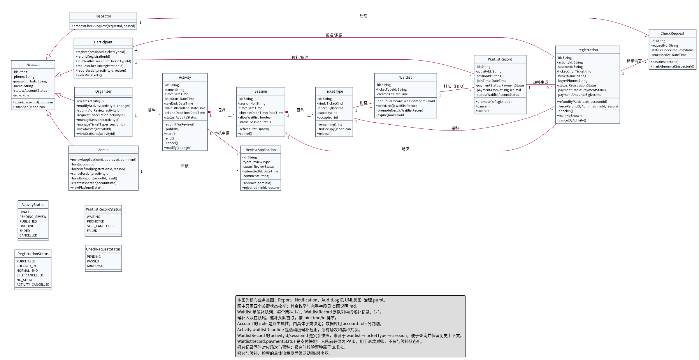

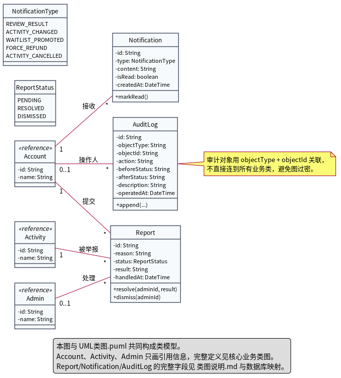

> 类图只画关键字段和关键方法；完整字段、索引和约束见本文第五节与 `00_设计基线.md` 第 7 节。

---

### 一、核心业务类

| 类 | 职责 | 关键字段 | 关键方法 | 主要需求 |
|---|---|---|---|---|
| `Account`（抽象） | 账号身份与状态 | id、phone、passwordHash、name、status、`/role`（派生） | `login`、`logout`、`isBanned` | REQ-002、REQ-045、REQ-047 |
| `Participant` | 参与者入口 | 继承 Account | `register`、`refund`、`joinWaitlist`、`requestCheckIn`、`reportActivity`、`viewMyTickets` | REQ-012～REQ-017、REQ-018 |
| `Organizer` | 组织者入口 | 继承 Account | `createActivity`、`modifyActivity`、`submitForReview`、`requestCancellation`、`manageSessions`、`manageTicketTypes`、`viewRoster`、`viewStatistics` | REQ-006～REQ-011、REQ-030、REQ-031 |
| `Inspector` | 检票员入口 | 继承 Account | `processCheckRequest` | REQ-014～REQ-017 |
| `Admin` | 管理员入口 | 继承 Account | `review`、`ban`、`forceRefund`、`cancelActivity`、`handleReport`、`createInspector`、`viewPlatformData` | REQ-009、REQ-018、REQ-048 |
| `Activity` | 活动聚合根 | id、name、time、saleStart、saleEnd、waitlistDeadline、refundDeadline、status | `submitForReview`、`publish`、`start`、`end`、`cancel`、`modify` | REQ-006～REQ-011、REQ-019、REQ-021、REQ-028 |
| `Session` | 场次 | id、sessionNo、time、checkinOpenTime、allowWaitlist、status | `refreshStatus`、`cancel` | REQ-007、REQ-026 |
| `TicketType` | 票种与容量 | id、kind、price、capacity、occupied | `remaining`、`tryOccupy`、`release` | REQ-008、REQ-026、REQ-032 |
| `Registration` | 报名记录 | id、activityId、sessionId、ticketKind、buyerName、buyerPhone、status、paymentStatus、paymentAmount、refundAmount、requestId | `refundByParticipant`、`forceRefundByAdmin`、`checkIn`、`markNoShow`、`cancelByActivity` | REQ-004、REQ-012、REQ-022、REQ-025、REQ-027、REQ-033、REQ-046、REQ-048 |
| `Waitlist` | 候补队列 | id、ticketTypeId、createdAt | `enqueue`、`peekNext`、`promoteNext`、`expire` | REQ-019、REQ-020 |
| `WaitlistRecord` | 候补记录 | id、activityId（快照）、sessionId（快照）、joinTime、paymentStatus、paymentAmount、status | `promote`、`cancel`、`expire` | REQ-019、REQ-020、REQ-023、REQ-049 |
| `CheckRequest` | 检票请求 | id、requestNo、status、processedAt | `pass`、`markAbnormal` | REQ-014～REQ-017、REQ-036 |
| `ReviewApplication` | 审核申请 | id、type、status、submittedAt、comment | `approve`、`reject` | REQ-009、REQ-010、REQ-011 |

> `Participant`、`Organizer`、`Inspector`、`Admin` 上的方法是**角色入口的示意**；实际编排在 A1～A4，领域规则在对应领域对象/服务中。类图这样画是为了同时表达“谁有这个入口”和“领域对象有哪些行为”。
>
> `Account` 的 `/role` 是派生属性，由具体子类决定，不额外存储；数据库表 `account` 用 `role` 列判别角色。这样类模型用继承表达“账号是哪一种角色”，持久化用单表 + 判别列，两者不重复。
>
> `Activity.waitlistDeadline` 是**活动级候补截止**，同一活动的所有场次、票种共享；候补队列 `Waitlist` 和候补记录 `WaitlistRecord` 不重复保存截止时间。
>
> `WaitlistRecord.paymentStatus` 是支付结果快照：按业务规则，候补入队前必须完成支付，因此 `WAITING` 状态的候补记录必须为 `PAID`；该字段用于退款对账，不参与候补状态机的分支判断。
>
> `WaitlistRecord.activityId/sessionId` 是冗余快照，来源于 `waitlist → ticketType → session`；保留它们是为了按活动/场次直接查询，并让候补记录保留当时的历史上下文。

---

### 二、关系与基数

| 关系 | 基数 | 说明 | 对应需求 |
|---|---|---|---|
| `Organizer` — `Activity` | 1 : * | 一个组织者创建/管理多个活动；活动属于一个组织者 | REQ-002、REQ-006～REQ-011 |
| `Activity` ◆— `Session` | 1 : 1..* | 活动包含场次；场次不能脱离活动存在 | REQ-007 |
| `Session` ◆— `TicketType` | 1 : 1..* | 场次包含票种；票种不能脱离场次存在 | REQ-008、REQ-024 |
| `Participant` — `Registration` | 1 : * | 一个账号可有多条报名记录（不同场次） | REQ-012、REQ-027 |
| `Session` — `Registration` | 1 : * | 一条报名记录对应具体场次；报名时校验票种属于该场次 | REQ-024、REQ-025 |
| `TicketType` — `Registration` | 1 : * | 一个票种对应多条报名记录；报名记录是历史记录，不能删除 | REQ-004、REQ-024、REQ-025 |
| `Participant` — `WaitlistRecord` | 1 : * | 一个账号可有多条候补记录 | REQ-019、REQ-049 |
| `TicketType` — `Waitlist` | 1 : 1 | 每个票种对应一条候补队列 | REQ-019 |
| `Waitlist` — `WaitlistRecord` | 1 : *（`{ordered}`） | 一条队列包含多条候补记录；入队在队尾，递补从队首取，按 `joinTime/id` 排序 | REQ-019、REQ-049 |
| `WaitlistRecord` — `Registration` | 1 : 0..1 | 只有递补成功才生成报名记录；候补记录独立存在 | REQ-020、REQ-024、REQ-049 |
| `Registration` — `CheckRequest` | 1 : * | 一条报名记录可有多次检票请求；只有第一次通过有效 | REQ-014、REQ-017、REQ-036 |
| `Inspector` — `CheckRequest` | 1 : * | 检票员处理其负责活动的请求 | REQ-014、REQ-015 |
| `Activity` — `ReviewApplication` | 1 : * | 活动可有发布、修改、取消等审核申请 | REQ-009、REQ-010、REQ-011 |
| `Admin` — `ReviewApplication` | 1 : * | 管理员审核申请；审核人可空（待审核时） | REQ-009 |

> `Waitlist` 是候补队列，每个票种 1-1；`WaitlistRecord` 是队列里的候补记录，1-*。不要把队列和记录合成一个类，否则每条记录的时间/支付/状态无处安放。
>
> `Waitlist` 只保存 `ticketTypeId`，活动/场次沿 `Waitlist → TicketType → Session → Activity` 推导，不在队列上重复存外键，避免同一事实出现多个来源。
>
> 关联线上的词表示“关系角色/主要操作”，不是完整操作清单；完整操作见第一节的类方法表。
>
> 报名记录同时关联 `Session` 和 `TicketType`：`TicketType` 必须属于该 `Session`；`Activity` 通过 `Session` 关联，`Registration` 中的 `activityId/sessionId` 是快照字段，便于查询和统计。

**为什么 Activity–Session–TicketType 用组合**：场次/票种的生命周期依附于活动；活动取消时场次取消（REQ-021）。
**为什么 Registration 不用组合**：报名记录是历史记录，任何角色都不能删除（REQ-004）；票种/活动变化不能删除它，只能改状态。

---

### 三、共享命令与角色入口

类图中同一条共享逻辑对应多个入口，但对外命令分开：

| 入口 | 命令 | 底层共享 | 关键差异 |
|---|---|---|---|
| A1 参与者 | `Registration.refundByParticipant` | 释放名额 + 退款 | 只能退自己的、已购票、未过退票截止 |
| A4 管理员 | `Registration.forceRefundByAdmin` | 同一套释放名额 + 退款 | 按 REQ-048 独立前置条件，可强制、需原因、通知、留痕 |
| 活动取消 | `Registration.cancelByActivity` | 同一套退款 | 批量处理，进入“活动取消”终态 |
| A1 参与者 | `Participant.requestCheckIn` | `CheckRequest` 状态转换 | 自己的有效报名、检票时间窗内 |
| A3 检票员 | `Inspector.processCheckRequest` | 同一套状态转换 | 自己负责的活动、请求存在、时间窗内 |

实现上，`refundByParticipant`、`forceRefundByAdmin`、`cancelByActivity` 共用私有方法 `releaseSeatAndRefund`，避免规则重复；不写 `switch(role)`。

---

### 四、状态枚举

| 枚举 | 取值 | 来源/说明 |
|---|---|---|
| `AccountStatus` | NORMAL、BANNED | REQ-018、REQ-047 |
| `ActivityStatus` | DRAFT、PENDING_REVIEW、PUBLISHED、ONGOING、ENDED、CANCELLED | REQ-021 |
| `SessionStatus` | NOT_OPEN、OPEN、FULL、CLOSED、CANCELLED、ENDED | REQ-007 |
| `TicketKind` | VIP、NORMAL | REQ-008 |
| `RegistrationStatus` | PURCHASED、CHECKED_IN、NORMAL_END、SELF_CANCELLED、NO_SHOW、ACTIVITY_CANCELLED | REQ-022、REQ-025 |
| `PaymentStatus` | PAID、UNPAID | REQ-025 |
| `WaitlistRecordStatus` | WAITING、PROMOTED、SELF_CANCELLED、FAILED | REQ-023 |
| `CheckRequestStatus` | PENDING、PASSED、ABNORMAL | REQ-014、REQ-017 |
| `ReviewType` | PUBLISH、MODIFY、CANCEL | REQ-009～REQ-011 |
| `ReviewStatus` | PENDING、APPROVED、REJECTED | 设计补充（审核流程） |
| `ReportStatus` | PENDING、RESOLVED、DISMISSED | 设计补充（举报处理） |
| `NotificationType` | REVIEW_RESULT、ACTIVITY_CHANGED、WAITLIST_PROMOTED、FORCE_REFUND、ACTIVITY_CANCELLED | REQ-009、REQ-011、REQ-020、REQ-028、REQ-037、REQ-048 |

> 类图只画了 ActivityStatus、RegistrationStatus、WaitlistRecordStatus、CheckRequestStatus 四个关键枚举；其余枚举在本表列出，避免类图过大。

---

### 五、类到数据库表的映射

| 类 | 表 | 关键字段/约束 |
|---|---|---|
| Account + 四个角色 | `account` | id、phone（唯一）、password_hash、name、role、status；一个手机号只对应一个身份；单表 + role 区分角色 |
| Activity | `activity` | id、organizer_id、name、description、time、location、estimated_participants、waitlist_deadline、sale_start、sale_end、refund_deadline、status、cover、tags |
| Session | `activity_session` | id、activity_id、session_no、time、checkin_open_time、allow_waitlist、status |
| TicketType | `ticket_type` | id、session_id、kind、price、capacity、occupied；`occupied <= capacity` |
| Registration | `registration` | id、account_id、activity_id、session_id、ticket_type_id、buyer_name、buyer_phone、ticket_kind、status、payment_status、payment_amount、refund_amount、refund_time、request_id、created_at；`(account_id, session_id)` 唯一，`request_id` 唯一 |
| Waitlist | `waitlist` | id、ticket_type_id（唯一）、created_at；每个票种一条队列 |
| WaitlistRecord | `waitlist_record` | id、waitlist_id、account_id、activity_id（快照）、session_id（快照）、join_time、payment_status、payment_amount、status、refund_amount、refund_time、request_id；`payment_status` 在候补中必须为 `PAID` |
| CheckRequest | `check_request` | id、registration_id、request_no、inspector_id、status、processed_at |
| 检票分配 | `activity_inspector` | inspector_id、activity_id、assigned_at；主键 `(inspector_id, activity_id)` |
| ReviewApplication | `review_application` | id、activity_id、type、status、submitted_at、reviewer_id、comment、reviewed_at |
| Report | `report` | id、reporter_id、activity_id、reason、status、handler_id、result、handled_at |
| Notification | `notification` | id、recipient_id、type、content、is_read、created_at |
| AuditLog | `audit_log` | id、operator_id、operated_at、object_type、object_id、action、before_status、after_status、description；追加式 |

**映射说明**：

- `Account` 继承在类图上用继承表示，落库用单表 + `role` 字段，避免四张表重复。
- 枚举落库用字符串/查表，不使用数据库原生 ENUM，便于扩展。
- `AuditLog` 用 `object_type + object_id` 关联任意业务对象，不建到所有表的外键。
- `Registration` 的 `activity_id/session_id` 是快照字段，便于查询和统计；关联关系仍以 `ticket_type_id` 为准。

---

### 六、治理类

| 类 | 职责 | 关系 | 需求 |
|---|---|---|---|
| `Report` | 举报活动/账号，管理员处理 | Account 1—*（提交）；Activity 1—*（被举报）；Admin 0..1—*（处理） | REQ-018 |
| `Notification` | 站内消息 | Account 1—*（接收） | REQ-009、REQ-020、REQ-028、REQ-048 |
| `AuditLog` | 审计留痕 | Account 0..1—*（操作人）；对象用 objectType/objectId | REQ-039～REQ-041 |

`AuditLog` 不直接连到所有业务类，否则类图会过密；它的对象用 `objectType + objectId` 表示，`beforeStatus/afterStatus` 记录状态变化。

---

### 七、与组件图的对应

| 组件 | 类 |
|---|---|
| D1 活动与场次 | Activity、Session、ReviewApplication |
| D2 票种与容量 | TicketType |
| D3 报名与支付标记 | Registration |
| D4 退票与候补 | Waitlist、WaitlistRecord；Registration 的退款方法 |
| D5 检票 | CheckRequest |
| D6 账号 | Account、Participant、Organizer、Inspector、Admin |
| Q1 查询与统计 | 无独立实体；只读 D1/D3/D5/D6 |
| M7 留痕与权限 | AuditLog；权限策略在应用层/M7 服务中 |
| S1 通知 | Notification |

---

### 八、读图时重点看

1. `Account` 的继承是否覆盖四类角色；
2. 活动—场次—票种是否是组合关系，基数是否正确；
3. `Registration` 是否与 `Participant`、`Session`、`TicketType` 正确关联；
4. 报名记录是否同时关联 `Session` 和 `TicketType`，票种是否属于该场次；票种与 `Waitlist` 是否是 `1 : 1`，`Waitlist` 与 `WaitlistRecord` 是否是 `1 : *`，`WaitlistRecord` 与报名是否是 `1 : 0..1`；
5. 检票请求是否属于报名记录，检票员是否只处理请求；
6. 退款为什么有 `refundByParticipant` / `forceRefundByAdmin` / `cancelByActivity` 三个命令；
7. `AuditLog` 是否用 `objectType/objectId` 而不是连所有类；
8. `Account` 的 `/role` 是否标为派生属性、`Activity` 是否包含 `waitlistDeadline`、`WaitlistRecord` 的支付状态是否说明为支付快照。

---

## 3. 用例图

本目录有两张用例图，按角色分成两组，避免一张图塞入 4 个角色、20 多个用例后过长、连线交叉。

| 文件 | 角色 | 内容 |
|---|---|---|
| `UML用例图_参与者与组织者.puml` / `.png` | 参与者、活动组织者 | 浏览、报名、候补、退票、检票请求、举报；活动创建/修改/审核/名单/统计 |
| `UML用例图_检票与管理员.puml` / `.png` | 检票员、平台管理员 | 检票工作台；审核、举报、封禁、强制退票、紧急取消、全平台数据、审计、创建检票账号、分配检票活动 |

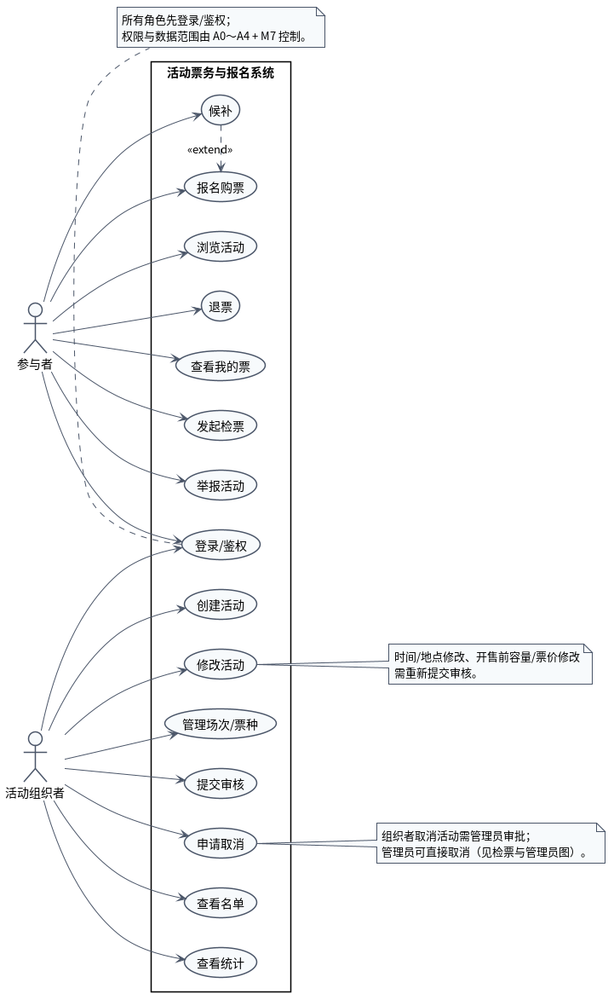

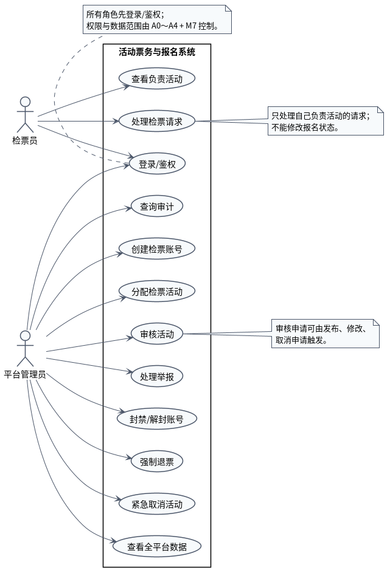

---

### 一、参与者与组织者

| 角色 | 用例 | 对应入口/模块 |
|---|---|---|
| 参与者 | 浏览活动 | A1 + Q1 |
| 参与者 | 报名购票 | A1 + D3/D2 |
| 参与者 | 候补 | A1 + D4 |
| 参与者 | 退票 | A1 + D4 |
| 参与者 | 查看我的票 | A1 + Q1 |
| 参与者 | 发起检票 | A1 + D5 |
| 参与者 | 举报活动 | A1 + M8/D1 |
| 组织者 | 创建活动 | A2 + D1 |
| 组织者 | 修改活动 | A2 + D1 |
| 组织者 | 管理场次/票种 | A2 + D1/D2 |
| 组织者 | 提交审核 | A2 + D1 |
| 组织者 | 申请取消 | A2 + D1（需管理员审批） |
| 组织者 | 查看名单 | A2 + Q1 |
| 组织者 | 查看统计 | A2 + Q1 |

#### 关系

- `候补` 对 `报名购票` 是 `<<extend>>`（课程符号中的“扩展”）：按课程定义，扩展由特殊用例 A 连向基本用例 B；这里 A = 候补，B = 报名购票，所以箭头是 `候补 → 报名购票`。含义是：报名购票是基本需求，候补是无票时的特殊情况。
- 登录/鉴权是所有角色共用的用例，具体权限和数据范围由 A0～A4 + M7 控制。
- 组织者修改时间/地点、开售前修改容量/票价，需要重新提交审核。
- 组织者申请取消活动需要管理员审批；管理员可直接取消（见第二张图）。

---

### 二、检票员与管理员

| 角色 | 用例 | 对应入口/模块 |
|---|---|---|
| 检票员 | 查看负责活动 | A3 + Q1 |
| 检票员 | 处理检票请求 | A3 + D5 |
| 管理员 | 审核活动 | A4 + D1 |
| 管理员 | 处理举报 | A4 + D1/D6/Q1 |
| 管理员 | 封禁/解封账号 | A4 + D6 |
| 管理员 | 强制退票 | A4 + D4 |
| 管理员 | 紧急取消活动 | A4 + D1 |
| 管理员 | 查看全平台数据 | A4 + Q1 |
| 管理员 | 查询审计 | A4 + M7 |
| 管理员 | 创建检票账号 | A4 + D6 |
| 管理员 | 分配检票活动 | A4 + D1/D6 |

#### 关系与限制

- 检票员只能查看自己负责的活动，只能处理该活动的检票请求；不能修改报名状态，不能访问完整名单。
- 管理员通过“分配检票活动”把检票员与活动关联起来；检票员的“负责活动”来自 `activity_inspector`，不是从检票请求反推。
- `审核活动` 可由发布审核、修改审核、取消申请触发。
- 管理员强制退票进入“自行取消”终态；紧急取消活动会触发批量退款和通知。
- 管理员查看个人信息只限运营、举报、封禁所需范围。

---

### 三、为什么拆成两张

- 一张图放 4 个角色、20 多个用例时，角色与用例的连线会跨越整张图，阅读困难；
- 按“参与者/组织者”和“检票员/管理员”拆开后，每张图只保留两组角色，连线清楚；
- 两张图共用 `登录/鉴权` 用例，但权限和数据范围不同，这一点写在图注和本文中。

> 用例图只表达“谁可以做什么”，不表达调用顺序；具体流程见活动图、时序图。

---

### 四、读图时重点看

1. 四个角色是否都有对应的用例；
2. `候补` 是否作为 `报名购票` 的扩展；
3. 组织者的修改/取消是否体现了“重新审核/管理员审批”；
4. 检票员是否只做检票请求处理，没有修改报名状态；
5. 管理员是否覆盖审核、举报、封禁、强制退票、紧急取消、审计；
6. 管理员是否可以把检票员分配到活动，检票员是否只查看/处理负责活动；
7. 是否把“报名流程”画成了用例之间的顺序（不应该）。

---

## 4. 活动图

对应源文件：`UML活动图_报名购票.puml`；导出图：`UML活动图_报名购票.png`。

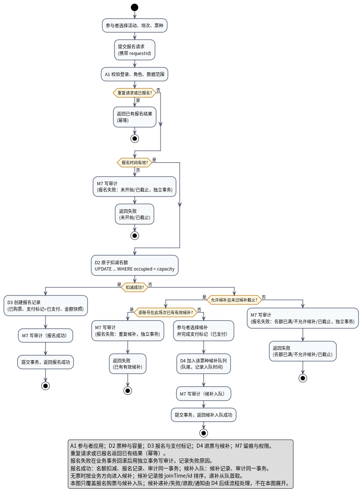

### 1. 这张图回答什么

活动图是**行为性图**，回答“报名购票这个业务流程怎么走”：

- 什么条件下报名成功；
- 什么条件下进入候补；
- 什么条件下直接失败；
- 重复请求、截止时间、名额并发、审计和事务分别在哪一步处理。

它和用例图的区别：用例图只表达“参与者可以报名购票、候补”，不表达先后顺序；活动图表达流程和分支。

> **范围说明**：本图只覆盖“报名购票”和“加入候补队列”这一段流程；候补入队之后是否递补成功、候补截止失败、退款、通知等，属于退票与候补模块的后续流程，不在本图展开。图中的“候补入队成功”只表示成功进入队列，不表示最终能买到票。

### 2. 流程说明

| 步骤 | 动作 | 负责模块 | 说明 |
|---|---|---|---|
| 1 | 选择活动、场次、票种 | 参与者 | 对应 UI-02/03 |
| 2 | 提交报名请求（携带 `requestId`） | 参与者 | 用于幂等 |
| 3 | 校验登录、角色、数据范围 | A1 + M7 | 不通过则拒绝 |
| 4 | 重复请求或已报名？ | A1 + D3 | 是：返回已有结果（幂等） |
| 5 | 报名时间有效？ | A1 | 否：写失败审计，返回未开始/已截止 |
| 6 | 原子扣减名额 | D2 | `UPDATE ... WHERE occupied < capacity` |
| 7 | 扣减成功？ | D2 | 是：走成功分支；否：走满员分支 |
| 8 | 创建报名记录 | D3 | 已购票、支付标记=已支付、金额快照 |
| 9 | 写审计 | M7 | 报名成功 |
| 10 | 提交事务，返回报名成功 | A1/D3 | 事务提交后返回 |
| 11 | 允许候补且未过候补截止？ | D4 | 否：写失败审计，返回名额已满/不允许候补/已截止 |
| 12 | 该账号在此场次已有有效候补？ | D4 | 是：写失败审计，返回已有有效候补 |
| 13 | 选择候补并完成支付标记 | 参与者 + D4 | 支付标记=已支付 |
| 14 | 加入该票种候补队列 | D4 | 队尾，记录入队时间 |
| 15 | 写审计（候补入队） | M7 | 关键操作留痕 |
| 16 | 提交事务，返回候补入队成功 | A1/D4 | 仅表示成功加入候补队列 |

> 失败分支的审计在业务事务回滚后用独立事务写入，记录失败原因；报名成功分支的审计与业务同事务提交。

### 3. 关键设计点

1. **幂等**：请求携带 `requestId`；重复请求返回第一次结果，不再扣名额。
2. **截止判定**：使用服务器时间；未开始或已截止直接失败。
3. **不超发**：名额由 D2 原子扣减，条件更新失败即视为满员。
4. **无票进候补**：扣减失败后，只有“允许候补且未过候补截止”且“该账号没有有效候补”才进入候补；否则直接失败。这就是业务上的“报名 → 查余票 → 无票 → 候补”方向。
5. **事务一致**：报名成功时名额扣减、报名记录、审计在同一数据库事务内；候补入队时候补记录、审计在同一事务内；失败回滚。
6. **失败留痕**：报名失败（未开始/已截止、名额已满且不能候补、重复候补）在业务事务回滚后用独立事务写审计，记录失败原因（REQ-039）。
7. **候补 FIFO**：候补记录按 `joinTime/id` 排序，入队尾，递补从队首取。
8. **行动作前缀**：A1/D2/D3/D4/M7 表示负责模块；本图不画泳道，避免泳道切换造成连线打结。

### 4. 为什么不用泳道

第一版使用“参与者 / 报名服务 / 票种与容量 / 审计 / 候补队列”五条泳道，分支跨泳道时连线交叉严重。最终改为单列流程，用动作前缀标出负责模块，流程方向和分支更清楚；模块职责由组件图和类图表达，不靠泳道重复。

### 5. 读图时重点看

1. 重复请求是否在扣名额之前被拦截；
2. 截止时间是否在扣名额之前判断；
3. 名额扣减失败后是否才进入候补；
4. 候补是否要求“允许候补、未过截止且没有有效候补”；
5. 报名成功/候补入队成功是否都在事务提交后才返回；
6. 审计是否覆盖报名成功、报名失败和候补入队；失败分支是否注明独立事务。

---

## 5. 时序图

对应源文件：`UML时序图_报名购票.puml`；导出图：`UML时序图_报名购票.png`。

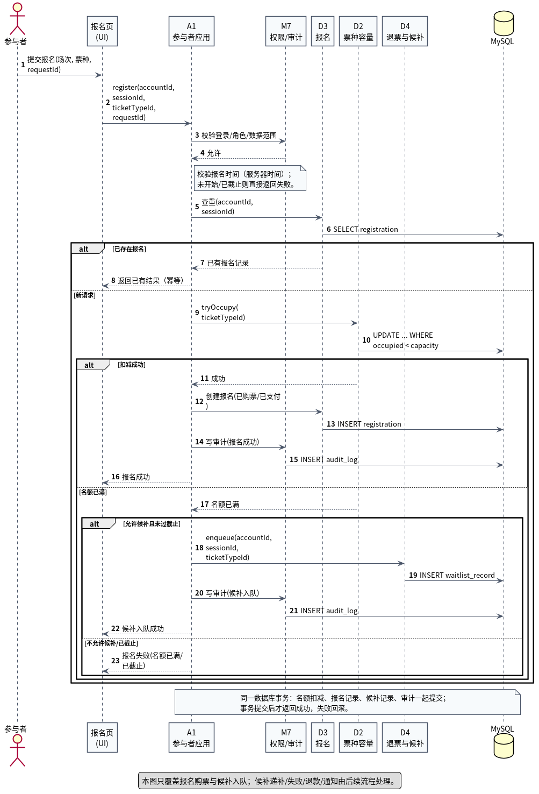

### 1. 这张图回答什么

时序图是**交互性图**，回答“一次报名请求中，对象按时间顺序怎么调用”：

- 前端、A1 参与者应用、M7、D3 报名、D2 票种容量、D4 退票与候补、MySQL 之间谁先调用谁；
- 重复请求、截止时间、扣名额、满员候补、审计、事务提交分别在哪一步；
- 哪些调用属于同一个数据库事务。

活动图表达业务分支；时序图表达对象协作和调用顺序，两者互补。

### 2. 参与者（生命线）

| 生命线 | 职责 |
|---|---|
| 参与者 | 发起报名请求 |
| 报名页（UI） | 收集场次/票种，提交请求 |
| A1 参与者应用 | 用例编排、事务边界、调用权限/审计 |
| M7 权限/审计 | 校验权限和数据范围；记录审计 |
| D3 报名与支付标记 | 查重、创建报名记录 |
| D2 票种与容量 | 原子扣减名额 |
| D4 退票与候补 | 满员时加入候补队列 |
| MySQL | 持久化 |

> D2/D3/D4/M7 实际通过 S2“持久化与并发”组件访问数据库；为了减少生命线数量，图中把 S2 省略，直接画成 MySQL。S2 的职责在组件图和设计基线中说明。

### 3. 消息流程

| 序号 | 消息 | 说明 |
|---|---|---|
| 1 | 参与者 → UI：提交报名 | 携带场次、票种、`requestId` |
| 2 | UI → A1：`register(...)` | 进入用例 |
| 3–4 | A1 → M7：校验登录/角色/数据范围 | 不通过则拒绝 |
| 5–6 | A1 → D3：查重；D3 → DB | 同一账号同一场次查重 |
| 7–8 | 已存在 → 返回已有结果 | 幂等 |
| — | 新请求：A1 校验报名时间 | 服务器时间；未开始/已截止则失败（图中用 note 表示） |
| 9–10 | D2 原子扣减；D2 → DB | `UPDATE ... WHERE occupied < capacity` |
| 11–13 | 扣减成功：D3 创建报名；D3 → DB | 已购票、支付标记=已支付、金额快照 |
| 14–15 | A1 → M7 写审计；M7 → DB | 报名成功留痕 |
| 16 | A1 → UI：报名成功 | 事务提交后返回 |
| 17 | 扣减失败：D2 → A1：名额已满 | 进入候补判断 |
| 18–19 | 允许候补：A1 → D4 入队；D4 → DB | 写入 `waitlist_record`，队尾 |
| 20–21 | A1 → M7 写审计；M7 → DB | 候补入队留痕 |
| 22 | A1 → UI：候补入队成功 | 仅表示进入队列 |
| 23 | 不允许候补/已截止：A1 → UI：报名失败 | 直接失败 |

### 4. 事务与一致性

- 名额扣减、报名记录、候补记录、审计在同一数据库事务内；
- 事务提交后才向 UI 返回成功；失败回滚；
- 重复请求在扣名额之前返回已有结果；
- 报名时间在扣名额之前判断（图中用 A1 的 note 表示，完整分支见活动图）；
- 候补入队成功不等于最终候补成功；递补/失败/退款/通知由 D4 后续流程处理。

### 5. 为什么 S2 没有作为生命线

如果画上 UI、A1、M7、D3、D2、D4、S2、MySQL 八条生命线，图会很宽。D2/D3/D4/M7 都通过 S2 访问数据库，这是统一的基础设施路径；时序图重点是业务对象之间的调用顺序，所以省略 S2，直接画 MySQL，并在本说明中注明。

### 6. 读图时重点看

1. 权限校验是否在业务调用之前；
2. 查重/幂等是否在扣名额之前；
3. 名额扣减与报名记录是否在同一事务；
4. 满员后是否先判断候补条件，再入队；
5. 审计是否覆盖报名成功和候补入队；
6. 是否把“候补入队成功”误读成“候补最终成功”。

---

## 6. 状态图

本目录有三张状态图，分别描述活动、报名记录、候补记录的生命周期：

| 文件 | 状态机 |
|---|---|
| `UML状态图_活动.puml` / `.png` | 活动：草稿 → 待审核 → 公开 → 进行中 → 已结束 / 已取消 |
| `UML状态图_报名记录.puml` / `.png` | 报名记录：已购票 → 已检票/自行取消/未检票/活动取消 |
| `UML状态图_候补记录.puml` / `.png` | 候补记录：候补中 → 已递补 / 自行取消 / 候补失败 |

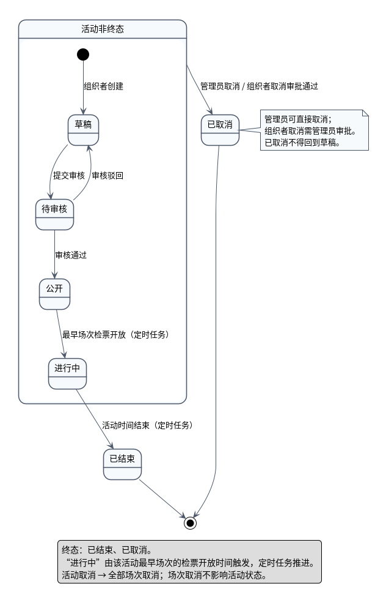

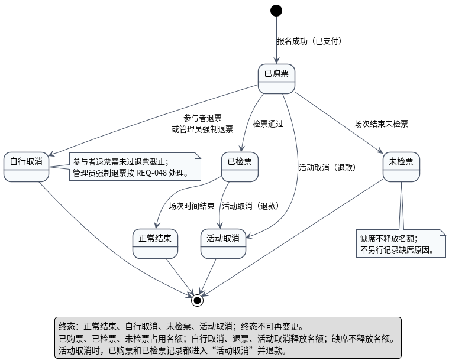

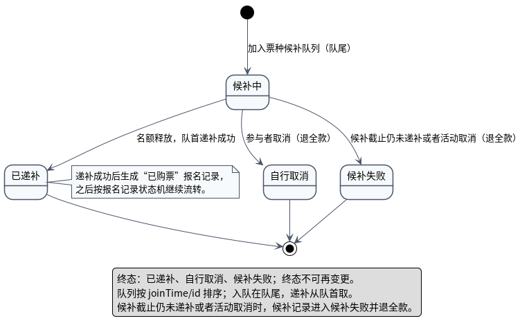

---

### 一、活动状态

| 当前状态 | 事件 | 下一状态 | 推动者 |
|---|---|---|---|
| 草稿 | 提交审核 | 待审核 | 组织者 |
| 待审核 | 审核通过 | 公开 | 管理员 |
| 待审核 | 审核驳回 | 草稿 | 管理员 |
| 公开 | 最早场次检票开放 | 进行中 | 定时任务 |
| 进行中 | 活动时间结束 | 已结束 | 定时任务 |
| 草稿/待审核/公开/进行中 | 管理员取消，或组织者取消审批通过 | 已取消 | 管理员 |
| 已结束/已取消 | — | 终态 | — |

说明：

- “进行中”由**最早场次的检票开放时间**触发，不是活动开始时间；
- 已取消不得回到草稿；
- 活动取消 → 全部场次取消；场次取消不影响活动状态。

> 布局说明：活动图用复合状态“活动非终态”包住草稿/待审核/公开/进行中，再从复合状态画一条取消转移。这样只保留一条取消箭头，避免四条线同时指向“已取消”；语义仍是“任意非终态都可取消”。

### 二、报名记录状态

| 当前状态 | 事件 | 下一状态 | 说明 |
|---|---|---|---|
| — | 报名成功（已支付） | 已购票 | 报名即购票 |
| 已购票 | 检票通过 | 已检票 | 检票员处理请求通过 |
| 已检票 | 场次时间结束 | 正常结束 | 时间推动 |
| 已购票 | 参与者退票 / 管理员强制退票 | 自行取消 | 参与者需未过退票截止；管理员按 REQ-048 |
| 已购票 | 场次结束未检票 | 未检票 | 缺席 |
| 已购票 / 已检票 | 活动取消 | 活动取消 | 同时退款 |
| 正常结束/自行取消/未检票/活动取消 | — | 终态 | — |

说明：

- 终态不可再变更；
- 已购票、已检票、未检票占用名额；自行取消、退票、活动取消释放名额；缺席不释放名额；
- 活动取消时，已购票和已检票记录都进入“活动取消”并退款。

### 三、候补记录状态

| 当前状态 | 事件 | 下一状态 | 说明 |
|---|---|---|---|
| — | 加入票种候补队列（队尾） | 候补中 | 记录入队时间、支付标记 |
| 候补中 | 名额释放，队首递补成功 | 已递补 | 生成“已购票”报名记录 |
| 候补中 | 参与者取消 | 自行取消 | 退全款 |
| 候补中 | 候补截止仍未递补或者活动取消 | 候补失败 | 退全款 |
| 已递补/自行取消/候补失败 | — | 终态 | — |

说明：

- 候补队列按 `joinTime/id` 排序；入队在队尾，递补从队首取；
- 已递补记录转为“已购票”报名记录，之后按报名记录状态机继续流转；
- 队列本身不是状态机；状态机描述的是每条 `WaitlistRecord`（候补记录）。

### 四、与类图/枚举的一致性

| 状态图 | 类图枚举 |
|---|---|
| 活动状态 | `ActivityStatus`：DRAFT、PENDING_REVIEW、PUBLISHED、ONGOING、ENDED、CANCELLED |
| 报名记录状态 | `RegistrationStatus`：PURCHASED、CHECKED_IN、NORMAL_END、SELF_CANCELLED、NO_SHOW、ACTIVITY_CANCELLED |
| 候补记录状态 | `WaitlistRecordStatus`：WAITING、PROMOTED、SELF_CANCELLED、FAILED |

### 五、读图时重点看

1. 活动状态是否由时间/管理员/组织者分别推动；
2. 已取消/已结束是否不可再转；
3. 报名记录终态是否不可再变；
4. 活动取消时已购票和已检票是否都进入“活动取消”；
5. 候补记录的已递补是否生成报名记录，而不是直接算“最终买到票”；
6. 缺席是否不释放名额；
7. 候补截止仍未递补或者活动取消时，候补记录是否进入“候补失败”并退款。
