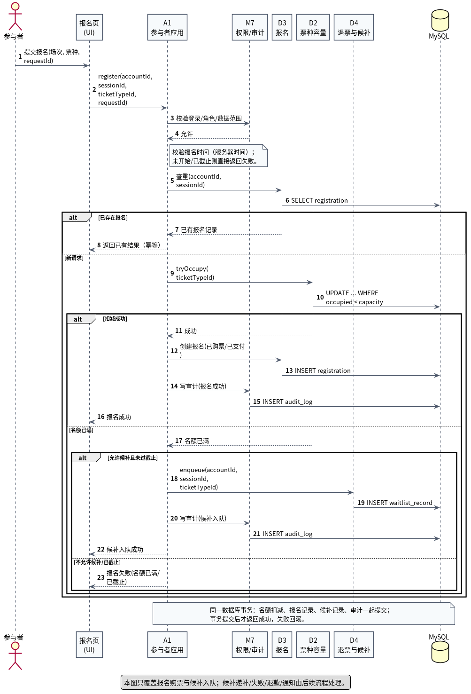

# 时序图说明

对应源文件：`UML时序图_报名购票.puml`；导出图：`UML时序图_报名购票.png`。

## 1. 这张图回答什么

时序图是**交互性图**，回答“一次报名请求中，对象按时间顺序怎么调用”：

- 前端、A1 参与者应用、M7、D3 报名、D2 票种容量、D4 退票与候补、MySQL 之间谁先调用谁；
- 重复请求、截止时间、扣名额、满员候补、审计、事务提交分别在哪一步；
- 哪些调用属于同一个数据库事务。

活动图表达业务分支；时序图表达对象协作和调用顺序，两者互补。

## 2. 参与者（生命线）

| 生命线 | 职责 |
|---|---|
| 参与者 | 发起报名请求 |
| 报名页（UI） | 收集场次/票种，提交请求 |
| A1 参与者应用 | 用例编排、事务边界、调用权限/审计 |
| M7 权限/审计 | 校验权限和数据范围；记录审计 |
| D3 报名与支付标记 | 查重、创建报名记录 |
| D2 票种与容量 | 原子扣减名额 |
| D4 退票与候补 | 满员时加入候补队列 |
| MySQL | 持久化 |

> D2/D3/D4/M7 实际通过 S2“持久化与并发”组件访问数据库；为了减少生命线数量，图中把 S2 省略，直接画成 MySQL。S2 的职责在组件图和设计基线中说明。

## 3. 消息流程

| 序号 | 消息 | 说明 |
|---|---|---|
| 1 | 参与者 → UI：提交报名 | 携带场次、票种、`requestId` |
| 2 | UI → A1：`register(...)` | 进入用例 |
| 3–4 | A1 → M7：校验登录/角色/数据范围 | 不通过则拒绝 |
| — | A1 自校验报名时间 | 服务器时间；未开始/已截止则失败（图中用 note 表示） |
| 5–6 | A1 → D3：查重；D3 → DB | 同一账号同一场次查重 |
| 7–8 | 已存在 → 返回已有结果 | 幂等 |
| 9–10 | 新请求：D2 原子扣减；D2 → DB | `UPDATE ... WHERE occupied < capacity` |
| 11–13 | 扣减成功：D3 创建报名；D3 → DB | 已购票、支付标记=已支付、金额快照 |
| 14–15 | A1 → M7 写审计；M7 → DB | 报名成功留痕 |
| 16 | A1 → UI：报名成功 | 事务提交后返回 |
| 17 | 扣减失败：D2 → A1：名额已满 | 进入候补判断 |
| 18–19 | 允许候补：A1 → D4 入队；D4 → DB | 写入 `waitlist_record`，队尾 |
| 20–21 | A1 → M7 写审计；M7 → DB | 候补入队留痕 |
| 22 | A1 → UI：候补入队成功 | 仅表示进入队列 |
| 23 | 不允许候补/已截止：A1 → UI：报名失败 | 直接失败 |

## 4. 事务与一致性

- 名额扣减、报名记录、候补记录、审计在同一数据库事务内；
- 事务提交后才向 UI 返回成功；失败回滚；
- 重复请求在扣名额之前返回已有结果；
- 报名时间在扣名额之前判断（图中用 A1 的 note 表示，完整分支见活动图）；
- 候补入队成功不等于最终候补成功；递补/失败/退款/通知由 D4 后续流程处理。

## 5. 为什么 S2 没有作为生命线

如果画上 UI、A1、M7、D3、D2、D4、S2、MySQL 八条生命线，图会很宽。D2/D3/D4/M7 都通过 S2 访问数据库，这是统一的基础设施路径；时序图重点是业务对象之间的调用顺序，所以省略 S2，直接画 MySQL，并在本说明中注明。

## 6. 读图时重点看

1. 权限校验是否在业务调用之前；
2. 查重/幂等是否在扣名额之前；
3. 名额扣减与报名记录是否在同一事务；
4. 满员后是否先判断候补条件，再入队；
5. 审计是否覆盖报名成功和候补入队；
6. 是否把“候补入队成功”误读成“候补最终成功”。
