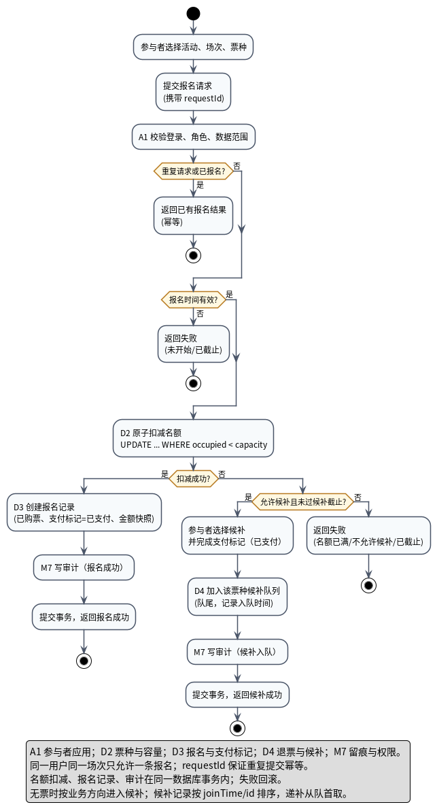

# 活动图说明

对应源文件：`UML活动图_报名购票.puml`；导出图：`UML活动图_报名购票.png`。

## 1. 这张图回答什么

活动图是**行为性图**，回答“报名购票这个业务流程怎么走”：

- 什么条件下报名成功；
- 什么条件下进入候补；
- 什么条件下直接失败；
- 重复请求、截止时间、名额并发、审计和事务分别在哪一步处理。

它和用例图的区别：用例图只表达“参与者可以报名购票、候补”，不表达先后顺序；活动图表达流程和分支。

## 2. 流程说明

| 步骤 | 动作 | 负责模块 | 说明 |
|---|---|---|---|
| 1 | 选择活动、场次、票种 | 参与者 | 对应 UI-02/03 |
| 2 | 提交报名请求（携带 `requestId`） | 参与者 | 用于幂等 |
| 3 | 校验登录、角色、数据范围 | A1 + M7 | 不通过则拒绝 |
| 4 | 重复请求或已报名？ | A1 + D3 | 是：返回已有结果（幂等） |
| 5 | 报名时间有效？ | A1 | 否：返回未开始/已截止 |
| 6 | 原子扣减名额 | D2 | `UPDATE ... WHERE occupied < capacity` |
| 7 | 扣减成功？ | D2 | 是：走成功分支；否：走满员分支 |
| 8 | 创建报名记录 | D3 | 已购票、支付标记=已支付、金额快照 |
| 9 | 写审计 | M7 | 报名成功 |
| 10 | 提交事务，返回报名成功 | A1/D3 | 事务提交后返回 |
| 11 | 允许候补且未过候补截止？ | D4 | 否：返回名额已满/不允许候补/已截止 |
| 12 | 选择候补并完成支付标记 | 参与者 + D4 | 支付标记=已支付 |
| 13 | 加入该票种候补队列 | D4 | 队尾，记录入队时间 |
| 14 | 写审计（候补入队） | M7 | 关键操作留痕 |
| 15 | 提交事务，返回候补成功 | A1/D4 | 事务提交后返回 |

## 3. 关键设计点

1. **幂等**：请求携带 `requestId`；重复请求返回第一次结果，不再扣名额。
2. **截止判定**：使用服务器时间；未开始或已截止直接失败。
3. **不超发**：名额由 D2 原子扣减，条件更新失败即视为满员。
4. **无票进候补**：扣减失败后，只有“允许候补且未过候补截止”才进入候补；否则直接失败。这就是业务上的“报名 → 查余票 → 无票 → 候补”方向。
5. **事务一致**：名额扣减、报名记录、审计在同一数据库事务内；失败回滚。
6. **候补 FIFO**：候补记录按 `joinTime/id` 排序，入队尾，递补从队首取。
7. **行动作前缀**：A1/D2/D3/D4/M7 表示负责模块；本图不画泳道，避免泳道切换造成连线打结。

## 4. 为什么不用泳道

第一版使用“参与者 / 报名服务 / 票种与容量 / 审计 / 候补队列”五条泳道，分支跨泳道时连线交叉严重。最终改为单列流程，用动作前缀标出负责模块，流程方向和分支更清楚；模块职责由组件图和类图表达，不靠泳道重复。

## 5. 读图时重点看

1. 重复请求是否在扣名额之前被拦截；
2. 截止时间是否在扣名额之前判断；
3. 名额扣减失败后是否才进入候补；
4. 候补是否要求“允许候补且未过截止”；
5. 报名/候补成功是否都在事务提交后才返回；
6. 审计是否覆盖报名成功和候补入队。
