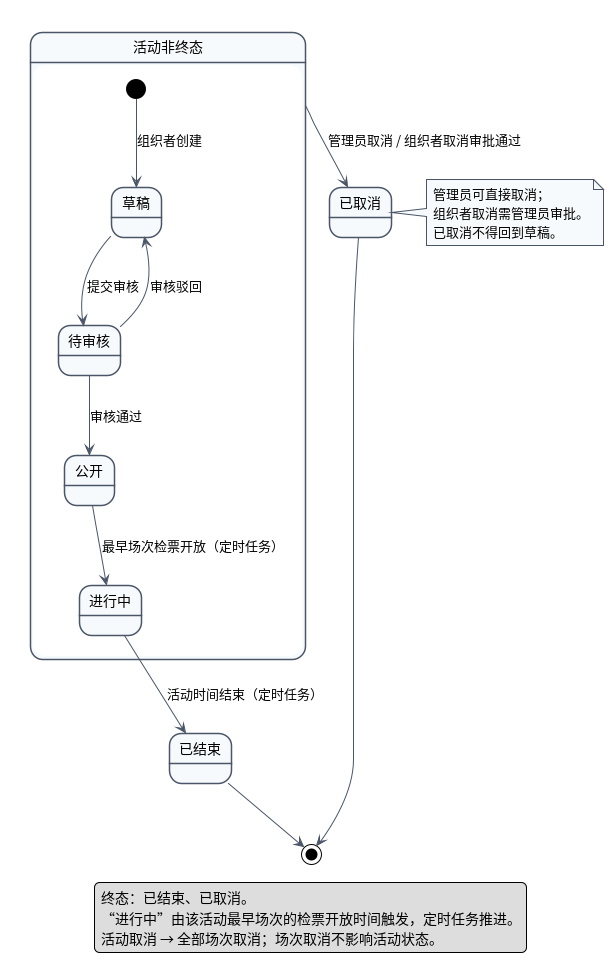
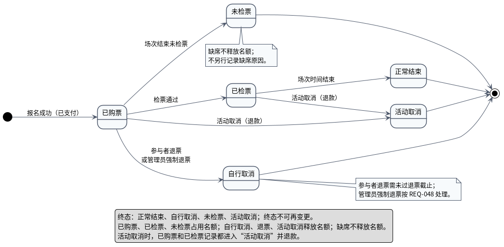
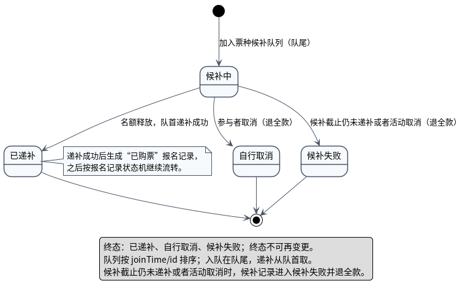

# 状态图说明

本目录有三张状态图，分别描述活动、报名记录、候补记录的生命周期：

| 文件 | 状态机 |
|---|---|
| `UML状态图_活动.puml` / `.png` | 活动：草稿 → 待审核 → 公开 → 进行中 → 已结束 / 已取消 |
| `UML状态图_报名记录.puml` / `.png` | 报名记录：已购票 → 已检票/自行取消/未检票/活动取消 |
| `UML状态图_候补记录.puml` / `.png` | 候补记录：候补中 → 已递补 / 自行取消 / 候补失败 |

---

## 一、活动状态

| 当前状态 | 事件 | 下一状态 | 推动者 |
|---|---|---|---|
| 草稿 | 提交审核 | 待审核 | 组织者 |
| 待审核 | 审核通过 | 公开 | 管理员 |
| 待审核 | 审核驳回 | 草稿 | 管理员 |
| 公开 | 最早场次检票开放 | 进行中 | 定时任务 |
| 进行中 | 活动时间结束 | 已结束 | 定时任务 |
| 草稿/待审核/公开/进行中 | 管理员取消，或组织者取消审批通过 | 已取消 | 管理员 |
| 已结束/已取消 | — | 终态 | — |

说明：

- “进行中”由**最早场次的检票开放时间**触发，不是活动开始时间；
- 已取消不得回到草稿；
- 活动取消 → 全部场次取消；场次取消不影响活动状态。

> 布局说明：活动图用复合状态“活动非终态”包住草稿/待审核/公开/进行中，再从复合状态画一条取消转移。这样只保留一条取消箭头，避免四条线同时指向“已取消”；语义仍是“任意非终态都可取消”。

## 二、报名记录状态

| 当前状态 | 事件 | 下一状态 | 说明 |
|---|---|---|---|
| — | 报名成功（已支付） | 已购票 | 报名即购票 |
| 已购票 | 检票通过 | 已检票 | 检票员处理请求通过 |
| 已检票 | 场次时间结束 | 正常结束 | 时间推动 |
| 已购票 | 参与者退票 / 管理员强制退票 | 自行取消 | 参与者需未过退票截止；管理员按 REQ-048 |
| 已购票 | 场次结束未检票 | 未检票 | 缺席 |
| 已购票 / 已检票 | 活动取消 | 活动取消 | 同时退款 |
| 正常结束/自行取消/未检票/活动取消 | — | 终态 | — |

说明：

- 终态不可再变更；
- 已购票、已检票、未检票占用名额；自行取消、退票、活动取消释放名额；缺席不释放名额；
- 活动取消时，已购票和已检票记录都进入“活动取消”并退款。

## 三、候补记录状态

| 当前状态 | 事件 | 下一状态 | 说明 |
|---|---|---|---|
| — | 加入票种候补队列（队尾） | 候补中 | 记录入队时间、支付标记 |
| 候补中 | 名额释放，队首递补成功 | 已递补 | 生成“已购票”报名记录 |
| 候补中 | 参与者取消 | 自行取消 | 退全款 |
| 候补中 | 候补截止仍未递补 | 候补失败 | 退全款 |
| 已递补/自行取消/候补失败 | — | 终态 | — |

说明：

- 候补队列按 `joinTime/id` 排序；入队在队尾，递补从队首取；
- 已递补记录转为“已购票”报名记录，之后按报名记录状态机继续流转；
- 队列本身不是状态机；状态机描述的是每条 `WaitlistRecord`（候补记录）。

## 四、与类图/枚举的一致性

| 状态图 | 类图枚举 |
|---|---|
| 活动状态 | `ActivityStatus`：DRAFT、PENDING_REVIEW、PUBLISHED、ONGOING、ENDED、CANCELLED |
| 报名记录状态 | `RegistrationStatus`：PURCHASED、CHECKED_IN、NORMAL_END、SELF_CANCELLED、NO_SHOW、ACTIVITY_CANCELLED |
| 候补记录状态 | `WaitlistRecordStatus`：WAITING、PROMOTED、SELF_CANCELLED、FAILED |

## 五、读图时重点看

1. 活动状态是否由时间/管理员/组织者分别推动；
2. 已取消/已结束是否不可再转；
3. 报名记录终态是否不可再变；
4. 活动取消时已购票和已检票是否都进入“活动取消”；
5. 候补记录的已递补是否生成报名记录，而不是直接算“最终买到票”；
6. 缺席是否不释放名额。
