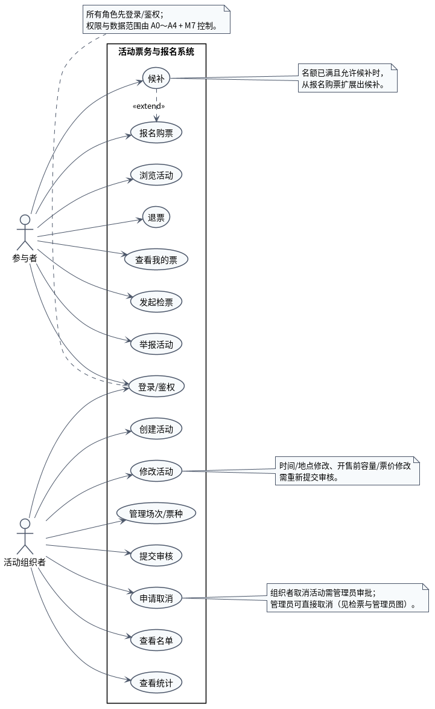
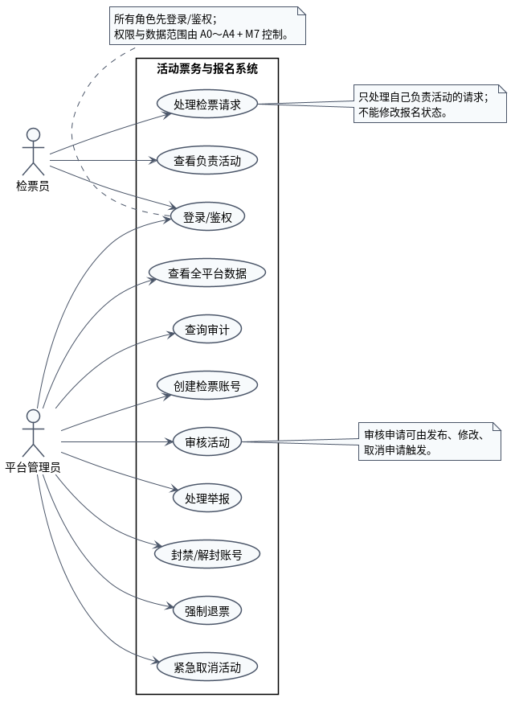

# 用例图说明

本目录有两张用例图，按角色分成两组，避免一张图塞入 4 个角色、20 多个用例后过长、连线交叉。

| 文件 | 角色 | 内容 |
|---|---|---|
| `UML用例图_参与者与组织者.puml` / `.png` | 参与者、活动组织者 | 浏览、报名、候补、退票、检票请求、举报；活动创建/修改/审核/名单/统计 |
| `UML用例图_检票与管理员.puml` / `.png` | 检票员、平台管理员 | 检票工作台；审核、举报、封禁、强制退票、紧急取消、全平台数据、审计、创建检票账号 |

---

## 一、参与者与组织者

| 角色 | 用例 | 对应入口/模块 |
|---|---|---|
| 参与者 | 浏览活动 | A1 + Q1 |
| 参与者 | 报名购票 | A1 + D3/D2 |
| 参与者 | 候补 | A1 + D4 |
| 参与者 | 退票 | A1 + D4 |
| 参与者 | 查看我的票 | A1 + Q1 |
| 参与者 | 发起检票 | A1 + D5 |
| 参与者 | 举报活动 | A1 + M8/D1 |
| 组织者 | 创建活动 | A2 + D1 |
| 组织者 | 修改活动 | A2 + D1 |
| 组织者 | 管理场次/票种 | A2 + D1/D2 |
| 组织者 | 提交审核 | A2 + D1 |
| 组织者 | 申请取消 | A2 + D1（需管理员审批） |
| 组织者 | 查看名单 | A2 + Q1 |
| 组织者 | 查看统计 | A2 + Q1 |

### 关系

- `候补` 对 `报名购票` 是 `<<extend>>`：名额已满且允许候补时，报名流程扩展出候补。
- 登录/鉴权是所有角色共用的用例，具体权限和数据范围由 A0～A4 + M7 控制。
- 组织者修改时间/地点、开售前修改容量/票价，需要重新提交审核。
- 组织者申请取消活动需要管理员审批；管理员可直接取消（见第二张图）。

---

## 二、检票员与管理员

| 角色 | 用例 | 对应入口/模块 |
|---|---|---|
| 检票员 | 查看负责活动 | A3 + Q1 |
| 检票员 | 处理检票请求 | A3 + D5 |
| 管理员 | 审核活动 | A4 + D1 |
| 管理员 | 处理举报 | A4 + D1/D6/Q1 |
| 管理员 | 封禁/解封账号 | A4 + D6 |
| 管理员 | 强制退票 | A4 + D4 |
| 管理员 | 紧急取消活动 | A4 + D1 |
| 管理员 | 查看全平台数据 | A4 + Q1 |
| 管理员 | 查询审计 | A4 + M7 |
| 管理员 | 创建检票账号 | A4 + D6 |

### 关系与限制

- 检票员只能查看自己负责的活动，只能处理该活动的检票请求；不能修改报名状态，不能访问完整名单。
- `审核活动` 可由发布审核、修改审核、取消申请触发。
- 管理员强制退票进入“自行取消”终态；紧急取消活动会触发批量退款和通知。
- 管理员查看个人信息只限运营、举报、封禁所需范围。

---

## 三、为什么拆成两张

- 一张图放 4 个角色、20 多个用例时，角色与用例的连线会跨越整张图，阅读困难；
- 按“参与者/组织者”和“检票员/管理员”拆开后，每张图只保留两组角色，连线清楚；
- 两张图共用 `登录/鉴权` 用例，但权限和数据范围不同，这一点写在图注和本文中。

> 用例图只表达“谁可以做什么”，不表达调用顺序；具体流程见活动图、时序图。

---

## 四、读图时重点看

1. 四个角色是否都有对应的用例；
2. `候补` 是否作为 `报名购票` 的扩展；
3. 组织者的修改/取消是否体现了“重新审核/管理员审批”；
4. 检票员是否只做检票请求处理，没有修改报名状态；
5. 管理员是否覆盖审核、举报、封禁、强制退票、紧急取消、审计；
6. 是否把“报名流程”画成了用例之间的顺序（不应该）。
