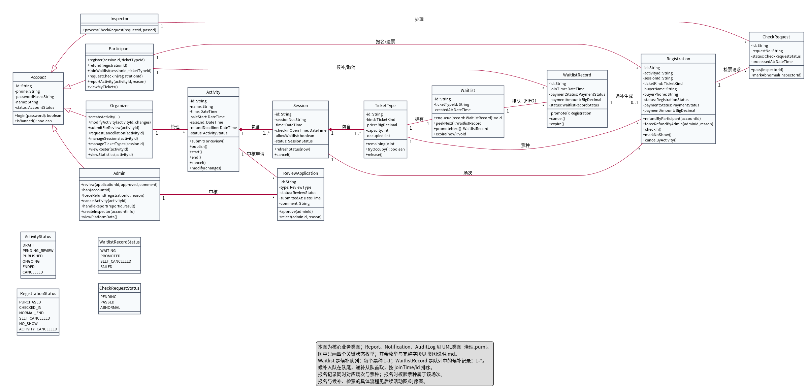
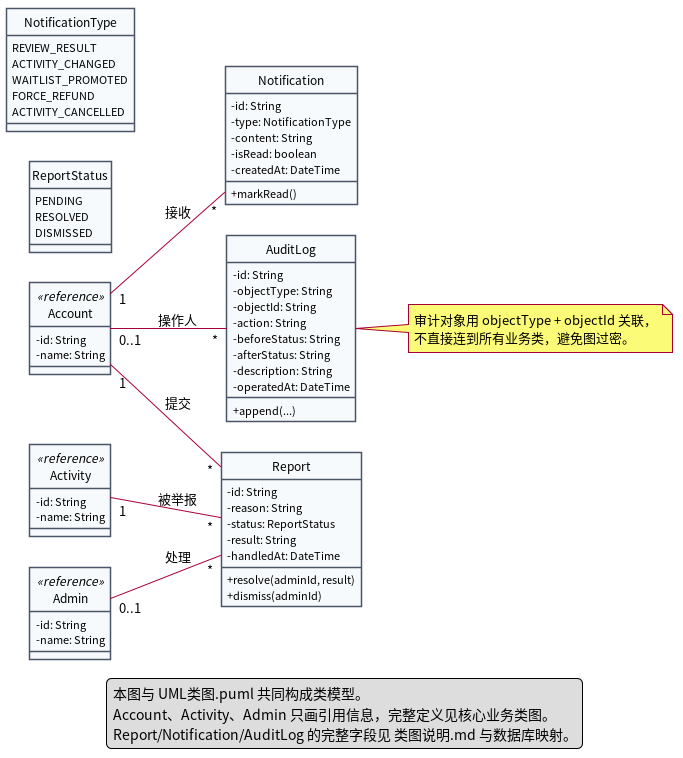

# 类图说明

本目录有两张类图，共同构成实验二的类模型：

| 文件 | 内容 |
|---|---|
| `UML类图.puml` / `.png` | 核心业务类图：账号、活动、场次、票种、报名、候补、检票、审核 |
| `UML类图_治理.puml` / `.png` | 治理类图：举报、通知、审计留痕 |

> 类图只画关键字段和关键方法；完整字段、索引和约束见本文第五节与 `00_设计基线.md` 第 7 节。

---

## 一、核心业务类

| 类 | 职责 | 关键字段 | 关键方法 | 主要需求 |
|---|---|---|---|---|
| `Account`（抽象） | 账号身份与状态 | id、phone、passwordHash、name、status | `login`、`logout`、`isBanned` | REQ-002、REQ-045、REQ-047 |
| `Participant` | 参与者入口 | 继承 Account | `register`、`refund`、`joinWaitlist`、`requestCheckIn`、`reportActivity`、`viewMyTickets` | REQ-012～REQ-017、REQ-018 |
| `Organizer` | 组织者入口 | 继承 Account | `createActivity`、`modifyActivity`、`submitForReview`、`requestCancellation`、`manageSessions`、`manageTicketTypes`、`viewRoster`、`viewStatistics` | REQ-006～REQ-011、REQ-030、REQ-031 |
| `Inspector` | 检票员入口 | 继承 Account | `processCheckRequest` | REQ-014～REQ-017 |
| `Admin` | 管理员入口 | 继承 Account | `review`、`ban`、`forceRefund`、`cancelActivity`、`handleReport`、`createInspector`、`viewPlatformData` | REQ-009、REQ-018、REQ-048 |
| `Activity` | 活动聚合根 | id、name、time、saleStart、saleEnd、refundDeadline、status | `submitForReview`、`publish`、`start`、`end`、`cancel`、`modify` | REQ-006～REQ-011、REQ-021、REQ-028 |
| `Session` | 场次 | id、sessionNo、time、checkinOpenTime、allowWaitlist、status | `refreshStatus`、`cancel` | REQ-007、REQ-026 |
| `TicketType` | 票种与容量 | id、kind、price、capacity、occupied | `remaining`、`tryOccupy`、`release` | REQ-008、REQ-026、REQ-032 |
| `Registration` | 报名记录 | id、activityId、sessionId、ticketKind、buyerName、buyerPhone、status、paymentStatus、paymentAmount、refundAmount、requestId | `refundByParticipant`、`forceRefundByAdmin`、`checkIn`、`markNoShow`、`cancelByActivity` | REQ-004、REQ-012、REQ-022、REQ-025、REQ-027、REQ-033、REQ-046、REQ-048 |
| `Waitlist` | 候补队列 | id、ticketTypeId、createdAt | `enqueue`、`peekNext`、`promoteNext`、`expire` | REQ-019、REQ-020 |
| `WaitlistRecord` | 候补记录 | id、joinTime、paymentStatus、paymentAmount、status | `promote`、`cancel`、`expire` | REQ-019、REQ-020、REQ-023、REQ-049 |
| `CheckRequest` | 检票请求 | id、requestNo、status、processedAt | `pass`、`markAbnormal` | REQ-014～REQ-017、REQ-036 |
| `ReviewApplication` | 审核申请 | id、type、status、submittedAt、comment | `approve`、`reject` | REQ-009、REQ-010、REQ-011 |

> `Participant`、`Organizer`、`Inspector`、`Admin` 上的方法是**角色入口的示意**；实际编排在 A1～A4，领域规则在对应领域对象/服务中。类图这样画是为了同时表达“谁有这个入口”和“领域对象有哪些行为”。

---

## 二、关系与基数

| 关系 | 基数 | 说明 | 对应需求 |
|---|---|---|---|
| `Organizer` — `Activity` | 1 : * | 一个组织者创建/管理多个活动；活动属于一个组织者 | REQ-002、REQ-006～REQ-011 |
| `Activity` ◆— `Session` | 1 : 1..* | 活动包含场次；场次不能脱离活动存在 | REQ-007 |
| `Session` ◆— `TicketType` | 1 : 1..* | 场次包含票种；票种不能脱离场次存在 | REQ-008、REQ-024 |
| `Participant` — `Registration` | 1 : * | 一个账号可有多条报名记录（不同场次） | REQ-012、REQ-027 |
| `Session` — `Registration` | 1 : * | 一条报名记录对应具体场次；报名时校验票种属于该场次 | REQ-024、REQ-025 |
| `TicketType` — `Registration` | 1 : * | 一个票种对应多条报名记录；报名记录是历史记录，不能删除 | REQ-004、REQ-024、REQ-025 |
| `Participant` — `WaitlistRecord` | 1 : * | 一个账号可有多条候补记录 | REQ-019、REQ-049 |
| `TicketType` — `Waitlist` | 1 : 1 | 每个票种对应一条候补队列 | REQ-019 |
| `Waitlist` — `WaitlistRecord` | 1 : *（`{ordered}`） | 一条队列包含多条候补记录；入队在队尾，递补从队首取，按 `joinTime/id` 排序 | REQ-019、REQ-049 |
| `WaitlistRecord` — `Registration` | 1 : 0..1 | 只有递补成功才生成报名记录；候补记录独立存在 | REQ-020、REQ-024、REQ-049 |
| `Registration` — `CheckRequest` | 1 : * | 一条报名记录可有多次检票请求；只有第一次通过有效 | REQ-014、REQ-017、REQ-036 |
| `Inspector` — `CheckRequest` | 1 : * | 检票员处理其负责活动的请求 | REQ-014、REQ-015 |
| `Activity` — `ReviewApplication` | 1 : * | 活动可有发布、修改、取消等审核申请 | REQ-009、REQ-010、REQ-011 |
| `Admin` — `ReviewApplication` | 1 : * | 管理员审核申请；审核人可空（待审核时） | REQ-009 |

> `Waitlist` 是候补队列，每个票种 1-1；`WaitlistRecord` 是队列里的候补记录，1-*。不要把队列和记录合成一个类，否则每条记录的时间/支付/状态无处安放。
>
> 关联线上的词表示“关系角色/主要操作”，不是完整操作清单；完整操作见第一节的类方法表。
>
> 报名记录同时关联 `Session` 和 `TicketType`：`TicketType` 必须属于该 `Session`；`Activity` 通过 `Session` 关联，`Registration` 中的 `activityId/sessionId` 是快照字段，便于查询和统计。

**为什么 Activity–Session–TicketType 用组合**：场次/票种的生命周期依附于活动；活动取消时场次取消（REQ-021）。
**为什么 Registration 不用组合**：报名记录是历史记录，任何角色都不能删除（REQ-004）；票种/活动变化不能删除它，只能改状态。

---

## 三、共享命令与角色入口

类图中同一条共享逻辑对应多个入口，但对外命令分开：

| 入口 | 命令 | 底层共享 | 关键差异 |
|---|---|---|---|
| A1 参与者 | `Registration.refundByParticipant` | 释放名额 + 退款 | 只能退自己的、已购票、未过退票截止 |
| A4 管理员 | `Registration.forceRefundByAdmin` | 同一套释放名额 + 退款 | 按 REQ-048 独立前置条件，可强制、需原因、通知、留痕 |
| 活动取消 | `Registration.cancelByActivity` | 同一套退款 | 批量处理，进入“活动取消”终态 |
| A1 参与者 | `Participant.requestCheckIn` | `CheckRequest` 状态转换 | 自己的有效报名、检票时间窗内 |
| A3 检票员 | `Inspector.processCheckRequest` | 同一套状态转换 | 自己负责的活动、请求存在、时间窗内 |

实现上，`refundByParticipant`、`forceRefundByAdmin`、`cancelByActivity` 共用私有方法 `releaseSeatAndRefund`，避免规则重复；不写 `switch(role)`。

---

## 四、状态枚举

| 枚举 | 取值 | 来源/说明 |
|---|---|---|
| `AccountStatus` | NORMAL、BANNED | REQ-018、REQ-047 |
| `ActivityStatus` | DRAFT、PENDING_REVIEW、PUBLISHED、ONGOING、ENDED、CANCELLED | REQ-021 |
| `SessionStatus` | NOT_OPEN、OPEN、FULL、CLOSED、CANCELLED、ENDED | REQ-007 |
| `TicketKind` | VIP、NORMAL | REQ-008 |
| `RegistrationStatus` | PURCHASED、CHECKED_IN、NORMAL_END、SELF_CANCELLED、NO_SHOW、ACTIVITY_CANCELLED | REQ-022、REQ-025 |
| `PaymentStatus` | PAID、UNPAID | REQ-025 |
| `WaitlistRecordStatus` | WAITING、PROMOTED、SELF_CANCELLED、FAILED | REQ-023 |
| `CheckRequestStatus` | PENDING、PASSED、ABNORMAL | REQ-014、REQ-017 |
| `ReviewType` | PUBLISH、MODIFY、CANCEL | REQ-009～REQ-011 |
| `ReviewStatus` | PENDING、APPROVED、REJECTED | 设计补充（审核流程） |
| `ReportStatus` | PENDING、RESOLVED、DISMISSED | 设计补充（举报处理） |
| `NotificationType` | REVIEW_RESULT、ACTIVITY_CHANGED、WAITLIST_PROMOTED、FORCE_REFUND | REQ-009、REQ-020、REQ-028、REQ-048 |

> 类图只画了 ActivityStatus、RegistrationStatus、WaitlistRecordStatus、CheckRequestStatus 四个关键枚举；其余枚举在本表列出，避免类图过大。

---

## 五、类到数据库表的映射

| 类 | 表 | 关键字段/约束 |
|---|---|---|
| Account + 四个角色 | `account` | id、phone（唯一）、password_hash、name、role、status；单表 + role 区分角色 |
| Activity | `activity` | id、organizer_id、name、description、time、location、estimated_participants、waitlist_deadline、sale_start、sale_end、refund_deadline、status、cover、tags |
| Session | `activity_session` | id、activity_id、session_no、time、checkin_open_time、allow_waitlist、status |
| TicketType | `ticket_type` | id、session_id、kind、price、capacity、occupied；`occupied <= capacity` |
| Registration | `registration` | id、account_id、activity_id、session_id、ticket_type_id、buyer_name、buyer_phone、ticket_kind、status、payment_status、payment_amount、refund_amount、refund_time、request_id、created_at；`(account_id, session_id)` 唯一，`request_id` 唯一 |
| Waitlist | `waitlist` | id、ticket_type_id（唯一）、created_at；每个票种一条队列 |
| WaitlistRecord | `waitlist_record` | id、waitlist_id、account_id、join_time、payment_status、payment_amount、status、refund_amount、refund_time、request_id |
| CheckRequest | `check_request` | id、registration_id、request_no、inspector_id、status、processed_at |
| ReviewApplication | `review_application` | id、activity_id、type、status、submitted_at、reviewer_id、comment、reviewed_at |
| Report | `report` | id、reporter_id、activity_id、reason、status、handler_id、result、handled_at |
| Notification | `notification` | id、recipient_id、type、content、is_read、created_at |
| AuditLog | `audit_log` | id、operator_id、operated_at、object_type、object_id、action、before_status、after_status、description；追加式 |

**映射说明**：

- `Account` 继承在类图上用继承表示，落库用单表 + `role` 字段，避免四张表重复。
- 枚举落库用字符串/查表，不使用数据库原生 ENUM，便于扩展。
- `AuditLog` 用 `object_type + object_id` 关联任意业务对象，不建到所有表的外键。
- `Registration` 的 `activity_id/session_id` 是快照字段，便于查询和统计；关联关系仍以 `ticket_type_id` 为准。

---

## 六、治理类

| 类 | 职责 | 关系 | 需求 |
|---|---|---|---|
| `Report` | 举报活动/账号，管理员处理 | Account 1—*（提交）；Activity 1—*（被举报）；Admin 0..1—*（处理） | REQ-018 |
| `Notification` | 站内消息 | Account 1—*（接收） | REQ-009、REQ-020、REQ-028、REQ-048 |
| `AuditLog` | 审计留痕 | Account 0..1—*（操作人）；对象用 objectType/objectId | REQ-039～REQ-041 |

`AuditLog` 不直接连到所有业务类，否则类图会过密；它的对象用 `objectType + objectId` 表示，`beforeStatus/afterStatus` 记录状态变化。

---

## 七、与组件图的对应

| 组件 | 类 |
|---|---|
| D1 活动与场次 | Activity、Session、ReviewApplication |
| D2 票种与容量 | TicketType |
| D3 报名与支付标记 | Registration |
| D4 退票与候补 | Waitlist、WaitlistRecord；Registration 的退款方法 |
| D5 检票 | CheckRequest |
| D6 账号 | Account、Participant、Organizer、Inspector、Admin |
| Q1 查询与统计 | 无独立实体；只读 D1/D3/D5/D6 |
| M7 留痕与权限 | AuditLog；权限策略在应用层/M7 服务中 |
| S1 通知 | Notification |

---

## 八、读图时重点看

1. `Account` 的继承是否覆盖四类角色；
2. 活动—场次—票种是否是组合关系，基数是否正确；
3. `Registration` 是否与 `TicketType`、`Participant` 正确关联；
4. 报名记录是否同时关联 `Session` 和 `TicketType`，票种是否属于该场次；票种与 `Waitlist` 是否是 `1 : 1`，`Waitlist` 与 `WaitlistRecord` 是否是 `1 : *`，`WaitlistRecord` 与报名是否是 `1 : 0..1`；
5. 检票请求是否属于报名记录，检票员是否只处理请求；
6. 退款为什么有 `refundByParticipant` / `forceRefundByAdmin` / `cancelByActivity` 三个命令；
7. `AuditLog` 是否用 `objectType/objectId` 而不是连所有类。
