# 实验二：软件设计与建模

**项目名称**：活动票务与报名系统  
**课程**：软件工程实验  
**学号**：241220022  
**姓名**：邓景文  
**联系方式**：13851629609 / 3459952817@qq.com  
**日期**：2026 年 11 月

> 本报告根据实验一《活动票务与报名系统需求整理》v3 和实验二设计过程整理。实验一的 49 条需求是设计输入；实验二不写代码，交付的是可指导实验三实现的软件设计。  
> 报告中引用的活动、日期、票数、人数、日志条数等均为界面演示数据，不代表真实业务数据。

---

## 1. 项目概述与主要功能

### 1.1 项目与范围

本项目是**活动票务与报名系统**，沿用实验一选定的项目主题。系统面向活动参与者、活动组织者、检票人员和平台管理员四类角色，覆盖活动创建与审核、场次与票种、报名购票、退票与候补、检票、查询统计、审计留痕等业务。

系统设计范围内包括：

- 活动与场次：创建、提交审核、审核通过/驳回、发布、修改、取消、状态推进；
- 票种与容量：VIP/普通票、价格、容量、余票、名额占用与释放；
- 报名与支付标记：报名即购票、支付标记、报名记录、次数/票数限制、幂等；
- 退票与候补：退票截止、候补入队、FIFO、自动递补、候补失败/取消与退款；
- 检票：检票请求、人工勾选、异常标记、重复检票、未检票终态；
- 查询与统计：活动查询、名单导出、报名人数/出席率/退票率统计；
- 留痕与权限：关键操作留痕、保存期限、按角色可见、RBAC 与数据范围；
- 账号与管理员处置：注册登录、封禁、举报处理、强制退票、紧急取消；
- 通知：审核结果、活动时间变更、候补递补、强制退票等站内消息。

**不实现**：真实支付渠道、实名核验、线下闸机/二维码验票（REQ-001）；活动多组织者共管（REQ-042 已拒绝）；代报名、一次购买多张票（REQ-027）；找回密码、自助修改个人信息（REQ-002、REQ-047 未提供）；外部短信/邮件/推送；生产级部署、高可用和分布式事务。

### 1.2 用户角色

| 角色 | 主要能力 | 关键约束 | 主要需求 |
|---|---|---|---|
| 参与者 | 浏览已公开活动、报名购票、候补、退票、查看已购票、发起检票请求、举报活动 | 不能修改活动；不能查看或修改他人个人信息 | REQ-002、REQ-012～REQ-017、REQ-027 |
| 活动组织者 | 创建并提交活动审核；管理自己的活动、场次、票种；查看和导出本活动名单；查看统计；申请取消活动 | 开售后不能改票价/容量；改时间/地点须重新审核；不能查看其他组织者的活动与报名 | REQ-002、REQ-006～REQ-011、REQ-030、REQ-031 |
| 检票人员 | 查看参与工作的活动；处理检票请求（通过或标记异常） | 不能修改报名状态；不能访问完整名单；不能看完整手机号 | REQ-002、REQ-003、REQ-014～REQ-017 |
| 平台管理员 | 审核活动、处理举报、封禁账号、查看全平台数据、紧急取消活动、强制退票 | 不能修改用户个人信息；查看个人信息仅限运营、举报、封禁所需 | REQ-002、REQ-018、REQ-041、REQ-048 |

账号产生方式：参与者、组织者注册时选择身份；管理员账号由系统预创建；检票人员账号由管理员预创建/分配。一个账号只能拥有一个角色，一个手机号只对应一个身份；登录只需手机号和密码，不提供找回密码功能。

### 1.3 主要功能与业务模块

实验一共 49 条需求：37 条功能需求、4 条非功能需求、8 条约束；48 条已确认，1 条已拒绝（REQ-042）。按业务对象和用户任务归纳为 8 个业务模块：

| 模块 | 覆盖内容 | 代表需求 |
|---|---|---|
| 活动与场次 | 创建、审核、发布、修改、取消、活动状态 | REQ-006～REQ-011、REQ-021、REQ-028 |
| 票种与容量 | VIP/普通票、价格、容量、余票 | REQ-008、REQ-026、REQ-032 |
| 报名与支付标记 | 报名即购票、支付标记、幂等、次数限制 | REQ-005、REQ-012、REQ-025、REQ-027、REQ-033 |
| 退票与候补 | 退票截止、候补队列、FIFO、递补、退款 | REQ-013、REQ-019、REQ-020、REQ-023、REQ-049 |
| 检票 | 检票请求、手动勾选、异常、缺席、重复检票 | REQ-014～REQ-017、REQ-036 |
| 查询与统计 | 多条件查询、名单导出、四项统计 | REQ-029～REQ-031 |
| 留痕与权限 | 留痕范围、内容、保存期、可见性 | REQ-003、REQ-039～REQ-041 |
| 账号与管理员处置 | 注册登录、封禁、举报、强制退票 | REQ-018、REQ-047、REQ-048 |

### 1.4 设计目标与质量约束

| 约束 | 来源 | 设计应对 |
|---|---|---|
| 报名性能：1 万条报名、50 并发，100 次请求至少 95 次 1 秒内成功 | REQ-043、REQ-044 | 关键路径减少查询；名额原子更新；索引覆盖；避免长事务 |
| 持久化：事务提交后崩溃不丢，未提交视为未发生 | REQ-046 | 单库事务；提交后返回成功；通知等副作用走 Outbox |
| 名额并发：最后名额仅一人成功，不超发名额 | REQ-032 | 票种行原子扣减；唯一约束兜底；失败进入候补询问 |
| 报名幂等：重复请求只生成一条记录 | REQ-033 | 唯一约束 + 请求幂等号；重复请求返回首次结果 |
| 口令与手机号安全 | REQ-045 | 口令带盐哈希；手机号按角色脱敏 |
| 审计：关键操作留痕，保存 6 个月 | REQ-039～REQ-041 | 追加式审计表；关键操作同事务写入；按角色过滤 |
| 时间判定：以服务器时间为准，含截止时刻 | REQ-034 | 统一服务器时间；截止比较使用 `<=`；定时任务推进状态 |
| 状态合法：活动/报名/候补状态封闭 | REQ-021～REQ-023 | 领域层状态机；非法转换直接拒绝 |

---

## 2. 软件架构与模块设计

### 2.1 架构风格与选择理由

系统采用**分层模块化单体**：部署为一个应用，代码按“角色入口 + 共享能力”分边界。

- 课程项目规模有限，单体部署和调试成本低；
- 名额扣减、报名、退款、候补递补需要强事务一致性，单库事务最简单可靠；
- 角色入口和共享领域边界清晰，后续若拆服务，已有接口和边界。

不选微服务：为一个课程项目引入服务注册、网关、分布式事务不划算，且会削弱“不超发”规则的可验证性。不选纯 MVC：MVC 只解决表现层组织，不能表达领域规则、状态机、模块依赖和并发控制。

### 2.2 分层与统一操作模型

系统分为：

- **表现层**：登录/注册、参与者、组织者、检票员、管理员界面；
- **应用层（角色入口）**：A0 认证入口、A1 参与者应用、A2 组织者应用、A3 检票员应用、A4 管理员应用；
- **共享能力层**：写能力 D1～D6，只读能力 Q1；
- **业务约束**：M7 留痕与权限；
- **技术支撑**：S1 通知、S2 持久化与并发、MySQL 8.0。

统一操作模型为：

```text
角色入口 A0～A4
      ↓
M7 权限校验 + 数据范围
      ↓
共享能力
  ├─ 写：D1～D6（事务、不变量、状态机）
  └─ 读：Q1（只读、跨域查询）
      ↓
S2 持久化/并发 → MySQL
```

统一的是“入口 → 约束 → 共享能力”的模式；不统一的是读写实现。写操作共享内部实现，但对外暴露有明确前置条件的独立命令，例如 `refundByParticipant`、`forceRefundByAdmin`、`refundByActivityCancellation`。读操作共享一套查询服务，用 `DataScope` 区分角色能看到的数据范围。

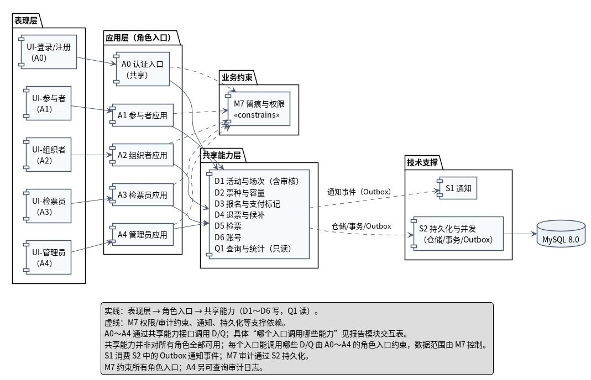

### 2.3 模块划分与职责

| 编号 | 模块 | 职责 | 关键需求 |
|---|---|---|---|
| A0 | 认证入口（共享） | 注册（仅参与者/组织者）、登录、退出 | REQ-047、REQ-002 |
| A1 | 参与者应用 | 浏览、报名、退票、候补、我的票、发起检票、举报 | REQ-012～REQ-017 |
| A2 | 组织者应用 | 创建/编辑活动、场次票种、提交审核、名单/统计、申请取消 | REQ-006～REQ-011、REQ-030、REQ-031 |
| A3 | 检票员应用 | 查看负责活动、处理检票请求 | REQ-014～REQ-017 |
| A4 | 管理员应用 | 审核、举报、封禁、强制退票、紧急取消、全平台数据、审计查询、创建检票账号 | REQ-009、REQ-018、REQ-041、REQ-048 |
| D1 | 活动与场次（含审核） | 活动、场次、活动状态机、修改规则、审核申请 | REQ-006～REQ-011、REQ-021、REQ-028 |
| D2 | 票种与容量 | 票种、价格、容量、已占用、原子占用/释放 | REQ-008、REQ-026、REQ-032 |
| D3 | 报名与支付标记 | 报名记录、支付标记、报名状态、幂等、次数限制 | REQ-005、REQ-012、REQ-025、REQ-027、REQ-033 |
| D4 | 退票与候补 | 退票/退款、候补队列、FIFO、递补、候补状态 | REQ-013、REQ-019、REQ-020、REQ-023、REQ-049 |
| D5 | 检票 | 检票请求、通过/异常、重复检票、未检票终态 | REQ-014～REQ-017、REQ-036 |
| D6 | 账号 | 注册登录、账号状态、角色、检票账号创建 | REQ-002、REQ-045、REQ-047 |
| Q1 | 查询与统计 | 活动查询、名单导出、四项统计；只读、按角色数据范围 | REQ-003、REQ-029～REQ-031 |
| M7 | 留痕与权限 | RBAC、数据范围、审计留痕、保存期限、审计查询 | REQ-003、REQ-039～REQ-041 |
| S1 | 通知 | 站内消息；消费 Outbox 事件；失败重试 | REQ-009、REQ-020、REQ-028、REQ-048 |
| S2 | 持久化与并发 | 仓储、事务、行锁/原子更新、唯一约束、Outbox | REQ-032、REQ-033、REQ-043、REQ-046 |

与实验一 8 个模块的对应：

| 实验一模块 | 实验二落点 |
|---|---|
| 活动与场次 | D1 |
| 票种与容量 | D2 |
| 报名与支付标记 | D3 |
| 退票与候补 | D4 |
| 检票 | D5 |
| 查询与统计 | Q1 |
| 留痕与权限 | M7 |
| 账号与管理员处置 | D6 + A4（注册登录由 A0 + D6 承担） |

### 2.4 模块交互与关键流程

**报名成功**：A1 校验权限和数据范围 → D3 查重 → D2 原子扣减名额 → D3 创建报名（已购票/已支付）→ M7 写审计 → 事务提交后返回成功。

**满员与候补**：D2 扣减失败后，A1 询问是否候补；用户选择并完成支付标记 → D4 按票种入队（队尾）→ 写审计 → 事务提交。

**退票与自动递补**：D4 校验退票截止/状态 → 释放名额 → 写审计和 `CapacityReleased` Outbox 事件 → D3 递补编排器消费事件，调用 D4 取出队首，创建报名并占用名额。

**活动审核**：A2 创建草稿并提交审核 → D1 创建审核申请 → A4 审核通过/驳回；驳回退回草稿，修改后重新提交。

**检票**：A1 发起检票请求 → A3 处理；通过后 D5 将报名记录转“已检票”；异常标记不通过并写审计；重复检票只有第一次有效。

**查询与统计**：A1～A4 通过 M7 获取数据范围 → Q1 只读 D1/D3/D5/D6；Q1 不修改业务数据，统一统计口径。

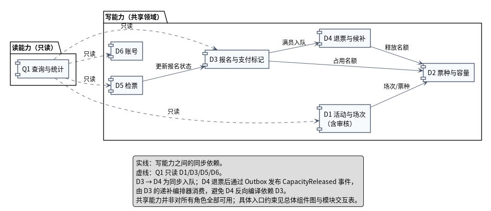

D3 与 D4 不形成编译期循环：D3 同步调用 D4 入队；D4 退票后只写 Outbox 事件，D3 的递补编排器消费事件后再生成报名记录。

### 2.5 关键设计决策

1. **名额原子扣减**：票种表维护 `occupied`，使用 `UPDATE ... WHERE occupied < capacity`；影响行数 1 表示成功，0 表示满员。
2. **报名幂等**：`(account_id, session_id)` 唯一 + `request_id` 唯一；重复请求返回首次结果。
3. **状态机在领域层**：活动、报名、候补使用封闭枚举和显式转换；非法转换直接拒绝。
4. **候补 FIFO + Outbox**：按票种分别排队，按 `joinTime/id` 排序；退票释放名额后通过事件触发递补，避免 D3/D4 循环依赖。
5. **审计同事务**：关键业务操作与审计记录在同一事务提交；审计只追加，保存至少 6 个月。
6. **RBAC + 数据范围**：角色决定可执行操作，数据范围决定可见记录；UI 隐藏不是安全边界，服务端统一校验。
7. **读查询只读**：Q1 使用只读查询接口/视图，不调用写仓储，统计口径统一。

---

## 3. UML 设计

实验二共使用 6 种 UML 图，覆盖结构性、行为性和交互性三类。手册要求说明模块之间的逻辑关系和设计原因，因此本章不只罗列图形，而是按“先结构、再行为、后交互”的顺序说明：组件图回答“系统由哪些模块组成、模块之间谁依赖谁”，类图回答“每个模块内部有哪些类、类之间是什么关系”，用例图回答“每个角色能做什么”，活动图和时序图回答“一次业务请求按什么步骤、由哪些对象协作完成”，状态图回答“核心业务对象允许经历哪些状态”。六张图共同覆盖 8 个业务模块，并与实验一的需求编号逐条对应。

| 类别 | 图 | 回答的问题 | 主要覆盖模块 |
|---|---|---|---|
| 结构性 | 类图 | 每个模块内部有哪些类、属性、方法、关系和基数 | D1～D6、M7 |
| 结构性 | 组件图 | 系统由哪些模块/组件组成、模块之间谁依赖谁 | A0～A4、D1～D6、Q1、M7、S1/S2 |
| 行为性 | 用例图 | 有哪些角色、每个角色能做什么、不能做什么 | A0～A4 |
| 行为性 | 活动图 | 报名购票流程怎么走、有哪些分支和终态 | A1、D2、D3、D4、M7 |
| 交互性 | 时序图 | 一次报名请求中对象按时间怎么调用、事务边界在哪 | A1、M7、D2、D3、D4 |
| 行为性 | 状态图 | 活动/报名/候补的生命周期和终态 | D1、D3、D4 |

这套图的分工是：**结构图确定边界，行为图确定规则，交互图确定时序**。组件图和类图先回答“谁负责什么、谁依赖谁”，避免把不同角色的职责混在一个模块里；用例图、活动图和状态图再回答“每个角色能做什么、流程怎么走、对象状态怎么变”；时序图最后把报名这一条关键链路按时间展开，落到对象调用和事务边界。这样，读者可以从模块边界一路追到具体业务规则，也能看出每个设计选择对应哪条需求。

### 3.1 类图

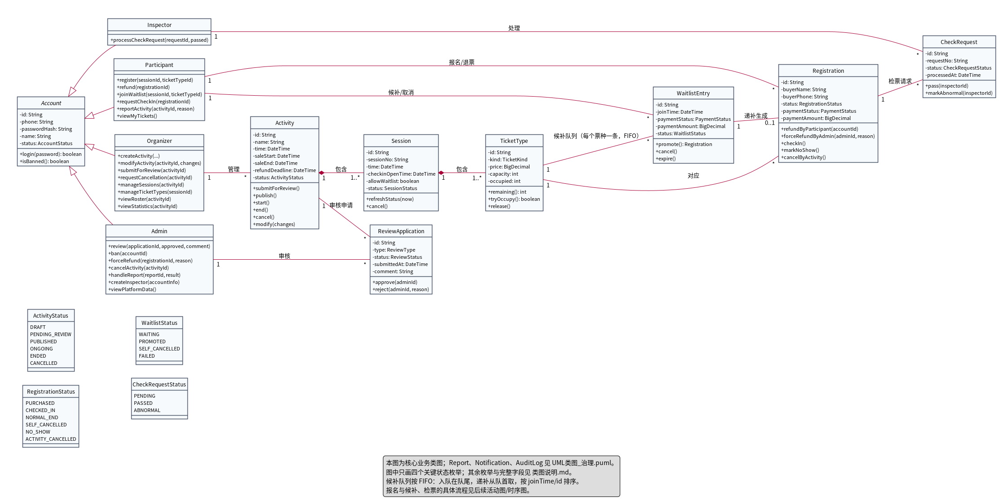

核心业务类图包含：

- `Account` 及 `Participant`、`Organizer`、`Inspector`、`Admin` 四个角色；
- `Activity`、`Session`、`TicketType`：活动 1—* 场次、场次 1—* 票种，使用组合关系；
- `Registration`：与 `Participant`、`Session`、`TicketType` 关联；报名记录是历史记录，不随票种删除；
- `Waitlist` 与 `WaitlistRecord`：`TicketType 1—1 Waitlist`，`Waitlist 1—* WaitlistRecord`，`WaitlistRecord 1—0..1 Registration`；
- `CheckRequest`：报名记录 1—* 检票请求，检票员 1—* 请求；
- `ReviewApplication`：活动 1—* 审核申请，管理员 1—* 审核。

关键命令设计：

- `Registration.refundByParticipant`：参与者退票，校验本人、已购票、未过退票截止；
- `Registration.forceRefundByAdmin`：管理员强制退票，按 REQ-048 独立前置条件；
- `Registration.cancelByActivity`：活动取消批量退款；
- 三者共用内部“释放名额 + 退款”实现，避免规则重复。

类图按“先主体、后业务、再治理”的顺序组织。首先确定系统中的主体是账号：`Account` 下分为参与者、组织者、检票员、管理员四个角色，角色决定入口和权限。其次确定业务的核心主体是活动：一个活动包含多个场次，一个场次又包含多个票种，因此 `Activity`、`Session`、`TicketType` 之间是组合关系，活动是聚合根，场次和票种不能脱离活动独立存在。

在此基础上，再按各角色的业务动作补充记录类：参与者购票产生 `Registration`；名额已满时进入候补，每个票种对应一条候补队列 `Waitlist`，队列中的每一条候补由 `WaitlistRecord` 表示；组织者提交发布、修改、取消申请，产生 `ReviewApplication`；检票员处理的是 `CheckRequest`。这些“记录/请求”类把角色动作落成可追踪的数据，也使报名、候补、审核、检票各自拥有明确的生命周期。

举报、通知、审计属于治理与支撑信息，与核心业务对象的耦合方式不同，单独放在治理类图中：举报关联举报人、活动和处理管理员；通知关联接收账号；审计用 `objectType + objectId` 关联任意业务对象，不直接连所有业务类，避免核心类图过密。需要说明的是，审核申请 `ReviewApplication` 仍属于核心业务类，因为它是活动生命周期的一部分；治理类图承载的是举报、通知、审计。核心类图回答“业务主体和业务记录是什么”，治理类图回答“业务之外的通知、举报、留痕如何挂接”，两者合起来覆盖实验一的 8 个业务模块。

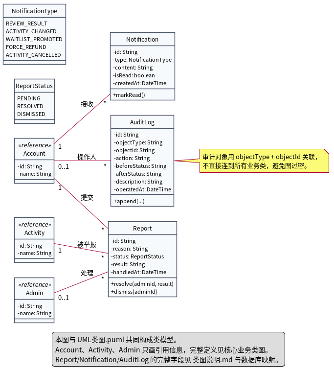

治理类图包含 `Report`、`Notification`、`AuditLog` 三个类，与核心业务类图分开绘制，避免核心图过密；三者的关联方式已在上文说明。

类到数据库表的映射见 `UML/UML设计说明.md` 第 2 节；核心表包括 `account`、`activity`、`activity_session`、`ticket_type`、`registration`、`waitlist`、`waitlist_record`、`check_request`、`review_application`、`report`、`notification`、`audit_log`、`outbox_message`。

### 3.2 组件图


组件图是本次设计中改动最大、也最能体现模块逻辑关系的一组图。总体组件图（图 3-3）说明系统分为表现层、应用层、共享能力层、业务约束和技术支撑五部分；领域依赖图（图 3-4）进一步说明共享能力内部各模块之间谁依赖谁。两张图层次不同，但共同回答“系统怎样分层、模块怎样协作、为什么这样划分”。

设计起点并不是这张图，而是一个判断：**很多业务能力并不是某一个角色独有的**。例如退票，参与者可以发起退票，管理员可以执行强制退票，活动取消时系统还要批量退款；三者的入口、前置条件和数据范围不同，但底层都包含“释放名额 + 退款”。如果按角色直接拆模块，同一套规则会被复制三份；如果不拆角色，又会退化成一个“什么都能做”的公共模块，所有角色都连到它。第一版组件图正是后者：账号、封禁、举报、强制退票、全平台数据被放进同一个模块（M8），所有角色都连 M8，M7 又被误放进“横切与支撑”，结果模块之间关系混乱，看不出权限边界。

最终的划分方法是：**先按角色拆入口，再按业务对象提取共享能力**。表现层只负责界面；应用层拆成 A0 认证入口和 A1～A4 四类角色入口，每个入口只暴露该角色允许的用例；入口在调用共享能力之前统一经过 M7 的权限校验和数据范围校验；共享能力层按业务对象划分为 D1～D6 写能力和 Q1 只读查询；S1 通知、S2 持久化与并发作为技术支撑，只连共享能力，不直接连角色入口。这样，角色差异体现在入口和 M7，业务规则沉淀在共享能力，技术细节收在 S1/S2，三层职责不混。

具体地，总体组件图表达以下逻辑关系：

- **A0～A4 → M7 → 共享能力**：所有角色入口先受权限约束，再调用共享能力；权限不是界面按钮的显隐，而是服务端的统一校验。
- **共享能力对外提供统一接口，但入口前置条件不同**：`refundByParticipant`、`forceRefundByAdmin`、`refundByActivityCancellation` 共用“释放名额 + 退款”的内部实现，但分别对应参与者退票、管理员强制退票和活动取消退款，避免用一个带 `role` 参数的通用方法造成权限泄漏。
- **Q1 只读**：查询与统计只读取 D1/D3/D5/D6 的数据，按 `Principal + DataScope` 过滤和脱敏，不产生业务副作用，统计口径只在一个地方实现。
- **S1/S2 只连共享能力**：通知由共享能力在业务事务内写 Outbox，S1 消费后投递站内消息；S2 提供仓储、事务、行锁、唯一约束和 Outbox。技术支撑不反向依赖业务入口。
- **D3/D4 事件解耦**：D3 在满员时同步调用 D4 入队；D4 退票后只写 `CapacityReleased` 事件，D3 的递补编排器消费事件后再创建报名记录，编译期依赖只有 D3 → D4，避免循环依赖。

领域依赖图则进一步把共享能力内部的关系展开：报名（D3）依赖票种与容量（D2）做原子扣减，退票与候补（D4）依赖 D2 释放和递补名额，检票（D5）依赖报名（D3）更新报名状态，活动与场次（D1）依赖 D2 创建票种。这样，读者先看总体图理解“入口—约束—能力”的封装，再看领域依赖图理解“买票为什么涉及票种与容量、退票为什么要触发递补”，两张图合起来才能完整表达模块之间的逻辑关系。

组件图主要说明“模块之间谁依赖谁”，类图说明“类之间谁关联谁”；两者不重复。组件图的最终形态经过多轮人工审查和重构：从 M8 上帝模块，到角色入口与共享能力分离，再到技术支撑只连共享能力、入口连线汇聚、领域依赖图的移除与恢复，每一步都对应一次明确的设计判断。

### 3.3 用例图

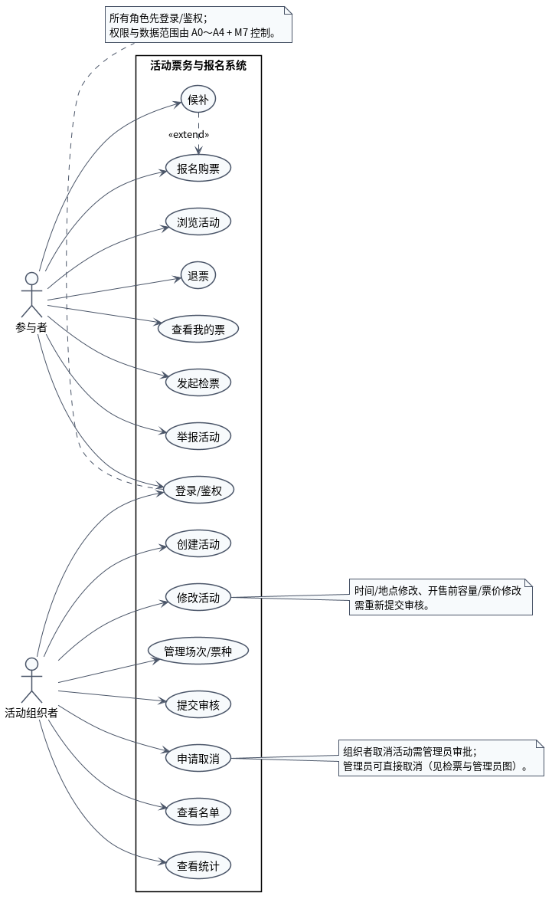

参与者用例：浏览活动、报名购票、候补、退票、查看我的票、发起检票、举报活动。组织者用例：创建活动、修改活动、管理场次/票种、提交审核、申请取消、查看名单、查看统计。

`候补`对`报名购票`是 `<<extend>>`：按课程定义，扩展由特殊用例 A 连向基本用例 B；这里 A=候补，B=报名购票，所以箭头为 `候补 → 报名购票`。

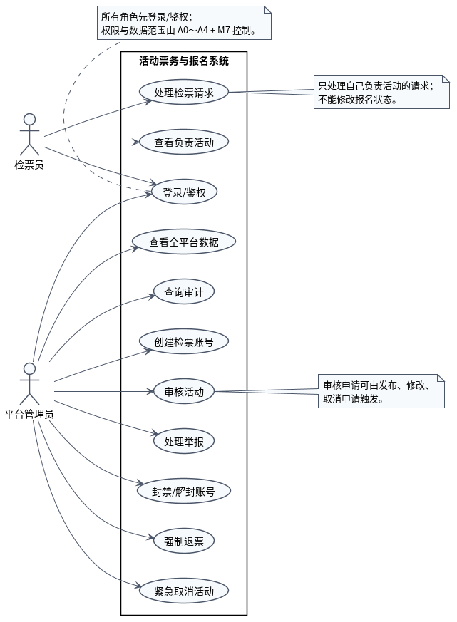

检票员用例：查看负责活动、处理检票请求，只处理自己负责活动的请求，不能修改报名状态。管理员用例：审核活动、处理举报、封禁/解封账号、强制退票、紧急取消活动、查看全平台数据、查询审计、创建检票账号。

用例图的组织方式是“角色—用例”对应：每个用例都是某个角色在系统中的一项功能操作，角色决定谁能发起，用例之间的扩展关系表示业务上的特殊路径。实验一已经明确了四类角色及其能做、不能做的事情，因此这一阶段的映射关系比较清楚，AI 生成的用例覆盖度较好；人工审查主要集中在三处：一是把四个角色、二十多个用例拆成“参与者/组织者”和“检票员/管理员”两张图，避免单图过长；二是按课程对 `<<extend>>` 的定义确认“候补 → 报名购票”的箭头方向，而不是按中文语序想当然；三是检查用例图只表达“谁能做什么”，不把活动图/时序图里的步骤顺序画进来。这样，用例图与后续活动图、时序图形成“角色能力 → 业务步骤 → 对象调用”的递进关系，而不是互相重复。

### 3.4 活动图

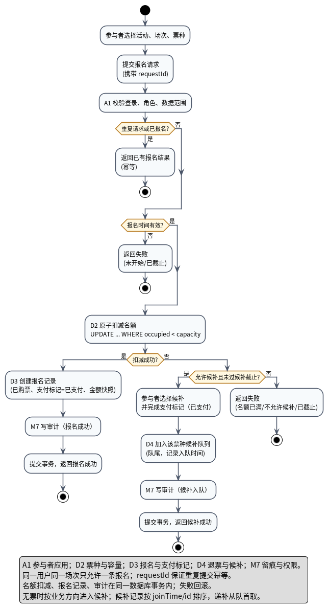

活动图覆盖报名购票流程：

1. 参与者选择活动、场次、票种并提交报名（携带 `requestId`）；
2. A1 校验登录、角色、数据范围；
3. 重复请求/已报名 → 返回已有结果（幂等）；
4. 校验报名时间（服务器时间，含截止时刻）；
5. D2 原子扣减名额；
6. 成功 → D3 创建报名（已购票、支付标记=已支付）→ M7 写审计 → 事务提交；
7. 满员 → 判断允许候补且未过候补截止；是 → 参与者选择候补并完成支付标记 → D4 加入票种候补队列（队尾）→ 写审计 → 事务提交；否 → 报名失败。

活动图聚焦整个系统中最核心的一条业务链路——报名购票。从实验一需求中可以提取出这条链路上的几个关键判断和终态：同一请求重复提交时返回已有结果；报名时间已截止时失败；名额扣减成功时生成报名并进入“已购票”；名额已满但允许候补时进入候补队列；名额已满且不允许候补（或已过候补截止）时报名失败。把这些分支按业务先后顺序串起来，就得到这张活动图。

这张图采用单列流程 + 模块前缀（A1/D2/D3/D4/M7），而不是多泳道，原因是本流程的分支较多、泳道之间的连线容易打结；用模块前缀标出每一步由哪个模块负责，可以在保持可读性的同时保留“谁做什么”的信息。图的范围只覆盖报名购票与候补入队：候补递补、候补失败、退款、通知属于 D4 的后续流程，由状态图和设计基线说明，不在本图展开。这里“候补入队成功”只表示进入队列，不表示最终买到票，这一点必须在图例和正文中区分清楚，避免读者把“入队”误读成“候补成功”。

### 3.5 时序图

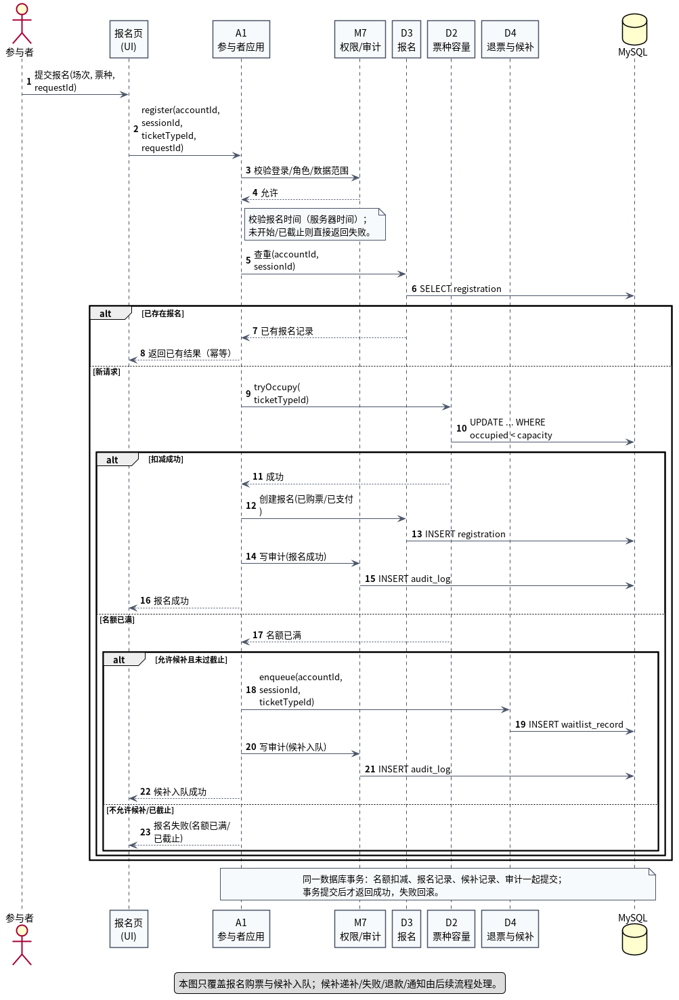

时序图展示一次报名请求中的对象协作：

- 参与者 → 报名页 → A1；
- A1 → M7 校验登录、角色、数据范围；
- A1 → D3 查重；已存在则返回首次结果；
- 新请求：A1 校验报名时间 → D2 原子扣减名额；
- 成功：D3 创建报名 → M7 写审计 → 事务提交 → 返回成功；
- 满员：判断允许候补且未过截止；是 → D4 入队 → M7 写审计 → 返回候补入队成功；否 → 返回失败。

时序图不是对活动图的简单重复，而是在活动图确定的业务流程上再加两个维度：**对象**和**时间**。活动图回答“流程怎么走、有哪些分支”，时序图回答“每一步由哪个对象执行、按什么顺序调用、事务边界在哪里”。图中参与者、报名页、A1、M7、D3、D2、D4、MySQL 是生命线，消息顺序为：权限校验 → 幂等查重 → 新请求校验报名时间 → `tryOccupy` 原子扣减 → 创建报名或候补入队 → 写审计 → 事务提交 → 返回结果。

这里有两个关键设计点。第一，**幂等查重放在扣减名额之前**：重复请求直接返回首次结果，不重复占用名额；**报名时间校验放在 `tryOccupy` 之前**：已截止的请求不应进入扣减，避免无效请求占用名额后再回滚。第二，**事务边界覆盖“扣名额、建报名/入队、写审计”三步**：三者要么一起成功，要么一起回滚；只有事务提交后才返回成功，保证 REQ-046 的“提交后崩溃不丢、未提交视为未发生”。图中用 `alt` 表示“已存在/新请求”“扣减成功/名额已满”“允许候补/不允许候补”三组分叉，用 note 标出事务边界。

为减少生命线数量，时序图省略了 S2，直接画 MySQL；D2/D3/D4/M7 实际都通过 S2 的仓储/事务接口访问数据库，这一点在正文中说明，不影响调用顺序的理解。时序图初稿曾把“校验报名时间”放在查重之前，与活动图顺序不一致；人工复核时发现了这个问题并调整到新请求分支、`tryOccupy` 之前，使两张图对同一流程的表达保持一致。这也是“AI 负责起草、人负责一致性和边界”的一个具体例子。

### 3.6 状态图

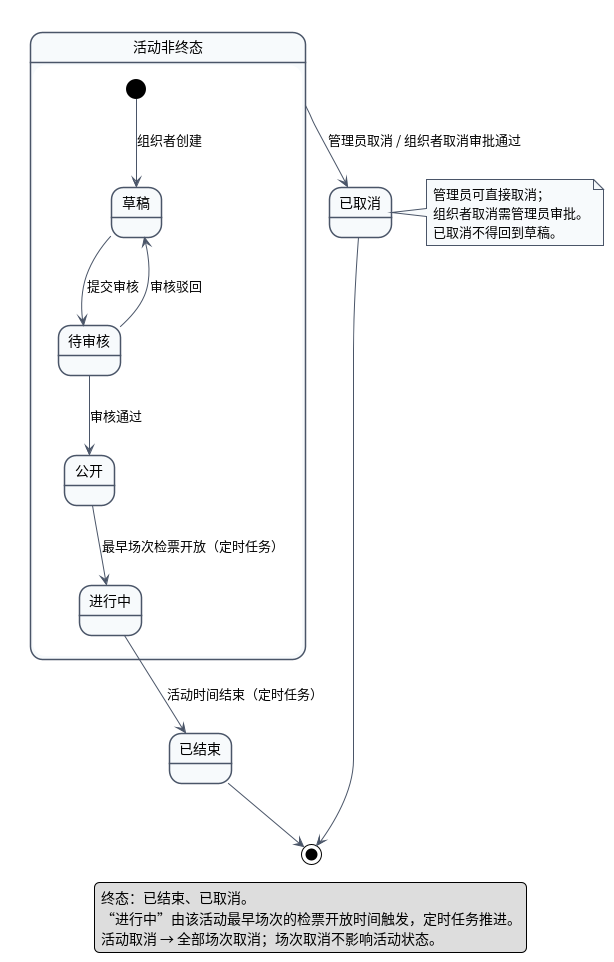

活动状态：草稿 → 待审核 → 公开 → 进行中 → 已结束；非终态可进入已取消。进行中由最早场次的检票开放时间触发；管理员可直接取消，组织者取消需审批；活动取消 → 全部场次取消。

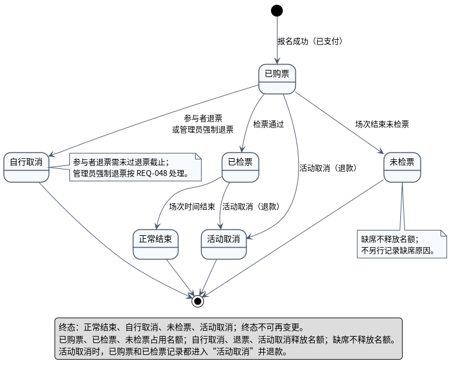

报名记录状态：已购票 → 已检票 → 正常结束；已购票 → 自行取消/未检票/活动取消；已检票 → 活动取消。终态包括正常结束、自行取消、未检票、活动取消，终态不可再变；已购票、已检票、未检票占用名额，自行取消、退票、活动取消释放名额。

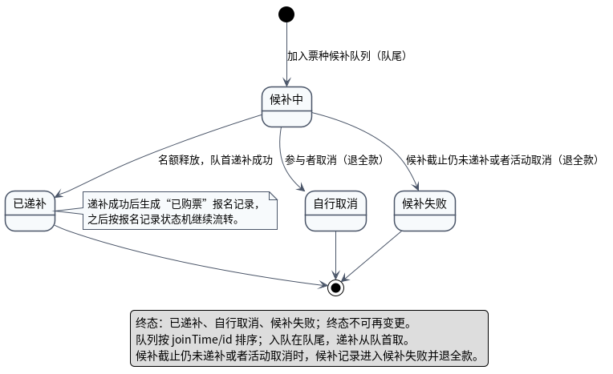

候补记录状态：候补中 → 已递补/自行取消/候补失败。递补成功后生成“已购票”报名记录，之后按报名记录状态机继续；队列按 `joinTime/id` 排序，入队尾、递补队首。

状态图针对三个核心业务对象：**活动、报名记录、候补记录**。这三者是整个系统里生命周期最长、状态转换最多的对象，其他对象（举报、通知、审计）要么状态简单，要么只追加不改，不需要单独画状态图。状态集合和转换规则全部来自实验一 REQ-021～REQ-023：活动是“草稿 → 待审核 → 公开 → 进行中 → 已结束”，非终态可取消；报名记录以“已购票”为中心，可转已检票、自行取消、未检票、活动取消；候补记录以“候补中”为中心，可转已递补、自行取消、候补失败。

状态图的设计重点有三条。第一，**终态不可再变**：正常结束、自行取消、未检票、活动取消都是终态，进入后不允许再转换，非法转换由领域层状态机直接拒绝（对应设计基线 ADR-05）。第二，**状态与名额联动**：已购票、已检票、未检票占用名额；自行取消、退票、活动取消释放名额；缺席（未检票）不释放名额，避免把“没来”误当成“名额空出”。第三，**时间推动与人工操作分开**：活动“进行中”由最早场次的检票开放时间触发，场次结束后的未检票终态也由定时任务推进；管理员取消、参与者退票、候补递补则是显式操作。需求在这一块写得比较明确，AI 生成的状态集合和转移基本正确，人工主要做布局简化和边界核对：活动图用复合状态“活动非终态”收敛四条取消箭头，报名图改横向布局，候补图保持简单。

---

## 4. UI 设计

### 4.1 设计目标与设计系统

UI 设计使用 Figma 网页版，画布 1440×900。9 个界面覆盖实验一的 8 个业务模块，并通过角色导航、权限入口和状态反馈体现四类角色差异。

设计系统：

- 主色 `#2563EB`，浅蓝底 `#EFF6FF`；成功/余票 `#059669`；警告/候补 `#B45309`；危险/售罄 `#DC2626`；背景 `#F8FAFC`，卡片 `#FFFFFF`；
- 中文使用 Noto Sans CJK SC / Microsoft YaHei；标题 22–32，正文 13–14，辅助 11–12；
- 8px 网格；卡片圆角 14–16，输入框/按钮 10–12；
- 组件：按钮、输入框、下拉、标签、状态徽章、活动卡片、票种行、表格、步骤条、提示条。

| 编号 | 界面 | 角色 | 覆盖模块 |
|---|---|---|---|
| UI-01 | 登录/注册 | 全部 | 账号 |
| UI-02 | 活动浏览与详情 | 参与者 | 活动/场次、票种/容量、查询 |
| UI-03 | 报名购票与候补 | 参与者 | 报名、退票/候补 |
| UI-04 | 我的票与退票 | 参与者 | 报名、退票、候补 |
| UI-05 | 组织者活动管理 | 组织者 | 活动/场次、票种、审核 |
| UI-06 | 组织者名单与统计 | 组织者 | 查询统计 |
| UI-07 | 管理员审核与处置 | 管理员 | 管理员处置、活动 |
| UI-08 | 检票员工作台 | 检票员 | 检票 |
| UI-09 | 审计日志与权限 | 管理员 | 留痕与权限 |

UI 的设计原则是**简单、清晰、可用**：每个界面只承担一个角色的一项或一组任务，信息层级和操作路径尽量短，不使用与业务无关的装饰。这样做的目的不是“省事”，而是让不同角色一眼能看出自己能做什么、不能做什么，让状态、权限和异常提示优先于视觉效果。

### 4.2 登录/注册

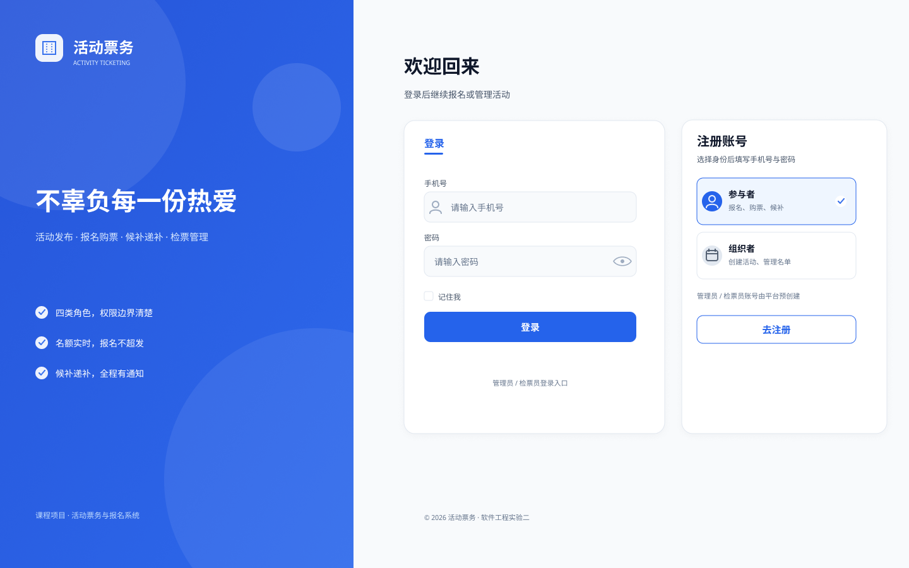

- 相关模块：账号（D6）、A0 认证入口。
- 登录：手机号 + 密码；一个手机号只对应一个身份，不选择登录身份；不提供找回密码。
- 注册：右侧注册卡选择参与者/组织者；管理员、检票员账号由平台预创建，不开放自助注册。
- 底部提供管理员/检票员登录入口。

**功能说明**：本界面承担注册、登录和角色入口三项功能。参与者与组织者可在右侧注册卡选择身份完成注册；管理员和检票员账号由平台预创建，不开放自助注册。根据 REQ-002/047，一个手机号只对应一个账号、一个身份，因此登录只需手机号与密码，不再选择登录身份；页面底部为管理员、检票员提供单独登录入口。把注册与登录放在同一页，可以减少角色切换成本，同时用“平台预创建”的提示区分两类账号来源。

### 4.3 活动浏览与详情

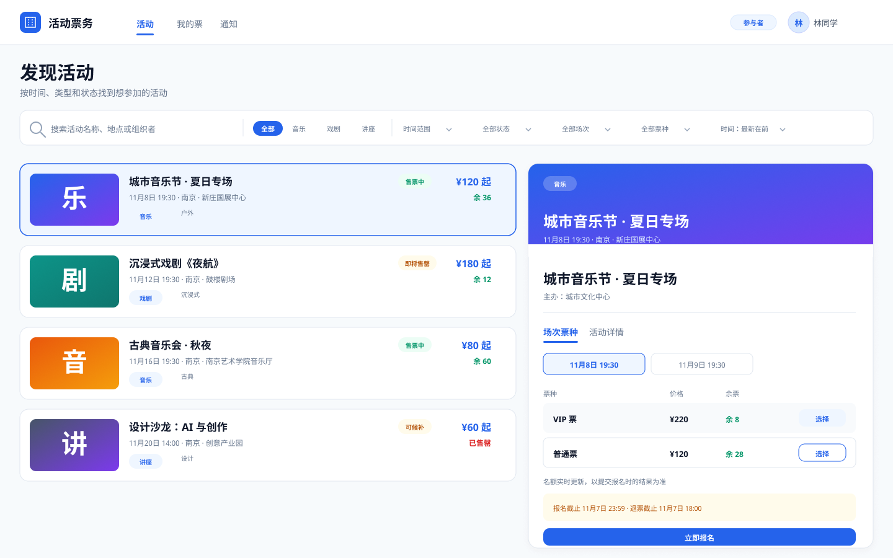

- 相关模块：活动/场次（D1）、票种/容量（D2）、查询（Q1）。
- 筛选：关键词、分类快捷（全部/音乐/戏剧/讲座）、时间范围、活动状态、场次、票种；排序为时间最新在前。
- 活动卡片展示时间、地点、票价、余票、状态；右侧展示场次、票种、余票、报名/退票截止。
- 售罄活动显示“可候补”；本页覆盖 REQ-029 的组合查询条件。

**功能说明**：参与者可按关键词、分类（音乐/戏剧/讲座）、时间范围、活动状态、场次、票种进行组合查询，结果按时间最新在前排序，对应 REQ-029。选中活动后，右侧展示场次、票种、余票、报名/退票截止等信息；点击报名进入 UI-03 的购票与候补流程。活动卡片同时给出时间、地点、票价、余票和状态，售罄活动显示“可候补”，让用户在进入详情前就能判断可购路径。

### 4.4 报名购票与候补

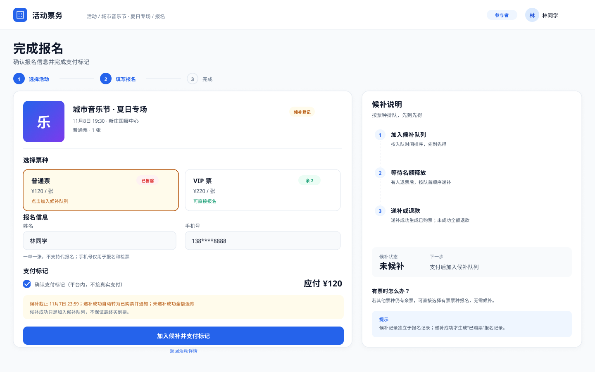

- 相关模块：报名（D3）、退票与候补（D4）。
- 普通票售罄时展示候补登记；VIP 票有余票时可直接报名，展示两种路径。
- 报名信息：姓名、手机号；一单一张、不支持代报名。
- 支付标记为平台内标记，不接真实支付；候补截止、递补规则、未成功全额退款。
- 当前页面未提交，状态为“未候补 / 支付后加入候补队列”；支付成功后才变为“候补中”。

**功能说明**：选择场次后，用户选择票种并填写本人姓名和手机号（不支持代报名，一次订单一张票，对应 REQ-012/027）。有余票时直接报名并标记“已支付”；票种售罄时进入候补路径，右侧展示候补截止、递补规则和“未成功全额退款”等说明。当前页面在提交前状态为“未候补”，支付成功后进入“候补中”，避免把未提交误显示为已排队（REQ-019/023）。

### 4.5 我的票与退票

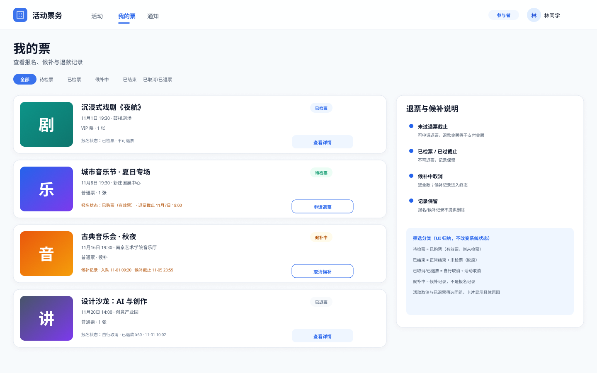

- 相关模块：报名（D3）、退票与候补（D4）。
- 筛选：全部/待检票/已检票/候补中/已结束/已取消/已退票。
- 待检票 = 已购票（有效票，尚未检票）；已结束 = 正常结束 + 未检票；已取消/已退票 = 自行取消 + 活动取消；候补中属于候补记录，不是报名记录。
- 未过退票截止可申请退票；已检票/已过截止不可退；候补中可取消候补并退全款；记录不提供删除。

**功能说明**：本界面是参与者的“票夹”，汇总该账号的报名、候补与退款记录。如果直接把系统的六种报名状态和四种候补状态暴露给用户，筛选会过于细碎、难以理解，因此按用户视角归纳为“全部/待检票/已检票/候补中/已结束/已取消/已退票”：待检票对应已购票，已结束对应正常结束 + 未检票，已取消/已退票对应自行取消 + 活动取消，候补中单独对应候补记录。该归纳只改变展示，不改变系统状态（REQ-022/023/025）。未过退票截止可申请退票，已检票或已过截止不可退；候补中可取消并退全款；记录不提供删除（REQ-004/013/035）。

### 4.6 组织者活动管理

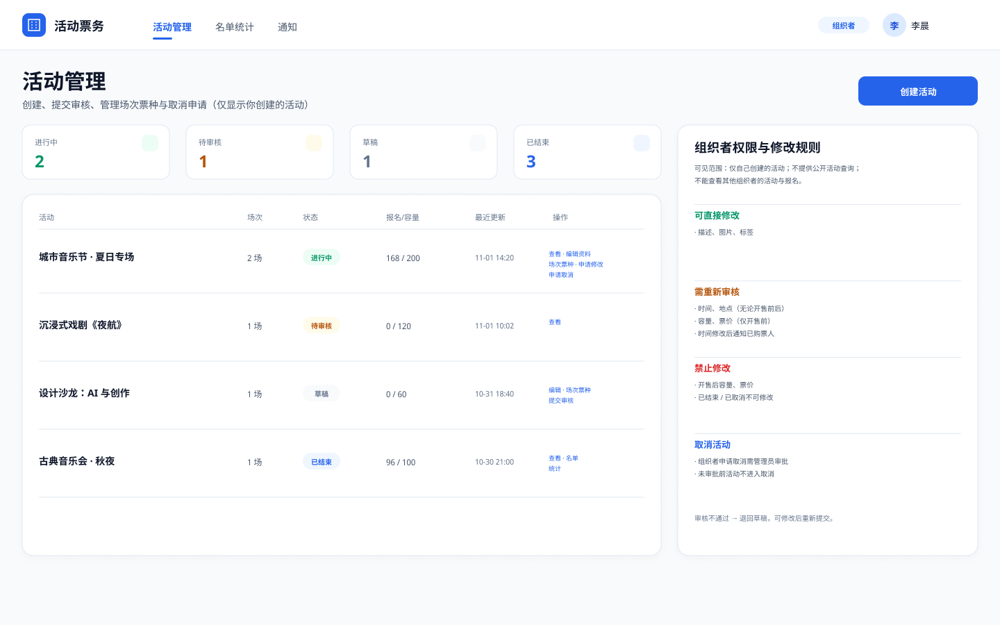

- 相关模块：活动/场次（D1）、票种/容量（D2）、审核。
- 只显示自己创建的活动；不提供公开活动查询，不查看其他组织者数据。
- 操作按状态区分：进行中“查看/编辑资料/场次票种/申请修改/申请取消”；待审核“查看”；草稿“编辑/场次票种/提交审核”；已结束“查看/名单/统计”。
- 右侧权限：描述/图片/标签直接改；时间/地点重新审核；容量/票价开售前可改需审核、开售后禁止；时间修改通知购票人；组织者取消需审批；审核不通过退回草稿。

**功能说明**：本界面集中组织者对自己活动的管理能力：只显示本人创建的活动，不提供公开活动查询，也不显示其他组织者的活动与报名（REQ-002/029）。操作按活动状态区分：进行中可查看、编辑资料、管理场次票种、申请修改、申请取消；待审核只能查看；草稿可编辑、管理场次票种、提交审核；已结束可查看、名单、统计。右侧“权限与修改规则”把 REQ-006～011/028 的字段级限制直接展示出来：描述/图片/标签可直接修改；时间/地点须重新审核；容量/票价开售前可改需审核、开售后禁止；时间修改通知购票人；组织者取消需管理员审批；审核不通过退回草稿。

### 4.7 组织者名单与统计

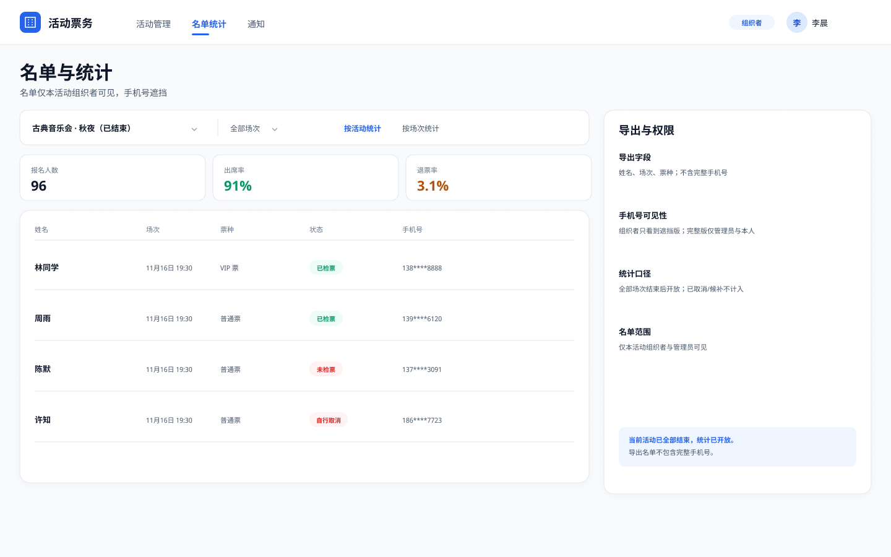

- 相关模块：查询与统计（Q1）。
- 统计：报名人数、出席率、退票率；报名名单由下方表格承载；按活动/按场次切换。
- 统计在全部场次结束后开放；已取消/候补不计入。
- 名单手机号遮挡；导出字段为姓名、场次、票种，不含完整手机号；名单仅本活动组织者与管理员可见。

**功能说明**：本界面用于查看本活动的报名名单和统计。统计卡展示报名人数、出席率、退票率，并支持按活动/按场次切换；报名名单由下方表格承载。统计在全部场次结束后开放，已取消和仍在候补的记录不计入（REQ-030）。名单中手机号按角色遮挡，导出字段仅为姓名、场次、票种，不含完整手机号；名单仅本活动组织者与管理员可见（REQ-003/031/045）。

### 4.8 管理员审核与处置

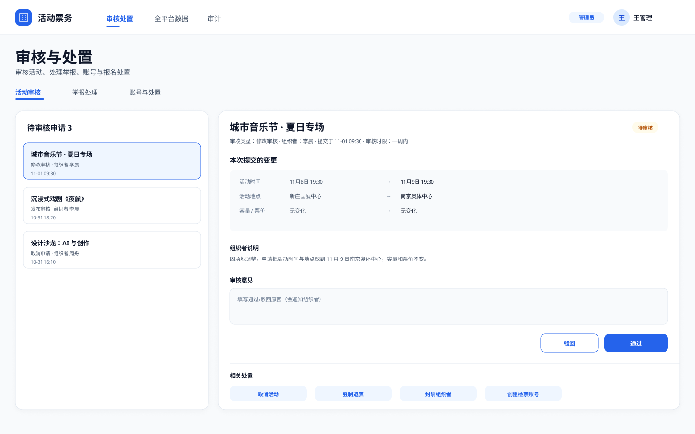

- 相关模块：管理员处置（A4）、活动/场次（D1）、账号（D6）。
- 三个 Tab：活动审核 / 举报处理 / 账号与处置。
- 待审核申请标出类型：发布审核、修改审核、取消申请；当前示例为“修改审核”，右侧展示时间/地点/容量票价的前后对比，类型一致。
- 审核意见 + 通过/驳回；底部“相关处置”为取消活动、强制退票、封禁组织者、创建检票账号；举报处理在独立 Tab。

**功能说明**：本界面是管理员的审核与处置入口，顶部三个 Tab 分别承担活动审核、举报处理、账号与处置。活动审核展示待审核申请及其类型（发布审核/修改审核/取消申请），选中后可查看申请内容与前后对比，并填写审核意见、通过或驳回；底部“相关处置”提供取消活动、强制退票、封禁组织者、创建检票账号四类与当前活动/组织者相关的操作；举报处理独立成 Tab，避免与活动审核混淆（REQ-009/010/011/018/047/048）。

### 4.9 检票员工作台

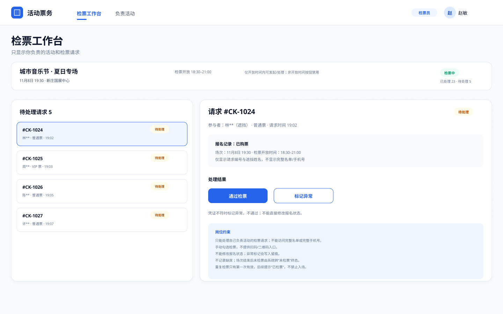

- 相关模块：检票（D5）。
- 只显示负责的活动和检票请求；非开放时间不能发起/处理。
- 请求列表使用请求编号和遮挡姓名；不访问完整名单、不查看完整手机号。
- 通过检票 / 标记异常；不能直接修改报名状态；异常标记写入留痕；不记录缺席；重复检票只有第一次有效，后续提示“已检票”，不禁止入场。

**功能说明**：检票员只能看到自己负责的活动和检票请求，非检票开放时间不能发起或处理请求；请求列表使用请求编号和遮挡姓名，不能访问完整名单和完整手机号（REQ-003/014/045）。处理时只能通过检票或标记异常，不能直接修改报名状态；异常标记写入留痕；检票员不记录缺席，缺席由系统在场次结束后转为未检票终态；重复检票只有第一次有效，后续提示“已检票”，不禁止入场（REQ-014～017/036）。

### 4.10 审计日志与权限

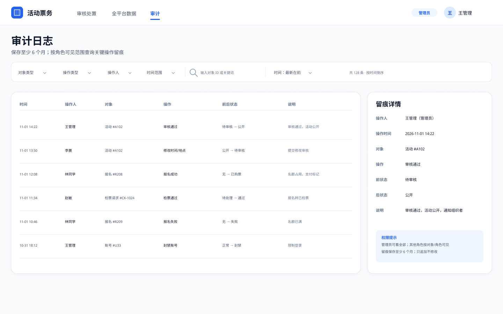

- 相关模块：留痕与权限（M7）。
- 筛选：对象类型、操作类型、操作人、时间范围、对象 ID/关键词；排序时间最新在前。
- 表格：时间、操作人、对象、操作、前后状态、说明；覆盖活动审核/修改、报名成功、报名失败（名额已满）、检票通过、账号封禁等。
- 右侧详情：操作人/时间/对象/操作/前后状态/说明。
- 留痕保存至少 6 个月、只追加不修改；管理员看全部，其他角色按对象/角色可见；通知本身不留痕。

**功能说明**：本界面是独立的审计与权限功能，按对象类型、操作类型、操作人、时间范围、对象 ID/关键词筛选，按时间最新在前排序；表格展示时间、操作人、对象、操作、前后状态和说明，覆盖活动审核/修改、报名成功、报名失败（名额已满）、检票通过、账号封禁等关键操作（REQ-039/040）。右侧详情复现单条留痕的完整字段。留痕只追加、不修改，保存至少 6 个月；管理员可看全部，其他角色按对象/角色范围可见；通知本身不留痕（REQ-028/041）。

### 4.11 UI 设计说明

UI 图由 Figma 导出，最终交付图在 `UI界面/`，SVG 源稿和生成脚本在 `UI/`。图中的活动名称、时间、票价、余票、人数、候补人数、统计数值及日志条数均为**演示数据**，仅用于展示界面结构和状态，不代表真实业务数据；不同界面之间的示例数据不要求完全一致。系统规则以设计基线和实验一需求为准。

---

## 5. AI 辅助设计

### 5.1 使用原则与工作流

本实验使用大模型辅助软件设计，但大模型只作为辅助。工作流是：

1. 人先确定设计目标和约束（模块边界、角色权限、关键规则）；
2. AI 生成初稿或备选方案；
3. 人对照实验一需求逐条审查，记录修改原因；
4. 人对边界问题、架构问题和模型结构做出判断，必要时直接重构；
5. AI 按人的意见修改，或人直接修改；
6. 用脚本/清单做一致性检查；
7. 人签字确认，Git 保留 AI 初稿和人工修改的 diff。

第 4 步是这套工作流的核心：AI 可以给出候选结构，但“哪些模块该合并/拆分、哪个概念该不该单独建类、权限边界放在哪里”必须由人判断。没有这一步，后面的修改就只是润色，而不是设计。

### 5.2 AI 使用记录

完整逐次记录共 42 条，保存在 `杂物/AI使用记录_完整过程.md`；报告用整理版在 `AI使用记录.md`。每条都按“使用场景、输入提示词要点、AI 生成结果、优点/问题、人工修改优化后的结果、对应 Git 提交”记录，时间顺序保留，能看出每一次 AI 初稿和人工修改的差异。受报告篇幅限制，本节先给总览，再从中选 7 组**人工介入最多、对设计走向影响最大**的过程详细展开；42 条的逐次索引见附录 C。选择标准不是“AI 生成了多少”，而是“人在哪里做了判断、为什么改、改完对设计产生了什么影响”。

| 编号 | 使用场景 | AI 初版/输出 | 人工介入 | 主要 Git 提交 |
|---|---|---|---|---|
| 1 | 设计基线与模块划分 | 8 业务 + 3 支撑；审计单列；三个政策点靠猜 | 审计归入 M7；确认检票账号预创建、候补可重入、进行中按最早场次检票开放触发 | `a636950`、`4e8a1ae` |
| 2 | 组件图 | M8 上帝模块；M7 与 S1/S2 混放；连线过密 | 按角色拆 A0～A4；M7 单列；S1/S2 只连共享能力；入口连线汇聚；拆总体/领域两张 | `b6b3ca1`、`4b83e97`、`167b1c2`、`6a6b3e1`、`f4bd797`、`2ffed7c`、`ba64ce1` |
| 3 | 类图与候补模型 | 多 package、组织者操作不全、`WaitlistEntry` 混淆队列/记录 | 角色成列；补组织者方法；`Waitlist` 1-1 票种、`WaitlistRecord` 1-*、`WaitlistRecord 1—0..1 Registration`；报名关联 `Session` | `f2a887b`、`9081550`、`c29e2f4`、`497201d`、`8ca8c8f`、`a9afaec` |
| 4 | 用例图 | 单图 4 角色 20+ 用例过长；扩展方向易混 | 拆两张；按课程定义确认 `候补 → 报名购票`；删注释 | `a3772bc`、`2e31428` |
| 5 | 活动图 | 5 泳道打结；“候补成功”易误解 | 单列 + 模块前缀；改“候补入队成功”；补范围说明 | `bceee1b`、`987974d` |
| 6 | 时序图/状态图 | 时间校验顺序与活动图不一致；状态图取消箭头重复 | 时间校验移到新请求分支；活动图复合状态；报名图横向 | `bce2ffc`、`95b5fc7`、`2dc47d6`、`5f8541b` |
| 7 | UI 三屏 | 登录身份选择、我的票状态、候补预提交状态有误 | 按 REQ-002/047 删身份选择；我的票用户视角分类；未候补 | `95e7d2b`、`f35e2c3`、`1545370`、`290d116`、`6fa9da0`、`3e7357b`、`7d13740` |
| 8 | UI 其余六屏 | 组织者权限、名单统计、管理员审核、检票约束、审计筛选不完整 | 按 REQ 逐项补齐；接收 Figma 导出；示例数据说明 | `3d2c5d8`、`6f45a10`、`fce1b84`、`55c826c`、`454cba2`、`eb0bdcf`、`731c7db`、`aaa8846` |

#### 记录 1：从设计基线到“角色入口 + 共享能力”

- **使用场景**：根据实验一 49 条需求生成实验二设计基线，覆盖项目范围、业务模块、架构风格、设计决策和待确认问题。
- **输入**：实验一 `requirements.md` 作为唯一需求输入；提示词要求覆盖 8 个业务模块，给出模块职责、依赖、架构风格和关键设计决策，不得修改实验一文件。
- **AI 生成结果**：`00_设计基线.md` v0.1，包含四类角色、8 个业务模块、3 个支撑组件、分层模块化单体、12 条 ADR、数据对象初稿、状态机摘要和 UI 范围。
- **优点/问题**：覆盖完整，能作为后续 UML/UI 的统一基线；D3/D4 的循环依赖给出了“事件驱动递补”的解法。但初稿把审计单列为支撑组件，与实验一“留痕与权限”重复；检票人员账号、候补重入、活动“进行中”触发三个政策点实验一没有写死，AI 只能给假设。
- **人工修改优化后的结果**：审计归入 M7，支撑组件由 3 个收敛为 2 个；确认检票人员账号由管理员预创建、候补取消后可在截止前重新入队、活动“进行中”由最早场次检票开放时间触发。后续又进一步把模块模型调整为 A0～A4 角色入口 + D1～D6 共享写能力 + Q1 只读查询 + M7 业务约束 + S1/S2 技术支撑。
- **Git**：`a636950`（AI 初稿）、`4e8a1ae`（人工确认）、`167b1c2`（角色/共享能力重构）。

#### 记录 2：组件图从“上帝模块”到“入口 + 共享能力”

- **使用场景**：把设计基线画成组件图，表达模块组成、角色入口、共享能力和支撑组件的关系。
- **输入**：模块表、依赖方向、D3/D4 事件解耦要求；提示词要求标出同步调用、只读查询和横切依赖。
- **AI 生成结果**：第一版组件图覆盖 8 个业务模块 + 2 个支撑组件，但 M8 把账号、封禁、举报、强制退票、全平台数据混在一起，所有角色都连 M8；M7 和 S1/S2 被放进“横切与支撑”，正交连线和横切依赖过密。
- **优点/问题**：覆盖完整，能看出表现层不直接访问数据库、查询只读、D3/D4 事件解耦；但 M8 是上帝模块，角色入口和共享能力没有分开，M7 的约束语义丢失，图主线不清，无法表达角色之间的权限差异。
- **人工修改优化后的结果**：确认“按角色拆入口、按业务对象提取共享能力”的方向；组件图从一张过密的图拆成“总体组件图 + 领域依赖图”两张；S1/S2 改为只连共享能力，通知改为“共享能力写 Outbox、S1 消费”；A0～A4 的十条连线通过“入口接入点”汇聚；领域依赖图先因“组件图只表达封装”被移除，后因“需要讲清共享能力内部关系”恢复。最终模型为 A0～A4 + D1～D6 + Q1 + M7 + S1/S2。
- **Git**：`b6b3ca1`（AI 初稿）、`4b83e97`（图例修正）、`167b1c2`（角色/共享能力重构）、`6a6b3e1`（支撑连接调整）、`f4bd797`（入口汇聚）、`2ffed7c`（移除领域依赖图）、`ba64ce1`（恢复领域依赖图）。

#### 记录 3：类图与 Waitlist 模型

- **使用场景**：生成账号、活动、场次、票种、报名、候补、检票、审核、治理的类图。
- **输入**：设计基线、REQ-021～REQ-026、REQ-039～REQ-041、REQ-049；要求标出多重性，退款命令区分参与者/管理员/活动取消。
- **AI 生成结果**：第一版多 package 类图，Account 继承线和跨包关联交叉；Organizer 只写“创建活动”；候补用 `WaitlistEntry` 表达，队列和记录混在一起；票种与候补队列没有 1-1 关系。
- **优点/问题**：核心关系基本齐全，`WaitlistEntry 1—0..1 Registration`、`Registration 1—* CheckRequest`、`Activity 1—* ReviewApplication` 与需求一致；但可读性差，组织者方法不全，候补模型反复。
- **人工修改优化后的结果**：四个角色排成一列；补组织者的修改/管理/场次票种/名单/统计方法，补管理员举报/创建检票账号/全平台数据方法；候补模型经过多轮调整，先加 `WaitlistQueue` 又撤销，最终确定为 `TicketType 1—1 Waitlist`（每个票种一条候补队列）、`Waitlist 1—* WaitlistRecord`（队列内多条记录）、`WaitlistRecord 1—0..1 Registration`；`Registration` 同时关联 `Session` 和 `TicketType`，保证“报名时校验票种属于该场次”。类图拆成核心业务类图 + 治理类图。
- **Git**：`f2a887b`（类图初稿）、`9081550`（人工修订）、`c29e2f4`（候补队列回归记录集合）、`497201d`（FIFO 语义）、`8ca8c8f`（简化标签并补报名—场次关联）、`a9afaec`（`Waitlist` 队列模型）。

#### 记录 4：用例图与活动图

- **使用场景**：生成用例图和报名购票活动图。
- **输入**：四类角色、组织者取消审批、检票限制、报名/候补规则；课程用例图符号定义。
- **AI 生成结果**：第一版用例图把 4 个角色、20 多个用例放在一张图里，过长；活动图用 5 条泳道，分支跨泳道后连线打结。
- **优点/问题**：用例覆盖基本完整，候补扩展、组织者取消审批、检票限制都能看到；但单图过长，候补扩展方向容易和中文语序混淆；活动图难读，且“候补成功”容易被理解为已经买到票。
- **人工修改优化后的结果**：用例图拆成“参与者/组织者”和“检票员/管理员”两张；按课程定义确认 `候补 → 报名购票` 的 `<<extend>>` 方向，只删旁注；活动图改为单列 + 模块前缀，只画到候补入队，把“返回候补成功”改为“返回候补入队成功”，并补范围说明。
- **Git**：`a3772bc`、`2e31428`、`bceee1b`、`987974d`。

#### 记录 5：时序图与状态图

- **使用场景**：生成报名购票时序图，以及活动、报名记录、候补记录三张状态图。
- **输入**：报名流程、权限/幂等/扣名额/候补/审计/事务；REQ-021/022/023 的状态集合和转换规则。
- **AI 生成结果**：时序图包含已存在/新请求、扣减成功/满员、允许候补/不允许候补等分支；三张状态图覆盖主要状态，但活动图有四条取消箭头、报名图上下堆叠交叉。
- **优点/问题**：时序图分支完整，审计与事务位置清楚；状态图状态和规则正确。但时序图初稿把“校验报名时间”放在查重之前，与活动图顺序不一致；状态图取消路径重复、阅读成本高。
- **人工修改优化后的结果**：时序图把报名时间校验移到新请求分支、`tryOccupy` 之前；活动状态图用复合状态“活动非终态”收敛取消箭头，报名状态图改横向布局，候补图保持原样；报名状态图图例补上“已购票也占用名额”。
- **Git**：`bce2ffc`、`95b5fc7`、`2dc47d6`、`5f8541b`。

#### 记录 6：UI 三屏——AI 负责风格，人负责产品语义

- **使用场景**：先生成登录/注册、活动浏览与详情、报名购票与候补三屏 SVG 骨架，再导入 Figma 人工调整。
- **输入**：设计规范、9 屏清单、角色权限、售票/售罄/候补/支付标记规则。
- **AI 生成结果**：三屏 SVG，风格简洁、布局可看；但登录页加了“登录身份选择”，账号唯一键改成 `(手机号, 角色)`；我的票直接叫“已购票”；报名候补页在未提交时写“候补中”；页面上还有重复的注册入口和平台创建提示。
- **优点/问题**：AI 对页面风格、布局和简洁度把握较好，初稿能直接作为 Figma 骨架；但容易过于遵从需求文字，忽略产品面向用户的属性；会产生重复冗余；跨屏示例数据不一致。
- **人工修改优化后的结果**：按 REQ-002/047 删除登录身份选择和顶部注册 Tab，恢复“手机号 + 密码、一手机号一身份”；活动浏览页删除运动分类、补齐场次/票种筛选、排序改为“时间最新在前”；报名候补页删除无需求依据的“排队顺序公开”和虚构候补人数，补充“候补成功只是加入队列，不保证最终买到票”；未提交状态改为“未候补”，支付成功后才“候补中”；我的票按用户视角分为待检票/已检票/候补中/已结束/已取消/已退票，并修正示例日期。
- **Git**：`95e7d2b`、`f35e2c3`、`1545370`、`290d116`、`6fa9da0`、`3e7357b`、`7d13740`、`8880b99`、`e5b3696`。

#### 记录 7：其余六屏与整体复核

- **使用场景**：在三屏风格确认后生成其余六屏 SVG，并在 Figma 中人工调整、导出、逐张复核。
- **输入**：设计规范、9 屏清单、角色权限、REQ-029～REQ-031、REQ-039～REQ-041、REQ-048。
- **AI 生成结果**：我的票与退票、组织者活动管理、组织者名单与统计、管理员审核与处置、检票员工作台、审计日志与权限六屏 SVG；仍然是静态骨架，部分权限和状态约束不完整。
- **优点/问题**：六屏覆盖剩余角色和模块，手机号遮挡、检票员不看名单、统计结束条件、审计字段等约束都能在页面上体现；但组织者操作被笼统写成“编辑”，名单统计混入“候补递补”，管理员审核示例类型与右侧内容不一致，检票页缺少时间窗/异常留痕/缺席说明，审计页缺少对象 ID 和时间排序。
- **人工修改优化后的结果**：按 REQ-002/006～011/028～031 逐项核对组织者活动管理；按 REQ-030/031/003/045 核对名单与统计；按 REQ-009/010/011/018/047/048 核对管理员审核与处置；按 REQ-014～017/036/003/045 核对检票员工作台；按 REQ-039/040/041/028 核对审计日志；在 Figma 中完成 9 屏调整并导出 1440×900 PNG；最后逐张整体复核，确认需求层面无错误，跨图示例数据不一致的来源是早期原型和分批制图，新增“示例数据说明”，不重新导出。
- **Git**：`3d2c5d8`、`6f45a10`、`fce1b84`、`55c826c`、`454cba2`、`eb0bdcf`、`731c7db`、`aaa8846`。

> 以上 7 组只覆盖“对设计走向影响最大”的过程；完整 42 条记录（含每次布局迭代、被撤销的尝试和提交哈希）见 `杂物/AI使用记录_完整过程.md`，逐次索引见附录 C。

### 5.3 架构阶段复盘

| 轮次 | AI 初稿/输出 | 主要问题 | 人工判断/修正 | 最终结果 |
|---|---|---|---|---|
| 1 | 设计基线 v0.1：8 业务 + 3 支撑 | 审计重复、政策点靠猜 | 审计归入 M7；确认检票账号/候补重入/进行中三条政策 | 模型开始收敛 |
| 2 | 组件图 v1：M8 普通模块 | M8 上帝模块、M7 与支撑混放 | 按角色拆入口、M7 单列 | 重构方向确定 |
| 3 | 组件图 v2：A/D/Q 分层 | 共享能力变成大池子 | 区分共享数据/角色操作、Q1 只读 | A0～A4/D1～D6/Q1/M7/S1/S2 |
| 4 | 技术支持连接 | 连到角色入口、线多 | 只连共享能力；通知走 Outbox | 主线清楚 |
| 5 | 类图与 Waitlist | package 多、票种队列关系不清 | 角色成列、Waitlist + WaitlistRecord | 核心类图定稿 |

**观察**：前几张整体架构/模块/类图，AI 第一版准确率明显不够，主要靠人工提供项目约束、模块边界和取舍；越往后、需求越确定，活动图/状态图/时序图越接近“规则翻译”，AI 准确率明显提高。

### 5.4 思考与总结

#### 5.4.1 AI 在 UML/架构设计中的表现

**AI 擅长**：把已确定的需求/规则翻译成 PlantUML 语法和初稿；快速给出备选结构；检查命名、关系、需求编号一致性；整理文档和表格；在需求明确时生成活动图、状态图、时序图的准确率较高。

**AI 不擅长**：理解课程项目的真实约束和取舍；模块边界、角色入口、横切约束这些需要判断的地方第一版往往混乱；会把“共享”“入口”“队列”等概念混在一起；不能为设计决策负责；图是否好读、是否该拆图、是否该省略细节，判断不稳定。有时又过于死板，机械照抄需求文字，导致 UI 不符合用户使用习惯，或 UML 模型结构混乱；也会出现疏漏、与需求不一致，甚至自相矛盾或虚构。

**两类任务的差异**：架构/组件/类图第一版效果不理想，需要多轮讨论和人工纠正；活动/状态/时序图在需求、状态和分支确定后准确率较高，人工主要检查范围、顺序和边界表述。AI 更像“快速起草器 + 语法助手”，不是“架构决策者”；架构方向必须由人来定，AI 负责把方向落成图、代码和文字。

#### 5.4.2 AI 在 UI 设计中的表现

AI 对页面风格、布局和整体简洁度把握较好，初稿通常已经“能看”，三屏样例的整体效果不错。但页面细节仍需要人审查：

- **AI 容易过于遵从需求文字，忽略产品面向用户的属性**。例如“我的票”若直接沿用报名状态“已购票”，对用户并不直观；工程师需要在尊重需求的前提下，把筛选归纳为待检票/已检票/候补中/已结束/已取消/已退票，并说明状态映射。
- **AI 可能产生重复、冗余的功能块**。例如注册入口、平台创建提示、登录身份选择等，需要人去重、收敛，避免同一信息在页面上出现多次。
- **长工作流中，AI 会注意力散失**：忘记前面的约束，或虚构未要求的功能；跨屏示例数据不一致也是表现之一。需要工程师用检查清单和一致性检查兜底。
- **AI 可以给出较好的风格实现，但仍需人介入修改**。有时让 AI 重新检查自身也能发现一部分问题（例如时序图时间校验顺序、图例/说明不一致），但最终判断仍由人负责。
- **很多问题不是“一眼可见”**：登录身份模型要对照 REQ-002/047 才能发现，我的票状态要对照 REQ-022/023/025 才能发现，候补预提交状态要对照 REQ-019/023 才能发现。检查必须带需求依据，不能只看页面是否好看；这也是本次 9 屏几乎每一屏都经过人工逐条核对的原因。

#### 5.4.3 能否设计一套工作流，让人只做检查校对？

“让人只做检查校对”可以有两种理解：

1. **完全放手型**：AI 自己完成设计，人只在最后看一眼、签字。这是“人在马下”——表面上看人还在流程里，实际上是被工具带着走，既没有定义约束，也没有能力判断结果。
2. **人在回路型**：人先定义约束和验收标准，AI 起草，人做检查、判断和修改，AI 再按人的意见迭代。这是“人在马上”——人握着缰绳，决定方向和边界，AI 负责跑。

对课程设计来说，**完全放手型不可靠**；**人在回路型是可行的**。原因不是“AI 画得不好”，而是“检查本身也是设计工作”。

要判断一张类图的基数对不对，必须知道 REQ-024 的对象关系；要判断时序图的事务边界，必须知道哪些操作必须一起成功；要判断 UI 是否符合要求，必须同时理解角色权限和用户使用习惯。这些判断需要同等的专业理解，不能只看“图像不像”“页面好不好看”。

可以把工作拆成三类：

| 任务类型 | AI 生成 | 人只做检查是否可行 | 说明 |
|---|---|---|---|
| 格式、语法、编号、命名一致性 | 可以 | 基本可行 | 适合脚本/AI 自动检查 + 人抽检 |
| 需求已经写死的状态图/活动图 | 可以 | 有条件可行 | 需要提供状态集合、转换规则和禁止项 |
| 架构取舍、模块边界、权限/数据范围 | 可以给候选 | 不可行 | 检查需要判断“为什么这样分”，不是看对错 |
| UI 视觉风格、组件摆放 | 可以 | 部分可行 | 风格可检查，信息架构和用户语义要人判断 |
| 报告文字、表格整理 | 可以 | 有条件可行 | 必须核对事实、需求和图号，防止虚构 |

更具体的工作流可以是：

| 阶段 | AI 做什么 | 人做什么 | 产物/检查点 |
|---|---|---|---|
| 1. 定约束 | 提供候选模块/架构 | 确定项目范围、角色、模块边界、关键规则 | 设计基线 |
| 2. 出初稿 | 生成 UML/UI/报告初稿 | 不做最终签字，只判断方向 | AI 初稿 commit |
| 3. 需求对照 | 列出类/图/界面与 REQ 的映射 | 逐条核对覆盖、基数、状态、权限 | 审查记录 |
| 4. 修改 | 按人的意见改，或人直接改 | 做实质修改，记录原因 | 人工修改 commit |
| 5. 一致性检查 | 检查命名、编号、跨图关系、示例数据 | 抽查关键结论，确认没有“图与文不一致” | 检查清单 |
| 6. 签收 | 整理最终文档 | 对设计负责，确认可指导实验三 | 最终 commit |

因此，**“人只做检查校对”在低风险、规则明确、可自动验证的部分是可行的**：格式、语法、REQ 编号、状态枚举、基数、命名、文档排版。对于架构决策、模块边界、权限模型、UI 信息架构，人不能只做检查，必须做决策；否则“检查”会退化成“看一眼觉得差不多”。

我的结论是：可以把人从“全部手写”降到“决策 + 审查 + 签收”，但不能降到“只盖章”。AI 适合做“起草器”和“校对器”，不适合做“责任主体”。

#### 5.4.4 结论

这次实验里，AI 最大的价值不是“替我想出了架构”，而是**把起草和机械检查的成本降下来**：它能快速给出模块表、PlantUML 语法、备选结构、UI 骨架和报告初稿，让我把时间集中在“哪些模块该合并/拆分”“M7 到底是不是支撑组件”“Waitlist 和 WaitlistRecord 怎么分”“我的票对用户应该怎么分类”这些真正需要判断的地方。对于缺少设计经验的我来说，AI 降低了上手实现的门槛和代价；但决定项目完成度和最终高度的，仍然是人能不能定义清楚问题、做出取舍并对结果负责。

但 AI 的第一版在整体架构上并不理想：M8 变成上帝模块、M7 和 S1/S2 混放、类图 package 过密、候补队列和记录混用、UI 状态分类不符合用户习惯。这些都不是“改个措辞”能解决的，而是需要人重新做设计判断。后期活动图、状态图、时序图之所以准确率较高，是因为需求、状态和分支已经确定，AI 更多是在做“规则翻译”，而不是“架构决策”。

所以我的结论是：

> **AI 可以加速设计，但不能替代设计。**  
> 高质量的工作流是“人决策 + AI 起草 + 人审查 + 自动检查 + Git 留痕”，而不是“AI 全自动、人只签字”。  
> 人可以把精力从“写初稿”转移到“定边界、做取舍、查一致性、对结果负责”，这才是 AI 辅助软件设计的合理位置。

## 6. 总结与后续

本设计覆盖实验一的 8 个业务模块，完成 6 种 UML 图、9 个 UI 界面，并把 49 条需求映射到模块、类、图和界面。关键业务规则（不超发、报名幂等、状态合法、候补 FIFO、审计留痕、权限与数据范围）都有明确落点，可以作为实验三实现的蓝图。

设计仍有可继续细化的部分：数据库索引与详细字段、接口签名、UI 的空/加载/错误状态、性能测试方案等。实验三实现时，如果发现设计与实现冲突，应按最新实现更新设计并记录在 Git 中。

通过本实验，我更清楚地体会到：设计不是把图“画漂亮”，而是做决策并说明理由；AI 可以加速起草，但模块边界、权限控制和取舍必须由人负责。

---

## 附录 A 需求—设计追踪表

> 说明：REQ-042 已拒绝；其余 48 条为已确认需求。模块编号：A=应用入口，D=共享写能力，Q=只读查询，M7=留痕与权限，S=技术支撑。

| REQ | 需求（类型） | 模块/类 | UML 图 | UI | 验收要点 |
|---|---|---|---|---|---|
| REQ-001 | 系统边界与不实现范围（约束） | 全局 | 组件图 | UI-01/02/03 | 不实现真实支付/实名/闸机 |
| REQ-002 | 角色与权限划分（功能） | A0-A4/M7/D6 | 类图/组件图/用例图 | UI-01/07/08 | 四角色权限、越权拒绝 |
| REQ-003 | 活动与报名数据的可见性（约束） | M7/Q1/D6 | 类图/组件图/用例图 | UI-02/04/06/08 | 按角色数据范围与脱敏 |
| REQ-004 | 报名记录不可删除（约束） | D3 | 类图/状态图 | UI-04 | 报名记录不可删除 |
| REQ-005 | 支付以"已支付"标记实现（功能） | D3 | 类图/时序图 | UI-03 | 支付标记=已支付 |
| REQ-006 | 活动创建与必填信息（功能） | D1 | 类图/活动图 | UI-05 | 活动/场次/票种必填 |
| REQ-007 | 场次设定（功能） | D1 | 类图/状态图 | UI-05 | 场次字段与状态封闭 |
| REQ-008 | 票种设定（功能） | D2 | 类图 | UI-05 | 票种价格/容量 |
| REQ-009 | 活动提交审核与审核结果处理（功能） | D1/A4 | 类图/活动图 | UI-07 | 审核、驳回退回草稿 |
| REQ-010 | 活动发布后可修改范围（功能） | D1 | 类图/活动图 | UI-05 | 按字段/开售状态限制修改 |
| REQ-011 | 活动取消权限（功能） | D1/A4 | 类图/状态图 | UI-05/07 | 组织者取消需审批 |
| REQ-012 | 报名即购票与报名信息（功能） | D3 | 类图/时序图 | UI-03 | 报名即购票 |
| REQ-013 | 退票与退票截止（功能） | D4 | 类图/状态图 | UI-04 | 退票截止 |
| REQ-014 | 检票请求与检票处理（功能） | D5 | 类图/时序图 | UI-08 | 检票请求与通过 |
| REQ-015 | 检票方式（功能） | D5 | 类图 | UI-08 | 手动勾选，无二维码 |
| REQ-016 | 缺席处理（功能） | D5 | 状态图 | UI-08 | 缺席=未检票终态 |
| REQ-017 | 凭证不符处理（功能） | D5 | 类图/时序图 | UI-08 | 异常不通过并留痕 |
| REQ-018 | 管理员违规处置与举报处理（功能） | A4/D6/D1 | 类图/用例图 | UI-07 | 举报/封禁/全平台数据 |
| REQ-019 | 候补入队与排序（功能） | D4 | 类图/状态图 | UI-03/04 | 按票种 FIFO |
| REQ-020 | 自动递补（功能） | D4/D3 | 类图/时序图/状态图 | UI-03/04 | 自动递补 |
| REQ-021 | 活动状态机（功能） | D1 | 状态图 | UI-05/07 | 活动状态封闭、取消终态 |
| REQ-022 | 报名记录状态机（功能） | D3 | 状态图 | UI-04 | 报名状态封闭、终态不可变 |
| REQ-023 | 候补记录状态机（功能） | D4 | 状态图 | UI-04 | 候补状态封闭、退款 |
| REQ-024 | 对象关系（约束） | D1/D2/D3/D4 | 类图 | UI-02/03/04 | 对象基数：1—N/1—0..1 |
| REQ-025 | 报名记录字段（约束） | D3 | 类图 | UI-03/04 | 报名记录字段完整 |
| REQ-026 | 场次容量计算与名额占用（功能） | D2/D3 | 类图/时序图 | UI-02/03 | 容量求和、名额占用/释放 |
| REQ-027 | 报名次数与票数限制（功能） | D3 | 类图/活动图 | UI-03 | 同场次一次、一单一张 |
| REQ-028 | 活动变更通知与票价冻结（功能） | D1/S1 | 类图/时序图 | UI-05 | 开售后票价冻结、时间通知 |
| REQ-029 | 活动查询（功能） | Q1 | 组件图/用例图 | UI-02 | 组合查询、时间最新在前 |
| REQ-030 | 活动统计（功能） | Q1 | 类图/组件图 | UI-06 | 四项统计、结束条件 |
| REQ-031 | 名单导出（功能） | Q1 | 类图/组件图 | UI-06 | 姓名/场次/票种，无完整手机号 |
| REQ-032 | 名额并发控制（功能） | D2 | 类图/时序图 | UI-03 | 原子扣减、不超发 |
| REQ-033 | 报名请求幂等（功能） | D3 | 类图/时序图/活动图 | UI-03 | requestId 幂等 |
| REQ-034 | 报名截止判定（功能） | D3 | 活动图/时序图 | UI-03 | 服务器时间含截止 |
| REQ-035 | 超过退票截止不可取消（功能） | D4 | 状态图 | UI-04 | 超退票截止不可退 |
| REQ-036 | 重复检票处理（功能） | D5 | 类图/状态图 | UI-08 | 重复检票仅首次有效 |
| REQ-037 | 活动取消后全额退票退款（功能） | D1/D3/D4 | 状态图/活动图 | UI-04/07 | 活动取消全额退款 |
| REQ-038 | 人数不足不自动取消（功能） | D1 | 状态图 | UI-05 | 人数不足不自动取消 |
| REQ-039 | 审计留痕范围（功能） | M7 | 类图/组件图 | UI-09 | 留痕范围、失败原因 |
| REQ-040 | 留痕内容（约束） | M7 | 类图 | UI-09 | 操作人/时间/对象/操作/前后/说明 |
| REQ-041 | 留痕保存期与查询权限（约束） | M7 | 类图/组件图 | UI-09 | 保存6个月、按角色可见 |
| REQ-042 | 活动多组织者共管（功能） | D1 | 类图 | UI-05 | 已拒绝：不实现多组织者 |
| REQ-043 | 报名接口性能（非功能） | D2/D3/Q1 | 组件图/类图 | UI-02/03 | 1万/50并发/95% 1秒 |
| REQ-044 | 性能验收口径（非功能） | Q1 | 组件图 | — | 性能测试口径可复现 |
| REQ-045 | 口令存储与手机号可见性（非功能） | D6/M7 | 类图/组件图 | UI-01/04/06/08 | 口令哈希、手机号遮挡 |
| REQ-046 | 报名持久化与重复提交（非功能） | D3/S2 | 类图/时序图 | UI-03 | 事务提交后持久化 |
| REQ-047 | 账号注册与登录（功能） | D6/A0 | 类图/用例图 | UI-01 | 注册选身份、手机号+密码、无找回 |
| REQ-048 | 管理员修改报名状态（强制退票）（功能） | D4/A4 | 类图/状态图 | UI-07 | 强制退票/退款/通知/留痕 |
| REQ-049 | 候补记录字段（约束） | D4 | 类图 | UI-03/04 | 候补字段、递补生成报名 |

## 附录 B Git 记录

- 仓库：`https://github.com/Lewis-44-China/se-lab1-requirements`
- 分支：`lab2`
- 实验一最终标签：`lab1-final` = `7a1472f56b359e334448907bff4ba5bceff12a8d`（未移动）
- 实验一 AI 初稿标签：`lab1-ai-draft` = `81c1055dab46c18cd7408451cb12baaced22f727`（未移动）

关键提交：

| 提交 | 内容 |
|---|---|
| `a636950` | 设计基线 AI 初稿 |
| `4e8a1ae` | 人工确认设计基线 |
| `167b1c2` | 按角色入口/共享能力重构组件图 |
| `f2a887b` | 类图 AI 初稿 |
| `9081550` | 类图人工修订 |
| `a9afaec` | Waitlist 候补队列模型 |
| `a3772bc` | 用例图初稿 |
| `bceee1b` | 活动图初稿 |
| `bce2ffc` | 时序图初稿 |
| `2dc47d6` | 状态图初稿 |
| `95e7d2b` | UI 三屏样例 |
| `3d2c5d8` | 其余六屏 UI |
| `731c7db` | 接收 UI 最终导出 |
| `d10deb0` | 合并说明、整理目录 |
| `82ff8b5` | 添加报告框架大纲 |
| `27cae41` | 实验报告初稿 |
| `3146c8b` | 按用户修改重写 AI 章节 |
| `7b9b255` | 整合 AI 章节并扩写使用记录 |
| `e623d12` | 扩写 5.4.3/5.4.4 |
| `a514018` | 记录 5.4 扩写的提交哈希 |

验证实验一未被修改：

```bash
git diff lab1-final..lab2 -- requirements.md chat.txt
```

该命令应无输出；`lab2/工具/检查实验一未改动.sh` 也应通过。

> 本次报告正文修改的提交哈希，在定稿提交后补充。

## 附录 C AI 使用记录索引（42 条）

> 本表是 `杂物/AI使用记录_完整过程.md` 的逐次索引，按时间顺序列出每次 AI 使用的场景、人工修改要点和主要提交；每条完整记录还包含输入提示词、AI 原始输出、优缺点分析和修改后结果。

| 序号 | 使用场景 | 人工修改/判断要点 | 主要提交 |
|---|---|---|---|
| 1 | 设计基线与模块划分初稿 | 审计归入 M7；确认检票账号预创建、候补可重入、进行中触发 | `a636950`、`4e8a1ae` |
| 2 | 组件图初稿 | 指出 M8 上帝模块、M7 与支撑混放，未采用 | `b6b3ca1`、`4b83e97` |
| 3 | 按角色入口/共享能力重构组件图 | 确认 A0～A4 + D1～D6 + Q1 + M7 + S1/S2 | `167b1c2` |
| 4 | 组件图排版与支撑连接 | 修“检票员”；S1/S2 只连共享能力；通知改 Outbox | `6a6b3e1` |
| 5 | 入口连线汇聚 | 每个入口一根线，汇聚后分连共享能力/M7 | `f4bd797` |
| 6 | 移除领域依赖图 | 组件视图聚焦入口封装，内部依赖改文字表 | `2ffed7c` |
| 7 | 恢复领域依赖图 | 共享能力内部关系重要，恢复并合并说明 | `ba64ce1` |
| 8 | 类图初稿 | 多 package、继承线与关联交叉 | `f2a887b` |
| 9 | 类图人工审查 | 角色成列；补组织者/管理员/参与者方法 | `9081550` |
| 10 | 候补队列回归记录集合 | 撤销 WaitlistQueue，队列是票种下有序记录集合 | `c29e2f4` |
| 11 | 候补队列 FIFO 语义 | 入队尾、递补队首，按 joinTime/id 排序 | `497201d` |
| 12 | 简化队列标签并补报名—场次关联 | 删除“入口”；Registration 关联 Session | `8ca8c8f` |
| 13 | WaitlistEntry 改为 Waitlist | TicketType 1-1 Waitlist；Waitlist 1-* WaitlistRecord；Record 1-0..1 Registration | `a9afaec` |
| 14 | 用例图初稿 | 四角色 20+ 用例一张图过长 | `a3772bc` |
| 15 | 课程规则确认扩展方向 | 候补→报名购票；删除注释 | `2e31428` |
| 16 | 活动图初稿 | 5 泳道打结，改单列 + 模块前缀 | `bceee1b` |
| 17 | 活动图范围说明 | 改“候补入队成功”；只到入队 | `987974d` |
| 18 | 时序图初稿 | 含幂等/扣名额/满员/候补/审计/事务分支 | `bce2ffc` |
| 19 | 时序图一致性检查 | 时间校验移到新请求分支、tryOccupy 前 | `95b5fc7` |
| 20 | 状态图初稿 | 三张状态图；补“已购票占用名额” | `2dc47d6` |
| 21 | 状态图布局简化 | 活动图复合状态；报名图横向 | `5f8541b` |
| 22 | UI 三屏样例 | 风格可用，静态骨架 | `95e7d2b` |
| 23 | 登录页人工审查 | 曾加身份选择、删忘记密码、去重 | `f35e2c3` |
| 24 | 按需求修正登录身份模型 | 一手机号一身份，删身份选择与顶部 Tab | `1545370` |
| 25 | 活动浏览页修改 | 删除运动；补场次/票种筛选；时间最新在前 | `290d116` |
| 26 | 报名候补页修改 | 删除“排队顺序公开”；补“不保证买到票” | `6fa9da0` |
| 27 | 候补预提交状态 | “未候补”支付后“候补中” | `3e7357b` |
| 28 | 其余六屏初稿 | 六屏静态骨架 | `3d2c5d8` |
| 29 | 我的票状态与退票 | 区分候补中与有效票；一单一张移购票页 | `7d13740` |
| 30 | 我的票筛选分类 | 六类筛选；修正示例日期 | `8880b99` |
| 31 | 我的票间距/标题 | 筛选等距；删除重复说明 | `e5b3696` |
| 32 | 组织者活动管理 | 按状态拆操作；补权限与修改规则 | `6f45a10` |
| 33 | 组织者名单与统计 | 三项统计 + 名单表；导出字段/脱敏 | `fce1b84` |
| 34 | 管理员审核与处置 | 类型一致；举报独立；相关处置四项 | `55c826c` |
| 35 | 检票员工作台 | 时间窗/手动勾选/异常留痕/缺席/重复 | `454cba2` |
| 36 | 审计日志 | 筛选/排序/说明列/报名失败示例 | `eb0bdcf` |
| 37 | 接收 UI 最终导出 | 9 张 1440×900，规范命名 | `731c7db` |
| 38 | UI 九图整体复核 | 需求无错误；示例数据说明 | `aaa8846` |
| 39 | 报告初稿 | 6 章 + 附录；20 张图（组件图在第 2、3 章各引用一次）；49 行追踪表 | `27cae41` |
| 40 | 报告人工修改 | 联系方式；5.2 重写；UI AI 体验 | `3146c8b` |
| 41 | AI 章节整合 | 总览 + 详细记录；5.4 合并 | `7b9b255` |
| 42 | 5.4.3/5.4.4 扩写 | 工作流表、结论、项目例子 | `e623d12` |
