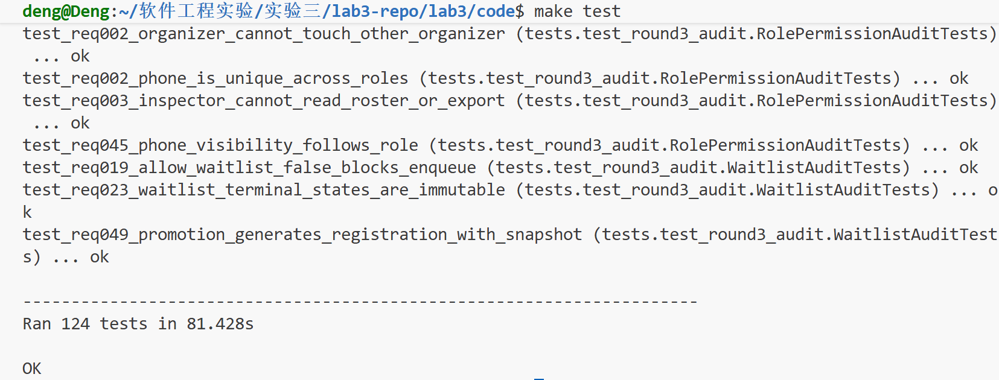
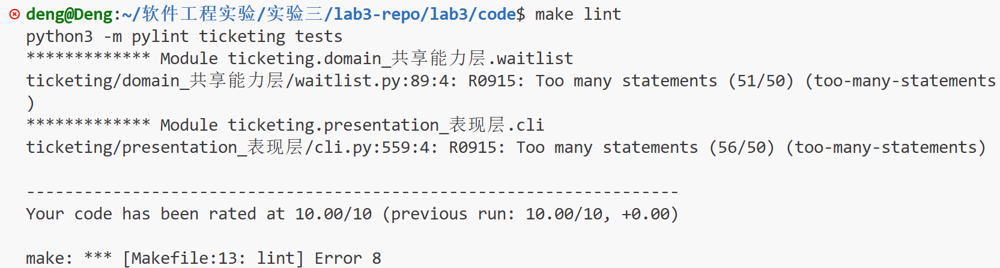

# 实验三报告

> **手册 3.1 要求核对**：
> - 根据 UML 图实现代码：如何转换、最终代码规模；
> - 如何使用大模型辅助：让它做了什么、不符合预期时怎么处理；
> - 代码的编译与运行结果；
> - Git 远程代码管理展示。


| 项目 | 内容 |
|---|---|
| 实验名称 | 实验三：软件实现与构建 |
| 学号/姓名 | 241220022  邓景文 |
| 项目主题 | 主题 5：活动票务与报名系统 |
| 设计输入 | 实验一 `requirements.md`、实验二 `00_设计基线.md`、UML图和UI设计 |
| 实现语言/存储/界面 | Python 3.10、SQLite、终端菜单 |
| 仓库与分支 | 沿用实验一/二仓库，工作分支 `lab3` | 

---

## 1. 代码目录与文件结构

目录按实验二组件图的 A/D/Q/M/S 思路分成五层，`container.py` 是唯一的组合根。
具体的业务逻辑和项目介绍见实验一和实验二的报告，这里就不再去重复了。

```text
code/
├── main.py                 # 程序入口，转调 CLI
├── schema.sql              # 14 张表、CHECK/UNIQUE、索引
├── Makefile                # run/test/lint/seed/clean
├── pylintrc                # pylint 配置
├── ticketing/
│   ├── container.py        # 组合根，装配所有服务
│   ├── presentation_表现层/
│   │   ├── cli.py          # 四角色终端菜单与操作入口
│   │   └── render.py       # 表格、提示、输入辅助
│   ├── application_应用层/
│   │   ├── admin.py        # 管理员审核/封禁/举报/分配
│   │   ├── promotion.py    # Outbox 递补消费
│   │   ├── scheduler.py    # tick 时间推进
│   │   └── seed.py         # 演示数据
│   ├── domain_共享能力层/
│   │   ├── models.py       # 枚举、dataclass、from_row、派生属性
│   │   ├── errors.py       # 业务异常
│   │   ├── auth.py         # 注册、登录、账号
│   │   ├── activities.py   # 活动/场次/票种/审核/状态推进
│   │   ├── tickets.py      # 票种查询、容量原子占用/释放
│   │   ├── registrations.py# 报名、幂等、名额扣减
│   │   ├── waitlist.py     # 候补 FIFO、取消、失败退款
│   │   ├── refunds.py      # 退票、强制退票、活动取消退款
│   │   ├── checkin.py      # 检票请求与处理
│   │   ├── queries.py      # 查询、名单、统计、审计范围
│   │   └── reports.py      # 举报提交与个人查询
│   ├── common_横切能力/
│   │   ├── permissions.py  # 角色、所有者、账号状态校验
│   │   ├── audit.py        # 审计写入
│   │   └── notifications.py# 站内通知
│   └── infrastructure_基础设施/
│       ├── db.py           # SQLite 连接、事务
│       ├── clock.py        # 业务时钟、时间解析
│       └── security.py     # 口令、手机号脱敏、金额换算
└── tests/
    ├── helpers.py          # 测试夹具、演示活动构造
    ├── test_core.py        # 认证、活动、报名、并发
    ├── test_lifecycle.py   # 候补、退票、检票、时间推进
    ├── test_queries.py     # 查询、名单、统计、审计范围
    ├── test_edge_cases.py  # 边界/联动/并发补充
    ├── test_presentation.py# CLI 入口回归
    └── test_round3_audit.py# 第三轮独立审计缺陷回归
```

各目录职责一句话概括：

| 目录/文件 | 职责 |
|---|---|
| `presentation_表现层` | 只收集输入、调用服务、展示结果，不直接写 SQL |
| `application_应用层` | 编排跨服务用例：审核、封禁、举报、递补、时间任务 |
| `domain_共享能力层` | 活动、票种、报名、候补、退款、检票、查询等业务能力 |
| `common_横切能力` | 权限、审计、通知三个横切关注点 |
| `infrastructure_基础设施` | SQLite、时钟、口令/脱敏/金额等底层工具 |
| `container.py` | 按依赖顺序装配所有服务，供 CLI/seed/测试复用 |

---

## 2. UML 到代码

### 2.1 从组件图到五层目录

我一开始没有直接让 AI 写代码，而是先和它把项目的“骨架”定下来。因为
我当时的想法是，如果一开始只给一个总目标，AI 生成的目录和文件可能会很庞大并且较为混乱，让人很难接手。

我和 AI 讨论后，延续实验二组件图的思路，把代码目录按层拆开：

```text
presentation_表现层
application_应用层
domain_共享能力层
common_横切能力
infrastructure_基础设施
container.py（组合根）
```

我当时的想法很朴素：目录先分清楚，每个文件负责什么也先约定好，这样后面
我读代码、改代码时至少知道该去哪个目录找。实际做完回头看，这个决定帮我省了
很多事；否则 30 个文件平铺在一个目录里，我可能连入口在哪都找不到。

然后最后分为的这六个部分，就是在我们实验二组件图的基础上和AI讨论之后得到的结果：

代码表现层对应的就是组件图中的表现层：面向用户的一些输入输出接口，调用的是下层的服务；

代码应用层对应的就是组件图中的应用层：编排各个角色类型对应的服务事务；

代码共享能力层对应的就是组件图中的共享能力层：提供给上层的共享的业务能力的实现；

代码横切能力层对应的就是组件图中的业务约束层：权限，审计，通知这三个穿插于各事务之间的能力点的实现；

代码基础设施层对应的就是组件图中的技术支撑层：对于底层数据库的交互接口，还有对于流程中时间的控制等等。


### 2.2 从类图到代码

这一块基本是照着类图直接实现的：先把图上的类对应成 `models.py` 里的枚举类型和 dataclass里的类属性，再给图上的操作补上对应的服务方法，类结构没有重新设计。代码基本上是对应的直接实现：类名、字段、方法名大多能直接对上，以下是几个有代表性的例子：

**Account。** 类图的 id、phone、passwordHash、name、status 都对上了；代码多了 `password_salt`（加盐哈希），`role` 按类图注释用 `account.role` 列存，没给四种子类单独建表。`isBanned()` 变成 `is_banned` 属性，`login()` 挪到 `AuthService.login()`，因为它要查库、验哈希、判断封禁，放实体里会把持久化逻辑塞进数据对象。

**Activity 和 Session。** 这是和类图差得比较明显的一处。类图里两者各有一个 time；实现里 Activity 不存 time，Session 的 time 拆成 `start_time` 和 `end_time`。原因是只有一个时间点判断不了“场次结束没有”，而报名终态和检票截止都要用到结束时刻。活动起止时间改由场次推导：开始取最早检票开放时间，结束取最晚 `end_time`，在 `refresh_statuses()` 里算。这个是我们代码实现过程中对于实验二的设计的修改。

**Registration。** 字段基本对上，多了 `request_id`（幂等）和 `refund_*`（退款对账）。方法没做成实体方法：退票在 `RefundService`，检票在 `CheckinService._pass()`，场次结束在 `Scheduler._finalize_sessions()`，活动取消在 `cancel_activity_conn()`。这些操作都要跨表、要事务、要写审计，放服务层更好管。

其余几个类思路一样：TicketType 的 `BigDecimal` 换成 `price_cents`（分），`try_occupy/release` 放进 `TicketService`；WaitlistRecord 不存 `registration_id`，靠 `(account_id, session_id)` 唯一约束隐式关联。整体看，类图字段基本都实现了，真正改的就三类：金额换成分、时间拆成起止、实体方法挪到服务层。

### 2.3 从活动图/时序图到代码

报名流程也是照着这两张图直接实现的，没有另外设计一套流程，图上的判断分支和事务边界都保留了。

活动图看分支，时序图看调用顺序，内容比较类似，以下结合在一起阐述。入口是 `cli.py` 的报名菜单，收场次、票种、requestId、姓名和手机号，然后调 `RegistrationService.register()`。`register()` 外面包了一层 try/except，失败时用 `record_standalone()` 写审计，对应活动图的“失败 → M7 留痕”。

真正的流程在 `_register_impl()`，和活动图的分支一一对应：

1. 校验：重新读账号，检查参与者角色和封禁状态，再校验购票人姓名、手机号（必须和账号一致，不支持代报名）。对应活动图的 A1/M7。
2. 幂等：先按 request_id 查，查到就直接返回已有结果；再按“账号+场次”查，已经报过名就拒绝。
3. 时间窗口：活动必须是 PUBLISHED/ONGOING，当前要在 sale_start 和 sale_end 之间，场次还没结束；不满足就抛截止异常，外层写失败审计。
4. 重复候补拦截：该账号在这个场次已经有“候补中”记录时，提示先取消候补再购买其他票种。
5. 查票种：票种不存在直接报错；`remaining <= 0` 抛 `CapacityFull`。
6. 事务内原子扣名额（D2 的 `try_occupy()`，SQL 是 `UPDATE ... WHERE occupied < capacity`）：
   - 成功：创建一条 PURCHASED、PAID、带金额快照的报名记录（D3），同一事务写审计（M7），提交后才返回成功；如果这个场次卖满了，顺手把场次状态置 FULL。
   - 失败：说明并发下名额被别的请求抢走了，抛 `CapacityFull`，事务回滚，外层 `register()` 写一条报名失败审计。
7. 并发兜底：唯一约束冲突（`IntegrityError`）时，先确认 request_id 属于当前账号，属于就按幂等返回，不属于就拒绝，避免把别人的记录当成自己的结果。

名额满以后走活动图右侧的候补分支，这部分在 CLI 和 `WaitlistService.enqueue()` 里：

- 报名服务把 `CapacityFull` 抛给 CLI，CLI 问用户是否加入候补，用户确认支付后才调 `enqueue()`。活动图是先判断“允许候补且未过截止”再让参与者选择；实现是把这些判断放在 `enqueue()` 里，用户先选、再校验，结果一样。
- `enqueue()` 依次校验：活动仍是 PUBLISHED/ONGOING、没到候补截止、没到售票截止、场次没结束、场次允许候补；再判断该账号在这个场次有没有报名、有没有“候补中”记录，有的话拒绝，对应活动图“该账号已有有效候补”的分支；最后再查一次票种，如果这时又有余票了，提示直接报名，不再入队。
- 校验通过后开事务：确保该票种的候补队列存在（`INSERT OR IGNORE`），在队尾插入一条 WAITING、PAID、带金额快照的候补记录（D4），同一事务写审计（M7），提交后返回候补编号。
- 候补失败（不允许候补、已截止、重复候补等）同样由外层写一条独立失败审计。

这样活动图上“扣减成功”“扣减失败 → 允许候补 → 是否已有有效候补”“不允许候补/已截止”几条分支，在代码里都有对应的入口。

对到时序图，A1/D2/D3/M7 在代码里是 `RegistrationService`（编排）、`TicketService`（容量）、SQL INSERT（报名）、`AuditService`（留痕），对象少了但调用顺序和事务边界没变。失败审计我们用的是独立事务，效果和活动图“回滚后另开事务写审计”一样。

### 2.4 从状态图到代码

状态图也是按图实现的：图上每个状态对应一个枚举值，每条转移对应一个服务方法，保证每条边都有代码入口。

三张状态图的状态枚举在 `models.py` 里原样实现了，转移动作分散在服务里。

- **活动**：`create_activity()` 写 DRAFT；`submit_for_review()` 进 PENDING_REVIEW；`approve_publish()`/`reject_publish()` 到 PUBLISHED 或退回 DRAFT；`refresh_statuses()` 按最早检票开放时间和最晚结束时间推进 ONGOING/ENDED；取消走 `cancel_activity_conn()`。终态保护用状态检查和条件 UPDATE。
- **报名记录**：报名写 PURCHASED；检票 `_pass()` 变 CHECKED_IN；退票和强制退票都变 SELF_CANCELLED 并释放名额；场次结束 `_finalize_sessions()` 把 PURCHASED 变 NO_SHOW、CHECKED_IN 变 NORMAL_END；活动取消变 ACTIVITY_CANCELLED 并退款。终态由 `is_terminal` 标出，缺席不释放名额。
- **候补记录**：入队 WAITING；`mark_promoted_conn()` 变 PROMOTED 并生成报名；取消变 SELF_CANCELLED；截止、活动取消、封禁三个入口都走 `mark_failed_conn()` 变 FAILED，退全款。

和图上不一致的只有触发方式：状态图写“定时任务”，实现里没有后台线程，是每次菜单循环前 `Scheduler.tick()` 依次推进活动/场次、候补过期、报名终态和 Outbox 递补。单进程下效果一样，多进程的时间窗按审查记录说明。

### 2.5 从用例图到代码

用例图是按角色实现的：每个 actor 对应一个菜单，每个用例对应一个服务入口，业务范围没有额外扩展。

四个 actor 对应 `account` 表的 `role` 列和 `models.Role`，没有拆四个子类。菜单在 `cli.py`，业务入口在各服务，权限统一走 `PermissionService`。

- **参与者**：菜单 8 项，覆盖浏览、报名、候补、退票、我的票、发起检票、举报，对应 `QueryService`、`RegistrationService`、`WaitlistService`、`RefundService`、`CheckinService`、`ReportService` 的入口。
- **组织者**：菜单 6 项，覆盖创建、修改、场次/票种、提交审核、申请取消、名单统计；修改活动按需求拆成“表面信息直接生效、地点/时间走审核、开售后票价容量禁止”三种。
- **检票员**：只看和处理分配给自己的活动（`activity_inspector` 表），处理结果是 PASSED/ABNORMAL，报名状态由 `_pass()` 连带改。
- **管理员**：审核、举报、封禁、强制退票、紧急取消、平台数据、审计、创建检票员、分配活动都有入口；“查看全平台数据”拆成了平台概览、报名查询、审计查询三项。

权限不只靠菜单隐藏，服务层每个入口都会再校验角色、数据所有者、检票员分配和封禁状态。这是第三轮审查专门补的一层，比如封禁组织者还能调服务接口的问题就是那时候修复的，这个还是比较关键的，因为业务的安全权限和这里就有关。

### 2.6 代码规模与规范

当前实现规模（利用AI写脚本统计的结果）：

- 主代码 `ticketing/`：30 个 `.py` 文件，7217 行，有效代码 6089 行，
  63 个类，271 个函数/方法；
- 测试 `tests/`：8 个文件，2870 行，124 个测试，全部通过；
- pylint：10.00/10。

这些数字由 `报告素材/代码规模统计.txt` 和测试输出直接统计，不包含
`__pycache__`、数据库文件和导出文件。

---

## 3. 大模型辅助实现的实际过程

### 3.1 第一次尝试：目标给得太满

第一次，我给的提示词是：

> 你作为专业的软件工程师，现在要求在我们需求分析和架构设计的基础上完成
> 代码实现，原则：严格按照我们的需求分析报告和设计架构进行实现，如果在
> 实现过程中发现原设计分析存在冲突或者矛盾，指出并交给我来最后决定。

我原本以为这样很省事，结果并不好。AI 拿到提示词之后就直接开始工作，烧了相当的token
但是最后代码文件比较杂乱（内容质量我当时还没有评估），让我本人理解都比较困难，不适合我们人类在上面
做后续的修改和完善。

### 3.2 第二次尝试：先定方向，再定目录，再让它实现

后来我换了一个思路：不能一上来就把整个项目的最终目标全部丢给 AI。
这样很容易让它生成一个“我看不懂”的项目，而且一旦在早期思路上出现偏差，
后面所有代码都会背上技术债，最后变成很难维护的屎山代码。

我把它拆成了几步：

**第一步：先讨论语言和架构方向。**

我让 AI 先不要急着实现，而是基于实验一的需求和实验二的架构，先讨论：

- 用什么编程语言；
- 具体的架构怎么组织（当时明确暂不考虑界面交互）；
- 底层支撑用什么（数据库？SQL？）；
- 每个选项的理由是什么。

AI 给出选项和理由，我再和它共同决定。对我来说，这一步很关键：我只系统
学过 C 和 C++，对软件构建的语言选择、框架选择没有很好的品味。如果没有
AI，我很可能第一步方向就走错了；而 AI 在这一步确实像一个有经验的软件
工程师，能先把大方向摆出来。当然我后来也做了网页搜索，
确认AI不是在胡说八道。

**第二步：一起草拟目录和文件组织。**

我们希望后续自己读得懂、改得动，所以先约定每个目录下放什么文件、文件负责
什么。最后决定延续实验二组件图的设计思路，按表现层、应用层、共享能力层、
横切能力、基础设施来分目录，具体每个目录下的需要实现的文件也有一个初步的构想。这个准备在后面帮了大忙。

**第三步：以需求为基线、以设计为方向实现代码。**

有了语言、目录和文件结构之后，我才让 AI 按实验一的需求分析作为需求基线，
以实验二的架构设计作为实现方向去写代码，并要求它最后补充基础测试用例，
验证主要功能是否跑得通。最后得到 6000 多行的实现。

### 3.3 三轮人工审核

拿到 6000 多行代码后，我很快发现一个问题：虽然第二步做了目录和文件准备，
但我还是没法一眼跟上 AI 的实现思路。我高估了自己读代码、写代码的能力，
没招了。

所以我最后决定做三轮审核：

- **第一轮：以理解为主。** 逐个文件读，先把代码看明白，同时把明显不对的
  地方改掉或记下来；
- **第二轮：在理解基础上做深度检查。** 找逻辑问题、边界问题，能自己改的
  自己改，改不了的整理成要求让 AI 改；
- **第三轮：只盯最核心、最容易出逻辑问题的部分。** 做最后检查，并用
  pylint 这类工具检查代码风格。

实际做下来，我的结论是：**审核一次绝对不够。** 第一次读的时候可能连 AI的实现思路都还没看懂，更别说找边界漏洞了。

通过这样多轮的人工审查，基本上我们把较为明显的逻辑漏洞都进行了修正和完善。

### 3.4 再开一个 Agent 做独立测试

审核过程中我还发现一个问题：如果让同一个 Agent 既负责生成代码、又负责
判断代码测试结果，很容易出现“自卖自夸”——它倾向于证明自己写的东西是对的，
找不到真正的问题。

另外，人的注意力和精力也是有限的。代码量一大，我最后确实看不出一些边界上
的潜在 bug 了。

所以我又单独开了一个 Agent，限定它不要看我之前构建代码的过程，只看最终的
项目代码和需求分析，让它按需求写测试、跑测试。这个办法效果不错：它在一些
边界场景上确实找出了原代码的新问题。第三轮测试一共补了 29 项检测，确认了
9 个缺陷，后续逐个修复，最终保留为回归测试。

### 3.5 AI 的优点：帮到我的地方

**第一，给新手一个不太差的起点。**

对于我这种代码新手，如果从零开始直接实现，第一步方向可能就走错了，
后面的代码质量、维护成本都会很难看。AI 能在第一步把语言、架构、
数据库这些大方向摆出来，并给出理由，这是它最直接的价值。虽然我们检验不足，但是有了AI的帮助，还是能得到一个不错的出发点和方向。

**第二，编程语言和工程实现的把握比我想象中好。**

它写出来的代码不只是“能编译、不 crash”。比如这个项目底层大量依赖
SQLite，很多功能都要和数据库交互。我之前只在数据库课上学过一些 SQL，
Python 和 SQL 怎么联动、连接和事务怎么管，我其实是第一次见；这部分
AI 帮我把基础实现搭了起来。

**第三，复杂需求下仍能保持较高的实现水平。**

这个项目最后 7000 多行。这个复杂度从实验一和甲方同学沟通时就能看出来，
真正实现只会更难。AI 的第一版代码虽然审核时发现并改了不少问题，但整体
质量是不错的，尤其是涉及我们业务流程的大框架的实现还是很不错的。

**第四，降低了上手门槛。**

原来从需求分析到架构设计，再到做出一个最小 MVP，我这种不熟悉软件构建
的新手可能根本无从下手；有了 AI工具，从零把这个项目搭起来变成了可能。并且相对于人工实现，精力成本的开销开始小得多。

### 3.6 AI 的不足：我实际遇到的问题

**第一，写死代码、留下一些没用的代码。**

我怀疑是因为提示词要求它“严格按照需求分析和设计架构实现”，它过度服从，
写出了一些完全没被使用的代码。比如：
- `AccountBanned` 异常定义了但没用到，最后删掉；
- `visible_phone` 统一脱敏函数定义了，但查询和 CLI 直接用了 `mask_phone`；
- `yuan_to_cents` / `cents_to_yuan` 金额工具也一度没有被调用。

**第二，复杂业务规则的理解有偏差。**

比如“活动开售后票价和容量不能修改”，初版代码里仍然保留了相关接口；
这条约束在实验一、实验二的处理中也反复出现过，说明模型对业务边界的理解
确实容易出偏差。

再比如“我的票”的分类，并没有按实验二 UI 的分类完整实现；后来是在审查中
补上的。

**第三，对需求的细微之处会遗漏。**

有些地方不是完全没做，而是做得“差一点”。我觉得问题可能还是在于模型的注意力和上下文窗口有限，对于需求还是会存在细微的偏差和遗漏，比如：
- 活动修改的范围，哪些直接生效、哪些要审核、哪些禁止，初版没有完全区分；
- 草稿（Draft）的修改，初版很死板地也要求走审核，没有意识到草稿还没公开、
  根本没有报名者，直接生效更合理；
- 候补截止和售票截止的关系，初版允许两者不一致，结果会出现“售票结束后
  还能候补”或者“候补先关闭、之后票才卖完”的死路。

**第四，并发和边界场景考虑不足。**

比如：
- 同一个账号并发报名同一场次，唯一约束兜底时可能把别人的记录当成自己的
  幂等结果返回；
- 并发取消活动时，可能重复写活动审计/通知；
- 并发入队时，唯一约束异常可能直接漏给调用方；
- 退票、活动取消、场次结束后，待处理的检票请求还留在工作台。

这些问题在小规模演示里不一定会暴露，但测试一补就出来了。

**第五，权限边界检查不够严密。**

AI工具对于权限的边界检查是不够的，涉及到的是安全性的问题，这部分在我们实际业务逻辑中其实是很关键的一部分，需要我们人工仔细检查关注。

第三轮测试暴露出一类问题：AI 只检查了账号角色，没有检查账号当前状态。
例如：
- 封禁组织者仍然能创建活动；
- 封禁检票员仍然能处理检票，甚至能查看工作台、被管理员继续分配。

后来我统一补了“重新读库 + 检查封禁状态”的入口。

**第六，处理方式有时过于死板。**

它容易照着给它的资料做，不太会主动想实际业务场景。比如：
- 草稿修改也要求审核；这个在现实场景中是肯定不可能的；
- 一些时间边界判断很机械，后来是我在审查中改的；
- 检票结束时刻、候补截止时刻这种边界，初版处理得不够细。

**第七，会“自卖自夸”。**

这和第 3.4 节是同一个问题。同一个 Agent 既写代码又判断测试，容易放过
自己的问题；只有换一个不了解实现过程的 Agent，从需求出发写测试，才更容易
把边界 bug 找出来。

### 3.7 我对 AI 辅助开发的整体看法

- AI 适合做“起点”和“草稿”，无法替代人对业务规则做最终判断；再好的“草稿”也只是“草稿”而已。
- 提示词要分阶段，不要一次给最终目标；最好人为的将大任务本身分解为一个个阶段的小任务，逐个攻破实现，这个思路在审核阶段依然适用。
- 可以利用多Agent之间交叉检验的方式去查找Bug，多Agent协作也可以提高效率。
- 人必须读代码、写测试、做审查，否则无法对产品负责。人需要对于产品代码的边界处理做决策，这个把握边界的能力AI是缺乏的，从实验一开始就体现出来了。

---

## 4. 编译与运行结果

> 只在自动化测试和代码规范两处保留原始终端截图（图 4-1、图 4-2）。
> 终端中的密码由 `getpass` 读取，不回显，因此显示为空行。

### 4.1 启动方式

```bash
cd lab3/code
python3 main.py
```

首次启动会自动创建 SQLite 数据库、执行 `schema.sql`、用 `ManualClock` 在
不同时间点生成演示数据，并打印演示账号。演示时如需隔离数据库，可使用
`python3 main.py --db /tmp/lab3-demo.db --reset`。


### 4.2 参与者：浏览、查询并报名

参与者刘洋登录后，先按关键词、最早/最晚场次时间、活动状态、票种筛选活动，
再进入「春日音乐会」详情，选择 S1 场次 VIP 票并确认支付。本次筛选条件全部
留空，因此列出全部活动；详情页同时展示售票、候补、退票三个截止时间和余票。
报名成功后返回报名编号 9、状态“已购票”，验证了浏览→查询→报名主链路。

```text
==============================================================
  活动票务与报名系统（实验三实现）
==============================================================
  1. 登录
  2. 注册参与者
  3. 注册组织者
  0. 退出
请选择：1
手机号：13600000004
密码：
✓ 欢迎，参与者刘洋（参与者）

=== 参与者菜单 · 参与者刘洋 ===
  1. 浏览/查询活动并报名
  2. 我的票与退票
  3. 我的候补与取消
  4. 发起检票请求
  5. 举报活动
  6. 我的通知
  7. 我的审计记录
  8. 账号信息
  0. 退出登录
请选择：1
关键词（名称/描述/地点）（可空）：
最早场次开始时间（可空）：
最晚场次开始时间（可空）：
活动状态 PUBLISHED/ONGOING/ENDED/CANCELLED（可空）：
票种筛选：0. 全部  1. VIP  2. 普通票：0

=== 活动列表 ===
  ID  活动         地点                   首场                 价格              余票/容量  状态
  --  -----------  ---------------------  -------------------  ----------------  ---------  ------
  1   春日音乐会   大学生活动中心 1 号厅  2026-11-08 22:36:29  ￥99.00~￥199.00  1/3        公开
  2   AI 应用讲座  图书馆报告厅           2026-11-06 21:36:29  ￥89.00~￥159.00  2/4        进行中
  3   秋季摄影展   艺术楼展厅             2026-11-04 22:36:29  ￥69.00~￥129.00  3/6        已结束
输入活动 ID 查看详情（0 返回）：1

=== 活动详情 · 春日音乐会（ID 1） ===
  描述：室内小型音乐会，VIP 含前排座位。
  地点：大学生活动中心 1 号厅
  状态：公开
  售票：2026-11-05 22:36:29 ~ 2026-11-07 22:36:29
  候补截止：2026-11-07 22:36:29
  退票截止：2026-11-07 18:36:29
  场次 ID  场次号  开始                 结束                 检票开放             状态
  -------  ------  -------------------  -------------------  -------------------  ------
  1        S1      2026-11-08 22:36:29  2026-11-09 01:36:29  2026-11-08 21:36:29  可报名
  票种 ID  场次  类型    价格      余票/容量
  -------  ----  ------  --------  ---------
  1        S1    VIP     ￥199.00  1/2
  2        S1    普通票  ￥99.00   0/1
1. 报名  2. 候补  0. 返回：1
场次 ID：1
票种：1. VIP  2. 普通票：1
购票人姓名（默认 参与者刘洋）：
手机号（默认 13600000004）：
确认支付 ￥199.00 并报名？（Y/n）：
✓ 报名成功，报名编号 9，状态：已购票

按回车继续...
```

### 4.3 参与者：查看候补

参与者赵强进入「我的候补」，列表显示其在春日音乐会 S1 普通票的候补记录：
金额 99 元、入队时间、状态“候补中”。这验证了候补记录按账号查询并展示。

```text
请选择：1
手机号：13600000002
密码：
✓ 欢迎，参与者赵强（参与者）

=== 参与者菜单 · 参与者赵强 ===
  1. 浏览/查询活动并报名
  2. 我的票与退票
  3. 我的候补与取消
  4. 发起检票请求
  5. 举报活动
  6. 我的通知
  7. 我的审计记录
  8. 账号信息
  0. 退出登录
请选择：3

=== 我的候补 ===
  ID  活动        场次  票种    金额     入队时间             状态
  --  ----------  ----  ------  -------  -------------------  ------
  1   春日音乐会  S1    普通票  ￥99.00  2026-11-06 22:41:37  候补中
输入要取消的候补记录 ID（0 返回）：


### 4.4 组织者：查看审计记录

组织者李明查看「我的审计记录」，可见活动创建和发布审核的状态迁移
（`-→DRAFT`、`DRAFT→PENDING_REVIEW`、`PENDING_REVIEW→PUBLISHED`）。
每条记录包含时间、操作人、对象类型/编号和变更前后状态，验证审计可以
追溯到活动的生命周期。

```text
请选择：1
手机号：13700000000
密码：
✓ 欢迎，组织者李明（组织者）

=== 组织者菜单 · 组织者李明 ===
  1. 我的活动
  2. 创建活动
  3. 名单与统计
  4. 我的通知
  5. 我的审计记录
  6. 账号信息
  0. 退出登录
请选择：5


```text
  PENDING_REVIEW→PUBLISHED  发布审核通过：秋季摄影展
  2026-10-27 22:45:45  组织者李明  ACTIVITY#3  PUBLISH_REVIEW_SUBMITTED
  DRAFT→PENDING_REVIEW      提交发布审核：秋季摄影展
  2026-10-27 22:45:45  组织者李明  ACTIVITY#3  ACTIVITY_CREATED  -→DRAFT
  创建活动《秋季摄影展》

按回车继续...
```

### 4.5 检票员：处理检票请求

检票员小张进入「待处理检票请求」，看到参与者刘洋对「AI 应用讲座」S1 普通票
的检票请求，手机号按 `136****0004` 脱敏。选择“通过检票”后请求被处理，
验证了检票工作台、手机号遮挡和通过流程。

```text
请选择：1
手机号：13900000000
密码：
✓ 欢迎，检票员小张（检票员）

=== 检票员菜单 · 检票员小张 ===
  1. 我负责的活动
  2. 待处理检票请求
  3. 我的通知
  4. 账号信息
  0. 退出登录
请选择：2

=== 待处理检票请求 ===
  请求 ID  请求编号                             活动         场次  姓名        手机号       票种
  -------  -----------------------------------  -----------  ----  ----------  -----------  ------
  2        CR-12a93e3a2efa41bd8f1df567c7fceb66  AI 应用讲座  S1    参与者刘洋  136****0004  普通票
请求 ID（0 返回）：2
1. 通过检票  2. 标记异常  0. 返回：1
✓ 检票通过，请求 CR-12a93e3a2efa41bd8f1df567c7fceb66 已处理。

按回车继续...
```

### 4.6 组织者：统计与名单导出

组织者李明对已结束的秋季摄影展（活动 3）查看统计与名单：整个活动和 S1
场次的报名 3、出席 2、退票 1，出席率 66.7%、退票率 25.0%；名单中手机号
遮挡，三种状态（正常结束、未检票、正常结束）各一条。最后提示可导出 CSV，
导出内容不含手机号，验证了统计口径和隐私边界。

```text
=== 组织者菜单 · 组织者李明 ===
  1. 我的活动
  2. 创建活动
  3. 名单与统计
  4. 我的通知
  5. 我的审计记录
  6. 账号信息
  0. 退出登录
请选择：3

=== 选择活动查看名单与统计 ===
  ID  活动            状态
  --  --------------  ------
  4   周末戏剧工作坊  草稿
  3   秋季摄影展      已结束
  2   AI 应用讲座     进行中
  1   春日音乐会      公开
活动 ID（0 返回）：3

=== 统计 ===
  口径                       报名人数  出席人数  退票人数  出席率  退票率
  -------------------------  --------  --------  --------  ------  ------
  整个活动                   3         2         1         66.7%   25.0%
  S1（2026-11-04 22:45:45）  3         2         1         66.7%   25.0%

=== 报名名单（手机号遮挡） ===
  报名 ID  姓名        手机号       场次  票种    状态
  -------  ----------  -----------  ----  ------  --------
  5        参与者王芳  136****0001  S1    VIP     正常结束
  6        参与者赵强  136****0002  S1    普通票  未检票
  7        参与者陈晨  136****0003  S1    普通票  正常结束

导出名单为 CSV（姓名/场次/票种，不含手机号）？（y/N）：
```

【此处导出结果未传全，待本人补充。】

### 4.7 自动化测试

```bash
python3 -m unittest discover -s tests -t . -v
```

**结果：124 个测试全部通过（Ran 124 tests in 81.428s，OK）。**



**图 4-1**：`make test` 的终端结尾。测试覆盖认证、活动审核、报名/候补、
退票、检票、查询统计、并发边界，以及第三轮独立审计的 9 个缺陷回归。
测试耗时主要来自每个用例独立建库和 PBKDF2 口令哈希。

### 4.8 代码规范检查

```bash
python3 -m pylint ticketing tests
```

**结果：评分 10.00/10；另有 2 条 R0915（too-many-statements）。**



**图 4-2**：`make lint` 的实际输出。两条 R0915 分别是
`waitlist.py:89 _enqueue_impl`（51/50 条语句）和 `cli.py:559 _manage_activity`
（56/50 条语句）。R0915 属于 refactor 类结构提示，只说明函数体语句数超过
默认阈值 50，不代表逻辑错误；124 个测试全部通过。

需要说明的是，pylint 的评分是加权扣分后四舍五入的结果（实际约 9.9954），
而退出码按消息类别按位或，refactor 类对应 8，因此 `make lint` 会显示
`Error 8`。评分与退出码是两个不同通道；这两条提示经评估后保留为已知项，
不涉及功能正确性。

---

## 5. Git 远程代码管理

实验一、二、三一直共用同一个远程仓库，每个实验各开一个分支：`main` 是实验一的需求基线，`lab2` 是实验二的设计与 UML，`lab3` 是实验三的实现。`lab3` 从 `lab2` 的最新提交 `e705ae6` 拉出来，没有改动实验一、二的内容。

远程仓库是 `git@github.com:Lewis-44-China/se-lab1-requirements.git`。实验三的 `lab3` 分支已经推送，本地和远程保持一致。

### 5.1 提交过程

`lab3` 从 2026-11-03 到 2026-11-07 共有 70 多次提交。因为开发过程中基本是每保存一次就提交一次，这里不逐条列出，只按阶段概括：

- 11-03：实现基线、SQLite 表结构和领域模型，然后补认证、活动、报名、候补、退票、检票服务，最后加四角色终端界面和演示数据；
- 11-03～11-05：补自动化测试、按分层重组 `ticketing/` 目录、同步实验二修订版 UML；
- 11-05～11-06：三轮人工审查期间按 BUG-01～BUG-09 分批修复，每个缺陷单独提交，方便回退和对照；
- 11-06～11-07：补报告素材、报告框架、运行结果，整理目录。

完整的提交哈希和说明在 `报告素材/Git记录.md`，也可以在仓库里运行：

```bash
git log --oneline --graph
```

### 5.2 实验一基线的保护

实验三没有修改实验一的 `requirements.md` 和 `chat.txt`：

```bash
git diff lab1-final..lab3 -- requirements.md chat.txt
```

输出为空，说明两个文件与实验一提交时一致。标签 `lab1-ai-draft`、`lab1-final` 也没有移动，仍指向实验一原来的提交。

### 5.3 推送

推送前本地提交都先确认过，没有 force push，也没有动标签：

```bash
git push -u github lab3
```

推送后 GitHub 上新增了 `lab3` 分支，本地 `lab3` 已设置跟踪 `github/lab3`。完整记录见 `报告素材/Git记录.md`。

---

## 6. 设计与实现不一致及我的看法

【待本人补充。不要逐条抄表，挑 3～5 个你真正有想法的点：】

- SQLite 代替 MySQL：为什么可以接受；
- 终端菜单代替 Web UI：为什么没有做 GUI；
- 活动级时间修改、管理员通用改报名状态：为什么按部分实现处理；
- 通知没有走 Outbox：同事务写入的利与弊；
- 终态审核单、检票请求的收尾方式：为什么不做自动清理；
- 同场次“一票或一候补”的实现选择。

完整差异见根目录 `需求与设计实现对照.md`，报告里不要整篇复制。

---

## 7. 总结与反思

【待本人补充。建议回答：】

- 这次实验最大的收获是什么；
- 如果再做一次，哪些地方会一开始就不一样；
- 对“AI 辅助开发”的理解发生了什么变化；
- 对实验四（分析/测试）有什么可延续的点。

---

## 附录

- 需求—设计—实现完整对照：`需求与设计实现对照.md`；
- 人工审查记录与 Q/BUG 编号：`报告素材/人工审查记录.md`；
- 测试与运行事实：`报告素材/运行与测试记录.md`；
- UML 到代码映射：`UML/实现映射说明.md`。
